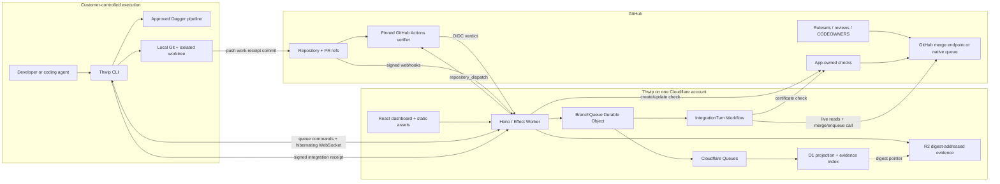
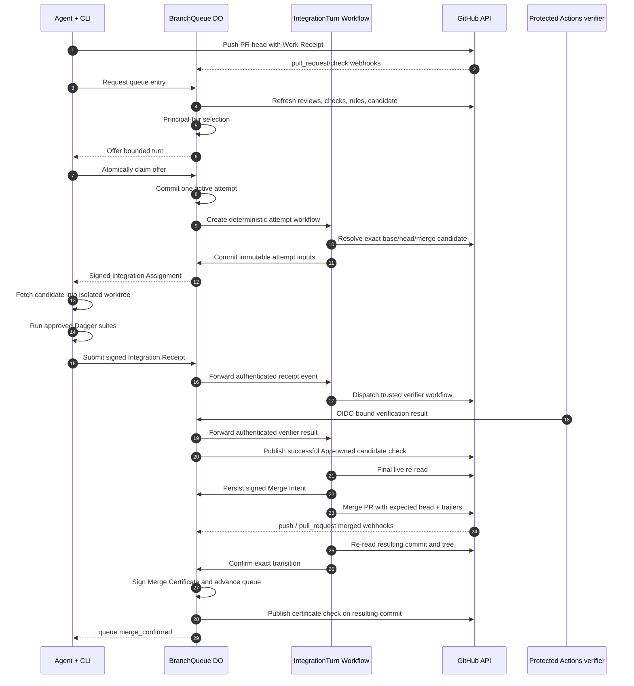
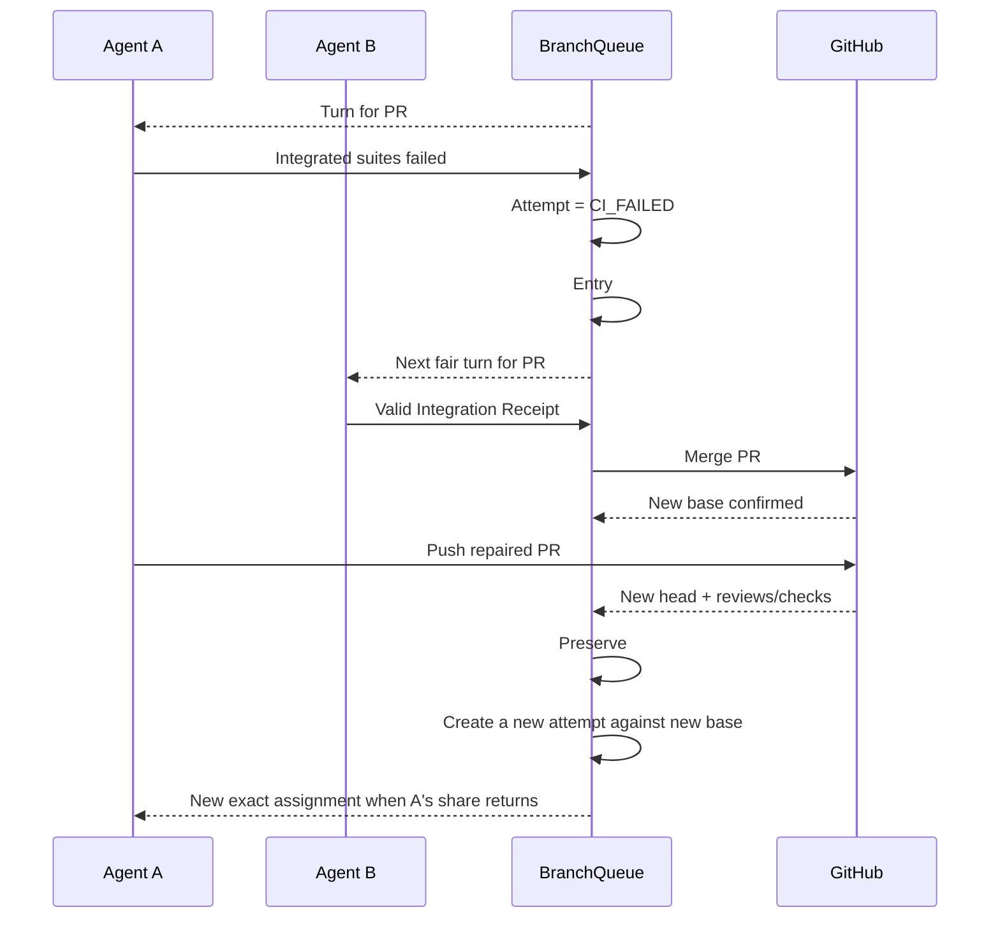
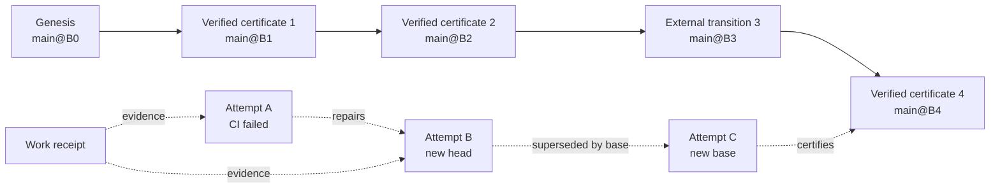

# Thwip Queue

## Product requirements, architecture, protocol, and build specification

> Historical design record. The shipped setup has one queue runtime: the
> installed GitHub App writes merge commits. Backend and merge-method options
> described below are not supported product configuration. See
> `docs/adr/0001-app-native-proof-checks.md` for the current decision.

**Status:** build-ready v1 proposal  
**Date:** 2026-07-29  
**Product:** Thwip  
**Development origin:** `https://airchime.recall.net`  
**Production origin:** undecided between `https://airchime.ai` and `https://airchime.dev`  
**Relationship to the earlier specification:** this document extends the existing Airchime/Thwip CI-receipt specification and supersedes its statements that merge queues, `merge_group` evidence, Durable Objects, and merge authority are deferred. Existing work-receipt semantics remain compatible.

---

## Document map

| Part | Contents |
|---|---|
| 0 | Decision summary and exact product/security claim |
| I | PRD: problem, goals, plans, canonical flows |
| II–III | Terminology, states, fairness, turns, managed/native behavior |
| IV | Cloudflare/GitHub architecture and Mermaid flows |
| V | Evidence, schemas, verification, chain, retention |
| VI | Homepage, pricing, dashboard, GitHub, CLI, prompts, YAML, onboarding |
| VII | Auth, API, events, Durable Object, Workflow, D1/R2, GitHub App/rulesets |
| VIII–IX | Adopted tooling, custom-code boundary, build requirements and tests |
| X | `cf`, Wrangler, `gh`, and Stripe setup |
| XI | Cloudflare cost model and $5 Pro margin |
| XII | Operations, security, rollout decisions, v1 boundary, definition of done |

## 0. Decision summary

Thwip Queue should ship as a real, principal-fair merge coordinator, not as a queue visualization or a recommendation layer.

- A queue exists independently for each protected repository/base-branch pair.
- A durable queue request keeps its fairness identity across ordinary disconnects, timeouts, and repairs. A short execution turn is separate and expires.
- Scheduling is round-robin by a stable GitHub/Thwip human principal, not by PR, key, device, bot, or agent process.
- Thwip admits only PRs that currently satisfy GitHub policy and have an acceptable work receipt.
- Thwip assigns the selected agent GitHub’s exact simulated merge candidate and a signed, expiring integration assignment.
- The agent runs the approved Dagger suites in an isolated worktree for that exact candidate and signs an integration receipt. If the existing work receipt already covers the identical base, candidate tree, policy, and suites, the Fast profile may reuse it.
- A protected GitHub Actions verifier fetches the assignment and receipt, computes the deterministic verdict, and returns an OIDC-authenticated result. Thwip’s API does not run the customer’s CI workload.
- The Thwip GitHub App publishes the source-pinned required check, performs the final live guard, calls GitHub’s merge endpoint, reconciles an ambiguous response, and confirms that the resulting tree is the tree that was tested.
- Every accepted branch transition receives a signed record. Verified merges, explicit overrides, and unexpected external transitions are distinguished honestly.
- Successful transition records form a linear chain. Failed, expired, repaired, and superseded attempts form an immutable attempt DAG.
- The chain strengthens evidence of order, exact context, attribution, gaps, and later cross-principal corroboration. It still does not prove that a dishonest signer actually ran Dagger.
- Use one SQLite-backed Cloudflare Durable Object per repository/base branch for serialized live state, one Cloudflare Workflow per device- or synthetic-service-claimed integration attempt for durable waits/retries, D1 tenant shards for global projections/indexes, private R2 for full digest-addressed signed evidence, and Cloudflare Queues for webhook/projection work.
- The managed backend supports `squash` and `merge`. It rejects `rebase` because rebase has no single stable integration commit to certify.
- Ship a GitHub-native merge-queue adapter in v1 for eligible repositories, using group size one and an App-owned admission gate. The Thwip-managed backend remains the primary path for private non-Enterprise teams.
- Queue is included on Free and Pro, with no per-merge or CI-minute charge. Do not sell queue priority.

### The product claim

> Thwip gives every developer a fair path to `main`, tells their agent the exact future state to test, performs or initiates the merge, and leaves a signed record of every observed transition.

### The precise security claim

> One or more authorized keys asserted that the approved suites passed for an exact repository, base, PR head, integration tree, policy, and queue assignment; a protected verifier accepted those assertions; and Thwip observed GitHub produce the matching integrated tree.

Thwip must not call this cryptographic proof that arbitrary computation occurred. A signer controlling an enrolled key can lie. Fresh assignments, later witnesses, and independent GitHub reruns improve assurance in different ways, but they do not make a compromised workstation honest.

### What is explicitly in v1

The following are not future placeholders:

- Actual GitHub merge execution in the Thwip-managed backend.
- Native GitHub queue admission/enqueueing in the native backend.
- Principal-fair scheduling.
- Exact integration-candidate preparation and local execution.
- Turn expiry, cooldown, reconnection, repair, and retry.
- App-owned required checks.
- Merge-intent and post-merge certificate issuance.
- Ambiguous merge reconciliation and no-blind-retry behavior.
- Queue pause/resume, cancel, transfer, expedite, bypass, disable, and rebaseline controls.
- GitHub permission/ruleset drift detection.
- Homepage, pricing, onboarding, dashboard, PR, CLI, and agent-instruction changes.
- `thwip.yaml`, repository workflow, CODEOWNERS, and setup migration changes.
- Cloudflare Durable Objects, Workflows, D1 migrations, Queues, observability, and costs.

---

# Part I — Product requirements

## 1. Product definition

### 1.1 Problem

Agentic development changes the coordination bottleneck. The scarce resource is no longer only CI compute; it is a stable, fair opportunity to change the protected branch.

The transcript identified several related problems:

1. **Isolated success is not integrated success.** A server PR and a client PR may each pass against their old context while their combination is logically incompatible.
2. **Moving-main thrash.** A fast developer can repeatedly land changes while another developer rebases and reruns, invalidating the slower developer before they can merge.
3. **PR-count domination.** A developer with ten agents or ten PRs can occupy ten FIFO positions even when another developer has one ready PR.
4. **Queue identity and execution liveness are different.** A durable place should not disappear because a laptop sleeps, but an offline laptop must not freeze the branch.
5. **Aggregate failure attribution is ambiguous.** When combined changes fail, the system knows an integrated state is bad; it does not automatically know which person is “at fault.”
6. **Integration compute needs an owner.** Thwip should coordinate the work without paying to run customer builds.
7. **The merger must be trustworthy and recoverable.** A timeout after a merge request is not permission to send another write blindly.
8. **The proof story is discontinuous without queue evidence.** A PR-head work receipt says little about the final state after earlier PRs land.

Traditional GitHub merge queues solve integrated-state testing but are available only for public organization repositories and private repositories on GitHub Enterprise Cloud. They also use FIFO ordering and can rebuild work after queue jumps. GitHub documents these availability and behavior constraints in [Managing a merge queue](https://docs.github.com/en/repositories/configuring-branches-and-merges-in-your-repository/configuring-pull-request-merges/managing-a-merge-queue).

Thwip’s opportunity is to combine fast local Dagger execution, attributable receipts, fair scheduling, and an actual merge authority for the small teams most affected by agent throughput.

### 1.2 Product thesis

The developer or agent with the warm codebase should run the build. A central coordinator should decide what exact future state must be tested and who gets the next bounded opportunity to test it.

Thwip therefore separates:

- **Work execution:** Dagger on a developer, coding-agent, or customer GitHub runner.
- **Queue ordering:** a serialized Thwip branch coordinator.
- **Evidence:** signed work and integration receipts.
- **Verification compute:** a pinned workflow in the customer’s GitHub Actions account.
- **Merge authority:** the Thwip GitHub App for the managed backend; GitHub’s native queue after Thwip admission for the native backend.
- **Repository mutation:** GitHub.
- **Control-plane and orchestration state:** Cloudflare.

### 1.3 Positioning

Thwip is:

- Local CI and fair merge coordination for agent teams.
- A principal-fair path to `main`.
- An exact-integration assignment protocol for Dagger.
- A signed history of verified, overridden, and external branch transitions.
- An affordable merge queue for private teams that do not have GitHub Enterprise Cloud.

Thwip is not:

- A hosted customer build runner.
- A Git merge implementation.
- An AI conflict resolver.
- A system that infers blame from a failing combined state.
- A permissionless or Byzantine consensus protocol.
- A guarantee that a malicious signer performed arbitrary computation.

### 1.4 Personas

| Persona | Primary job |
|---|---|
| Organization owner | Install or upgrade the App, select repositories, approve merge authority, and manage billing. |
| Repository administrator | Activate queue configuration, preserve GitHub policy, choose merge method/security profile, and handle break-glass operations. |
| Developer | Receive a fair share of branch turns regardless of personal PR volume. |
| Coding agent | Run `thwip ship --wait`, execute the exact candidate, fix integrated failures, and stop safely when human action is required. |
| Reviewer | Know what source was reviewed, what integrated tree was tested, and whether the final merge matched it. |
| Security reviewer | Inspect signers, policy, verifier identity, transition continuity, overrides, gaps, and witness depth. |
| Operator | Reconcile provider ambiguity, webhook loss, App permission drift, and Cloudflare workflow failures without duplicate merges. |

### 1.5 Jobs to be done

- “When ten PRs belong to one prolific developer and one belongs to me, give each developer a turn instead of treating each PR as one share.”
- “When my turn arrives, tell my agent the exact `main + PR` state to test and hold normal branch movement long enough to finish.”
- “When the agent is offline, keep its queue identity but continue merging other ready work.”
- “When integrated CI fails, keep the evidence and repair path without blocking everyone else.”
- “When the receipt verifies, have Thwip actually merge the PR and tell me when GitHub confirms it.”
- “When GitHub times out or delivers webhooks out of order, converge without submitting the same merge twice.”
- “When an administrator bypasses the normal path, record the gap honestly.”
- “When I inspect an old commit, recover the integration receipt, transition record, and prior-chain link from GitHub metadata and Thwip history.”

## 2. Goals, non-goals, and metrics

### 2.1 Goals

Thwip Queue v1 must:

- Guarantee at most one active integration attempt per configured base branch.
- Give one scheduling share to one stable fairness principal, regardless of their number of PRs, agents, devices, or keys.
- Preserve a queue entry’s original fairness ordinal across ordinary timeout and repair while preventing an offline entry from holding the lane.
- Require acceptable evidence for GitHub’s exact candidate tree before a normal managed merge.
- Make the actual merge request itself.
- Detect and pause on unexpected base movement.
- Re-read all security-critical GitHub and Thwip facts immediately before merge.
- Never blindly retry an ambiguous merge write.
- Confirm the actual resulting tree before issuing a verified certificate.
- Store no customer source, ordinary build log, build artifact, private key, or production secret.
- Run no customer Dagger workload in Cloudflare.
- Support both shared-repository and fork PRs without executing fork code in the verifier.
- Preserve existing GitHub review, CODEOWNERS, conversation, signed-commit, deployment, and allowed-Action rules where compatible.
- Provide complete self-service setup, diagnosis, queue operation, and removal.
- Support a GitHub-native backend without weakening the claim about exact merge-group evidence.
- Keep core security and fairness features available on Free and Pro.

### 2.2 Non-goals

Thwip Queue v1 will not:

- Merge multiple PRs as one batch.
- Speculatively execute several future queue tails in parallel.
- Automatically resolve source or semantic conflicts.
- Assign blame to a PR or developer from a combined failure.
- Offer weighted, paid, team-priority, or selectable scheduling algorithms.
- Let coding agents negotiate through a peer-to-peer gossip protocol.
- Host customer build compute.
- Support GitLab, Bitbucket, or third-party queue providers.
- Build a public transparency log, blockchain, zero-knowledge proof system, or trusted-execution attestation service.

These are not required to deliver a complete queue. In particular, serialized one-PR integration solves state stability, fairness, and attribution without the failure-isolation complexity of batching.

### 2.3 Product metrics

| Metric | v1 target |
|---|---:|
| Maximum consecutive normal merges by one principal while another is continuously ready and connected | 1 |
| Continuously ready principal skipped beyond one full rotation | 0 |
| Active integration attempts per branch queue | exactly 0 or 1 |
| Ready-to-offer after lane opens, excluding GitHub latency | p95 < 2 seconds |
| Offer notification to connected CLI | p95 < 2 seconds |
| Queue command processing in the Durable Object, excluding provider I/O | p95 < 50 ms |
| Final guard to merge API request, excluding GitHub latency | p95 < 2 seconds |
| Duplicate merge requests after an ambiguous outcome | 0 |
| Confirmed merge with resulting tree different from tested tree | 0; integrity incident if observed |
| App/ruleset drift to automatic pause | p95 < 2 minutes; immediate when webhook arrives |
| Queue state lost after Worker/DO/Workflow restart | 0 |
| Customer build executions on Cloudflare | 0 |
| Queue setup completion for an existing Thwip project | median < 15 minutes |
| Integration assignment | target < 8 KiB; hard max 12 KiB encoded envelope |
| Integration receipt | target < 16 KiB; hard max 20 KiB encoded envelope |
| Verifier result | target < 4 KiB; hard max 8 KiB encoded result |
| Override Merge Intent | target < 8 KiB; hard max 16 KiB encoded envelope |
| Transition record | target < 8 KiB; hard max 12 KiB encoded envelope |
| Candidate evidence block | hard max 48 KiB UTF-8 including framing |
| Override candidate block | hard max 32 KiB UTF-8 including framing |
| Resulting-commit certificate evidence block | hard max 16 KiB UTF-8 including framing |

### 2.4 Fairness metric definition

A **starvation incident** occurs only when an entry was continuously:

- admitted,
- ready,
- connected or fast-path executable,
- not paused or in cooldown,
- and still skipped beyond the scheduler’s stated bound.

A PR waiting on review, repair, a compatible runner, or its disconnected owner is not a scheduler starvation incident.

## 3. Plans and packaging

Queue belongs in both existing plans:

| Plan | Price | Active projects (repositories) | Active users | Queue |
|---|---:|---:|---:|---|
| Free | $0 | 3 | 5 | Managed and native backends, same fairness/security controls |
| Pro | $5/month or $50/year | 15 | 25 | Same controls, organization-scale dashboard and longer convenient history |

Rules:

- No CI-minute, build-minute, queue-event, or per-merge charge.
- No paid queue priority.
- No faster turns for Pro.
- No security profile available only on Pro.
- Free may show 90 days and Pro one year of rich dashboard event history, but signed certificate checks on GitHub and compact chain continuity are not deleted to create a security paywall.
- The customer’s GitHub plan remains relevant. Thwip cannot enforce exclusive merging on a private organization repository whose GitHub plan does not provide protected branches/rulesets. Public repositories and private organization repositories on GitHub Team or better are the supported enforcement surface.

## 4. Canonical product flows

### 4.1 Enable Queue on an existing Thwip repository

1. The owner selects **Add Queue**.
2. Thwip explains and requests the incremental App permissions.
3. The CLI/dashboard verifies that the installation accepted the new permissions.
4. `thwip queue setup` prepares a reviewed setup PR containing `thwip.yaml`, `THWIP.md`, a thin verifier caller, and bounded CODEOWNERS/instruction changes.
5. The setup PR merges under the repository’s existing controls, before either new Queue ruleset is active.
6. The App publishes a clearly labeled bootstrap `Thwip / Merge` check; the owner creates the disabled policy rule, source-pins that pre-existing context to the App, and verifies the pin.
7. The owner activates the final policy and ownership/merge-queue ruleset pair with the generated `gh api` commands.
8. Thwip runs `queue doctor` against the live repository, including a negative unexpected-source test.
9. Thwip creates a signed genesis transition record for the current base and enters observe.
10. After the required shadow attempts, the owner promotes one actual canary merge.
11. Setup is complete only after GitHub changes the base, Thwip validates the resulting tree, publishes the transition record, and promotes runtime activation to enforced.

### 4.2 Normal agent flow

1. The agent runs `thwip ship --wait --json-events`.
2. The CLI runs the approved branch Dagger suites, signs the work receipt, pushes, and creates or updates the PR.
3. The protected local-receipt check passes.
4. A durable queue request is recorded.
5. GitHub review/readiness changes move the entry between Blocked and Ready.
6. The fair scheduler offers a turn when the lane and an eligible runner are available.
7. The CLI claims the offer, fetches the signed assignment, and materializes the exact candidate in an isolated worktree.
8. Dagger runs; the CLI signs and submits the integration receipt.
9. The protected GitHub verifier computes the verdict.
10. Thwip performs the final guard, creates a merge intent, and calls GitHub.
11. GitHub confirms the merge; Thwip verifies the resulting tree, signs the transition record, and advances the queue.

### 4.3 Fast path

If the branch work receipt already binds the same current base, PR head, candidate tree, active policy, Dagger material, and required suites:

1. The scheduler may select the entry without a connected runner.
2. The integration evidence references the existing receipt.
3. GitHub Actions verifies the exact equivalence.
4. Thwip proceeds through the normal final guard and merge.

Fast-path reuse is allowed only by the Fast profile. Fresh, Audited, and Remote profiles retain their stronger requirements.

### 4.4 Offline developer

- The queue request and fairness ordinal remain durable.
- The entry is not offered a turn if it requires fresh local execution and no compatible CLI is connected.
- Other principals continue.
- Reconnecting does not create a new share or reset the original ordinal.
- A principal that was offered a turn and failed to claim it consumes that round and receives a short cooldown; it cannot repeatedly seize the front.

### 4.5 Integrated failure

- The immutable attempt ends as `CI_FAILED`.
- The entry becomes Needs repair and releases the lane.
- The isolated worktree is preserved locally for diagnosis.
- No blame is inferred.
- A new head with a valid work receipt creates a new attempt linked by a `repairs` edge.
- The original fairness ordinal is retained unless a maintainer records that the PR was replaced with unrelated work.

### 4.6 Ambiguous merge response

- The active lane remains held in Reconciliation.
- Thwip does not issue a second merge request.
- It queries the PR, base ref, candidate tree, checks, and webhook history.
- If the expected PR is merged and the resulting tree matches, it certifies once.
- If GitHub definitively proves the PR was not merged, Thwip terminalizes that immutable attempt as `CONFIRMED_NOT_MERGED`, releases the lane, and returns the durable entry to normal eligibility. A later fair turn creates a linked `retries` attempt with a new assignment, nonce, operation, and merge intent. It never replays the ambiguous mutation or immediately extends the old turn.
- Any other state pauses the queue and requires operator reconciliation.

### 4.7 Emergency bypass

- Only an organization owner or authorized repository administrator may request it.
- Recent authentication, a typed repository/PR confirmation, a reason, and a final live GitHub recheck are mandatory.
- V1 App override may omit only the active profile’s Queue integration execution/evidence and resulting integration-verifier verdict. The exact closed omission set is profile-specific in section 21.7. Local CI admission, reviews, conversations, deployments, non-Thwip required checks, permissions, base/head exactness, mergeability, and result-tree validation must still pass.
- Thwip issues a service-signed exact-candidate Assignment and persists the strict `kind="override"` Merge Intent; it never invents local/reuse/independent integration evidence or a Verifier Result digest.
- The App first creates the candidate check as `in_progress` to obtain its immutable ID, signs the override intent bound to that ID, updates the same check to `neutral` with the bounded override block, then repeats the final live guard before the merge write.
- The App publishes `Thwip / Merge` as `neutral` on the exact candidate/group, which GitHub treats as satisfying that Thwip-specific context, then performs the normal final guard and merge call.
- The resulting check is visibly non-verified and the transition kind is `override-merge`; the record lists the exact profile-specific omitted controls plus exact actor/reason/candidate/result.
- A bypass never contributes to verified-merge or witness metrics.
- A true bypass of GitHub reviews, external checks, deployments, or branch policy is an administrator-controlled GitHub operation. Thwip cannot perform it under its v1 ruleset authority; it is observed and recorded as an external/degraded transition.

### 4.8 Activation lifecycle

```text
Configured → Observing → Canary → Enforced
```

- This is one audited control-plane `activationState`, not a second copy of repository configuration. `thwip.yaml` defines backend/branch/merge/timeouts; it does not contain lifecycle state.
- **Configured:** repository files/App permissions/rulesets are installed and active policy is known.
- **Observing:** Thwip derives readiness/fairness and completes shadow candidate/verifier paths, but never mutates the base.
- **Canary:** an administrator authorizes a specific PR; Thwip executes the complete actual merge/certificate path for that PR only.
- **Enforced:** all normal scheduler-selected PRs may be merged automatically.

Default promotion requires 24 hours of healthy observation, at least three successful shadow attempts across two principals when available, zero unresolved drift/invariants, and one confirmed canary merge. A repository admin may shorten the time requirement with a recorded rollout reason, but cannot skip the three shadow checks, actual App merge, result-tree validation, or certificate. Every transition is authorized against the active configuration digest, signed/audited, and stored with actor/reason. Onboarding says “Enforced” only after the canary succeeds and runtime activation is promoted.

---

# Part II — Terminology

## 5. Canonical terms

| Term | Definition |
|---|---|
| Branch queue | Independent queue for one numeric GitHub repository ID and one exact base ref. |
| Queue request | Durable request for a PR to merge when eligible. |
| Queue entry | Current state of one PR’s queue request. It survives individual attempts. |
| Queue owner | Product-facing name for the fairness principal consuming the share. |
| Fairness principal | Stable activated human principal used by the scheduler. |
| Sponsor | Human fairness principal assigned to a bot-authored or delegated PR. |
| Fairness ordinal | Monotonic branch-local value assigned at first admission and normally retained through repairs. |
| Ready | Current GitHub requirements, Thwip policy, work receipt, candidate, and runner conditions permit selection. |
| Connected agent | Authenticated CLI currently able to claim and execute an assignment for the entry. |
| Integration lane | Single exclusive active transition for the branch queue. |
| Turn | Product term for one bounded opportunity to use the lane. |
| Turn offer | Short, compare-and-set claim window for the selected sponsor’s device or an exact-entry delegated runner. |
| Execution lease | Protocol term for the expiring assignment window after a claim. |
| Integration attempt | Immutable attempt to integrate one exact head into one exact base under one exact policy. |
| Integration candidate | Pinned GitHub simulated merge commit and tree for the exact base/head pair. |
| Integration assignment | Thwip-signed authorization describing the exact candidate, policy, runner, and deadline. |
| Work receipt | Existing signer assertion attached to the PR-head commit. |
| Integration receipt | Signer assertion for the exact assigned candidate; stored out-of-band until published in GitHub metadata. |
| Queue decision | Signed scheduler input/output record for one turn selection. |
| Merge intent | Signed pre-merge record containing all facts known before GitHub creates the final commit. |
| Transition record | Signed postcondition record for an observed protected-branch movement. |
| Verified merge certificate | Transition record backed by valid evidence and a matching GitHub merge. |
| Override certificate | Transition record for an explicitly authorized merge missing one or more normal controls. |
| External transition record | Honest record of unrecognized branch movement. |
| Canonical transition chain | Linear digest-linked history of every observed base transition. |
| Attempt DAG | Immutable graph of failed, retried, repaired, and superseded attempts. |
| Witness depth | Count of distinct later fairness principals whose exact integrated runs included the earlier transition. Corroboration, not proof of execution. |
| Deferred | Entry retained but temporarily not selectable after no-claim, disconnect, or timeout. |
| Needs repair | Entry cannot currently land and requires a head or metadata change. |
| Superseded | Attempt made unusable by a newer head, base, policy, review, permission, or assignment. |
| Reconciliation | Fail-closed comparison of Thwip state with live GitHub state after ambiguity or drift. |
| Native backend | Thwip schedules/admit/enqueues; GitHub’s merge queue prepares and performs the final merge. |
| Managed backend | Thwip schedules, verifies, and calls GitHub’s ordinary PR merge endpoint itself. |

Use “turn” and “expires” in product UI. Use “lease” only in protocol/operator material. Use “proof” as shorthand only when nearby copy states the actual trust claim.

---

# Part III — Queue semantics

## 6. Queue boundaries and invariants

### 6.1 Queue key

The authoritative queue key is:

```text
sha256("thwip-branch-queue-v1\n" + decimalRepositoryId + "\n" + exactBaseRef)
```

Use one SQLite-backed `BranchQueue` Durable Object per key. This is deliberately branch-scoped rather than repository-scoped: `main` and `release` are independent protected resources and should not block one another.

### 6.2 Non-negotiable invariants

1. At most one nonterminal integration attempt exists per branch queue.
2. Every state-changing branch-queue command passes through its Durable Object.
3. Every mutation has a caller-supplied idempotency key and a repository-local event sequence.
4. Queue entries and attempts are separate; an attempt failure never silently deletes queue age.
5. Attempt base, head, candidate SHA/tree, policy, runner, assignment, and deadlines are immutable.
6. Every retry or changed context creates a new attempt.
7. Fairness identity is never a key, device, bot account, commit-author string, or CLI process.
8. One entry has exactly one fairness principal at a time.
9. Sponsor transfer requires administrator authority, a reason, and an audit event; it does not import the old sponsor’s priority into the new sponsor’s share.
10. Only the deterministic scheduler or an explicit audited override may choose the next entry.
11. A turn is consumed when offered, including no-claim expiry. A flaky client cannot repeatedly take the front.
12. Offer/lease expiry does not reset the entry’s fairness ordinal.
13. A normal merge always has acceptable evidence for the exact candidate.
14. The active base-approved policy judges a PR. A candidate policy cannot authorize itself.
15. A verifier verdict is accepted only from the pinned GitHub workflow identity and for one exact attempt/nonce.
16. All security-critical GitHub and Thwip facts are refreshed immediately before merge.
17. An unknown merge outcome is never blindly retried.
18. A verified certificate is issued only after the final tree matches the candidate tree.
19. Transition sequence numbers are consecutive within an epoch and link the prior digest and base.
20. Failed attempts never enter the canonical transition chain.
21. Unexpected base movement pauses the queue and creates an external-transition record.
22. Unknown schema, algorithm, merge method, state transition, or reason code fails closed.

## 7. Admission and readiness

### 7.1 Durable request versus readiness

A developer may request the queue before reviews finish. The request is durable; readiness is continuously derived.

An entry is **Ready** when its repository, policy, and evidence conditions are satisfied:

- The project and queue target are enabled.
- The PR is open, non-draft, and targets the exact configured base ref.
- The queue owner is active and has the configured repository permission.
- A bot PR has a valid human sponsor.
- The current head has an acceptable `Thwip / Local CI` result from the expected source.
- The current active policy digest—not the PR’s proposed policy—accepts the work receipt.
- GitHub’s required reviews, CODEOWNERS, approval-after-push, unresolved-conversation, deployment, and non-Thwip required-check rules are satisfied.
- The PR currently has a conflict-free simulated merge candidate.
- The App installation and required permissions are healthy.
- The repository ruleset is still in an enforced shape.
- The entry is not cancelled, paused, in cooldown, or waiting for repair.

A Ready entry is **scheduler-eligible** only when a compatible connected runner exists, the evidence profile permits an exact-receipt fast path, or Remote execution is available. Runner connectivity is an ephemeral capability, not repository readiness. A Ready-but-offline entry keeps its fairness identity, does not receive an offer, and does not block another Ready entry from the same principal.

GitHub remains authoritative for review and branch-policy semantics. Thwip uses GraphQL/REST state for scheduling and explanation, then relies on GitHub’s enforcement again at merge. `mergeable` and `mergeStateStatus` are hints, not a complete security decision.

### 7.2 Stable blocking and eligibility reasons

Examples:

```text
PROJECT_DISABLED
QUEUE_PAUSED
PR_CLOSED
PR_DRAFT
BASE_NOT_MANAGED
OWNER_UNAUTHORIZED
SPONSOR_REQUIRED
LOCAL_RECEIPT_MISSING
LOCAL_RECEIPT_REJECTED
REVIEW_REQUIRED
CODEOWNER_REVIEW_REQUIRED
APPROVAL_AFTER_PUSH_REQUIRED
CONVERSATION_UNRESOLVED
REQUIRED_CHECK_PENDING
REQUIRED_CHECK_FAILED
MERGE_CONFLICT
AGENT_OFFLINE
NO_COMPATIBLE_RUNNER
APP_PERMISSION_DRIFT
RULESET_DRIFT
POLICY_CHANGED
COOLDOWN_ACTIVE
NEEDS_REPAIR
```

Do not encode each as a state. Store one primary and zero or more secondary typed reasons.

`AGENT_OFFLINE` and `NO_COMPATIBLE_RUNNER` set `schedulerEligible: false` while the entry remains Ready. The other reasons determine admission/readiness state as applicable.

## 8. Principal-fair scheduler

### 8.1 Identity

Default fairness principal:

- A human-authored PR: the authenticated GitHub user who made the queue request.
- A bot/App-authored PR: the human sponsor recorded during request.
- A delegated maintainer runner: still consumes the sponsor’s share.

Numeric GitHub user IDs and Thwip’s activated-principal projection are used; login strings are display data only.

Multiple devices or agent processes may race to claim one offer. A compare-and-set selects one; they never create additional queue shares.

### 8.2 Deterministic selection

For each principal, consider only their oldest scheduler-eligible Ready entry. Then choose the principal with the least recently served turn.

```ts
type EligibleEntry = {
  readonly entryId: string
  readonly sponsorPrincipalId: string
  readonly sponsorGithubUserId: bigint
  readonly fairnessOrdinal: bigint
  readonly pullRequestNumber: number
  readonly cooldownUntil: string | null
}

const selectNext = (
  eligibleEntries: ReadonlyArray<EligibleEntry>,
  lastServedTurn: ReadonlyMap<string, bigint>,
  now: string,
): EligibleEntry | null => {
  const eligible = eligibleEntries.filter(
    (entry) => entry.cooldownUntil === null || entry.cooldownUntil <= now,
  )

  const oldestPerPrincipal = oldestEligibleEntryByPrincipal(eligible)

  return minimumBy(oldestPerPrincipal, [
    (entry) => lastServedTurn.get(entry.sponsorPrincipalId) ?? 0n,
    (entry) => entry.fairnessOrdinal,
    (entry) => entry.sponsorGithubUserId,
    (entry) => BigInt(entry.pullRequestNumber),
    (entry) => entry.entryId,
  ])
}
```

When selected, one Durable Object transaction:

1. Increments `turnSequence`.
2. Sets the principal’s `lastServedTurn`.
3. Creates a signed Queue Decision and short offer.
4. Marks the entry Offered and the lane occupied.
5. Stores the offer deadline and schedules the Durable Object alarm.

The Durable Object owns offer delivery, claim compare-and-set, expiry, cooldown, and lane ownership. It starts `IntegrationTurnWorkflow` only after a successful claim. Fast exact-reuse and Remote selections are server-executable: the Durable Object creates an atomic synthetic service claim, records the execution mode, and starts the Workflow immediately without waiting for a device. Synthetic claims consume the sponsor’s normal fair turn exactly once and cannot be submitted by a client.

### 8.3 Fairness guarantee

With `N` continuously eligible principals and no explicit override, a principal receives another offer only after at most `N - 1` offers to other continuously eligible principals.

Therefore:

- Alice’s ten PRs do not precede Bob’s one PR.
- If Bob is ready while Alice merges, Bob receives a turn before Alice receives another normal turn.
- A new or returning principal receives one early opportunity, not unlimited accumulated credit.
- A no-claim offer consumes that round and adds a cooldown.
- A failing PR becomes ineligible, but another Ready PR from the same principal may participate in a later round.
- Within a principal, Ready entries are FIFO by fairness ordinal. Blocked entries do not head-of-line block that principal’s other independent Ready work.

Do not expose an exact permanent queue position. Display projected order and explain that readiness changes after every GitHub event.

### 8.4 Abuse controls

- Closing and reopening a PR creates a new queue request and fairness ordinal.
- Ordinary repair head changes retain the ordinal.
- A maintainer may reset the ordinal when a force-push replaced the PR with unrelated work; reason required.
- Sponsor transfer uses the receiving principal’s current scheduler history and a fresh ordering point.
- Expedite is a one-shot explicit override, not a hidden weight. It still requires all normal evidence and GitHub policy.
- Security bypass is a distinct operation and never reported as a scheduler success.

Expedite algorithm:

1. Require repository-admin authority, a reason, a specific Ready entry/head, and no unresolved active attempt.
2. Record the set of other scheduler-eligible principals at authorization.
3. Offer the expedited entry once; in native mode use the same App-controlled enqueue with GitHub `jump: false` after clearing unauthorized members—do not rely on provider queue jumping.
4. Set the expedited principal’s `lastServedTurn` to the new lifetime-monotonic turn sequence exactly as for a normal turn.
5. Do not change any other principal’s scheduler history.
6. Until every principal captured in step 2 has received or forfeited one offer, reject another expedite for the same principal unless a separate emergency administrator override is recorded.

This is the fairness debt: expedite consumes the principal’s current share and cannot create an immediate second normal turn. Dashboard/check/evidence show the override, captured principal set, actor, reason, and debt discharge events.

## 9. Turns, liveness, and recovery

### 9.1 Offer

- Default claim window: 90 seconds.
- Configurable hard range: 15 seconds to 5 minutes.
- Any currently eligible device for the selected sponsor principal may claim. A different principal’s device may claim only when the sponsor or an administrator previously authorized that exact entry/delegated runner; the turn still consumes the sponsor’s share.
- Claim is atomic.
- If the connection disappears before claim, the offer expires.
- No claim creates `EXPIRED_UNCLAIMED`, preserves the entry, and applies a five-minute default cooldown.

### 9.2 Assignment

After claim, Thwip refreshes the live base, head, merge candidate, policy, key, and permission state. Only then does it sign the Integration Assignment.

- Default execution deadline: 20 minutes.
- Allowed configured range: 5–45 minutes in v1.
- Heartbeat interval: 20 seconds.
- Missing three consecutive heartbeats enters a 60-second reconnect grace, bounded by the signed execution deadline.
- During grace, the lane remains held and no other attempt starts.
- A reconnecting process may resume only during grace, only before signed expiry, and only after proving the same device/session binding.
- Grace expiry atomically terminally supersedes the attempt, revokes it in live state, releases the lane, and defers the durable entry without changing its fairness ordinal.
- A receipt submitted after live revocation fails even if the signed assignment’s wall-clock `exp` has not yet passed.
- An expired assignment is never revived; retry creates a new attempt and nonce.

### 9.3 Entry state machine

```mermaid
stateDiagram-v2
    [*] --> Requested
    Requested --> Blocked: admission incomplete
    Blocked --> Ready: all conditions satisfied
    Ready --> Blocked: review/check/policy changes
    Ready --> Offered: fair scheduler selects
    Ready --> Active: server Fast/Remote synthetic claim
    Offered --> Active: agent claims
    Offered --> Deferred: offer expires
    Deferred --> Ready: cooldown complete and capable
    Active --> ReconnectGrace: heartbeat lost
    ReconnectGrace --> Active: same device reconnects
    ReconnectGrace --> Deferred: grace expires; attempt superseded
    Active --> Verifying: receipt submitted
    Active --> NeedsRepair: conflict or integrated CI fails
    Active --> Deferred: execution expiry
    Verifying --> MergeGuard: verifier accepts
    Verifying --> Blocked: evidence/policy rejected
    MergeGuard --> Merging: live state still exact
    MergeGuard --> Blocked: base/head/policy changed; attempt terminal
    Merging --> Merged: GitHub confirms matching tree
    Merging --> Reconciling: result ambiguous
    Reconciling --> Merged: matching merge observed
    Reconciling --> Ready: exact non-merge confirmed
    Reconciling --> Blocked: invariant disagreement
    NeedsRepair --> Blocked: repaired head submitted
    Blocked --> Cancelled: withdrawn/ejected
    Ready --> Cancelled: withdrawn/ejected
    Active --> Cancelled: administrator cancels
    Merged --> [*]
    Cancelled --> [*]
```



### 9.4 Attempt state machine

Attempts never move backward:

```text
OFFERED
→ CLAIMED
→ PREPARING_CANDIDATE
→ ASSIGNED
→ RUNNING
→ RECEIPT_SUBMITTED
→ VERIFYING
→ VERIFIED
→ MERGE_INTENT_CREATED
→ MERGE_REQUESTED
→ AWAITING_CONFIRMATION
→ MERGED
```

Terminal non-merge outcomes include:

```text
EXPIRED_UNCLAIMED
EXPIRED_EXECUTION
CI_FAILED
RECEIPT_REJECTED
VERIFICATION_FAILED
HEAD_MOVED
BASE_MOVED
POLICY_CHANGED
REVIEWS_CHANGED
PERMISSION_REVOKED
MERGE_CONFLICT
MERGE_REJECTED
CONFIRMED_NOT_MERGED
PROVIDER_FAILURE
INVARIANT_FAILURE
APP_UNINSTALLED
ADMIN_CANCELLED
SUPERSEDED
INTERNAL_FAILURE
```

Recovery always creates a new attempt linked in the attempt DAG.

`MERGE_OUTCOME_UNKNOWN` is a nonterminal event/phase. It moves the lane to `RECONCILING`; only `MERGED`, `CONFIRMED_NOT_MERGED`, or an operator-resolved provider/invariant failure may terminate that attempt.

Reconnect grace is a liveness substate of `RUNNING`, not a backward attempt-phase transition.

## 10. Managed and native backends

### 10.1 Thwip-managed backend

Thwip:

- owns admission, scheduling, assignment, verification gate, and merge intent;
- calls GitHub’s ordinary PR merge endpoint;
- waits for and validates the actual transition;
- advances the queue.

This is the default for private organization repositories on GitHub Team and for teams that want Thwip’s exact per-principal scheduling.

The managed backend supports `squash` and `merge`; it rejects `rebase`. `queue doctor` evaluates merge-method/rules compatibility before activation:

| GitHub rules | Managed result |
|---|---|
| No signed-commit or linear-history conflict | Use configured `squash` or `merge` |
| Require linear history | `merge` is invalid; `squash` is the only v1 candidate |
| Require signed commits + App is not PR author | GitHub-hosted `squash` is invalid |
| Require signed commits + require linear history | No generally supported managed v1 method; reject without weakening either rule |

GitHub documents that a branch requiring signed commits cannot be squash-merged on GitHub unless the merge actor is the PR author, while linear history disallows merge commits. Thwip reports the incompatible rule IDs and supported alternatives; it does not disable signed commits/linear history or silently change merge method. See [About protected branches](https://docs.github.com/en/repositories/configuring-branches-and-merges-in-your-repository/managing-protected-branches/about-protected-branches).

### 10.2 GitHub-native backend

For eligible public organization repositories and private GitHub Enterprise Cloud repositories:

- Thwip keeps the principal-fair scheduler.
- Only the selected PR receives a successful App-owned `Thwip / Merge` admission result on its ordinary candidate.
- Thwip enqueues it with `jump: false`.
- Native group size is one in v1.
- The agent’s receipt covers the exact `merge_group.head_sha`, not the ordinary PR-head or earlier simulated candidate.
- Thwip’s repository-owned verifier is triggered through `repository_dispatch`, validates the exact group SHA supplied by Thwip, and publishes to that group SHA. Any other required repository workflow that builds code must separately support GitHub’s `merge_group` event.
- GitHub performs the merge.
- Thwip observes the result and issues the post-merge transition record.

GitHub requires CI to report for `merge_group` and uses temporary `gh-readonly-queue/{base}` refs for third-party CI. Its documented queue is FIFO and can rebuild in-progress work after a jump. See [Managing a merge queue](https://docs.github.com/en/repositories/configuring-branches-and-merges-in-your-repository/configuring-pull-request-merges/managing-a-merge-queue) and the [`merge_group` webhook](https://docs.github.com/en/webhooks/webhook-events-and-payloads#merge_group).

Native mode cannot promise custom Thwip commit trailers because GitHub controls the queue merge message. The signed certificate remains attached as an App check on the resulting commit and in Thwip history.

### 10.3 Backend capability table

| Capability | Thwip-managed | GitHub-native |
|---|---:|---:|
| Principal-fair selection | Yes | Yes, through App-owned admission gate |
| Actual trigger originates with Thwip | Yes, merge API | Yes, enqueue mutation |
| Final repository mutation performed by GitHub | Yes | Yes |
| Exact one-PR candidate | `refs/pull/N/merge` | `merge_group.head_sha` |
| Thwip commit trailers | Yes | No |
| Post-merge certificate check | Yes | Yes |
| Private non-Enterprise org repos | Yes when GitHub protections are available | No |
| Native batch groups | No in v1 | Forced to size one in v1 |

---

# Part IV — Architecture

## 11. System architecture



### 11.1 Architectural boundary

Thwip owns:

- fair scheduling;
- queue and attempt state;
- signed assignments, decisions, intents, and transition records;
- verifier dispatch and OIDC result acceptance;
- App-owned check publication;
- final guard;
- merge/enqueue request;
- reconciliation and certificate chain.

GitHub owns:

- Git objects and synthetic PR/native-queue candidates;
- reviews, conversations, permissions, checks, and repository rules;
- the actual protected-branch mutation;
- PR merged state and resulting commit.

The customer owns:

- source;
- Dagger code and execution environment;
- build logs and artifacts;
- private signing keys;
- GitHub Actions usage.

Cloudflare never receives source, ordinary build logs, build artifacts, private signing keys, or customer build secrets.

## 12. Cloudflare topology

### 12.1 Products

| Product | Queue role |
|---|---|
| Workers + Static Assets | API, webhooks, authentication, dashboard, GitHub callbacks |
| SQLite-backed Durable Objects | Strongly consistent branch scheduler, live queue snapshot, dedupe, WebSocket presence |
| Workflows | One durable integration-turn execution with waits, retries, timeouts, and recovery |
| D1 | Organization-wide projections, retained metadata/indexes, analytics |
| R2 | Digest-addressed signed envelopes and compact evidence bundles |
| Queues | Webhook enrichment, D1 projection, notifications, replay/DLQ |
| Workers observability | Logs, traces, error analytics |

Cloudflare Workflows is GA and provides durable steps, retries, sleeps, and `waitForEvent`; use it instead of building a generic job engine. See [Cloudflare Workflows](https://developers.cloudflare.com/workflows/) and [events and parameters](https://developers.cloudflare.com/workflows/build/events-and-parameters/).

Durable Objects are justified here even though the earlier receipt-only architecture excluded them. Serialized per-key coordination is the product’s crux. Cloudflare recommends SQLite-backed objects for new classes; each object may hold up to 10 GB on Workers Paid, far beyond one branch queue’s bounded hot state. See [Durable Object pricing](https://developers.cloudflare.com/durable-objects/platform/pricing/) and [limits](https://developers.cloudflare.com/durable-objects/platform/limits/).

### 12.2 Authority split between Durable Object and Workflow

The `BranchQueue` Durable Object is the only authoritative state machine.

`IntegrationTurnWorkflow` is a durable effect runner:

- It starts with a deterministic attempt ID only after a device claim, or immediately after the Durable Object commits a synthetic service claim for a server-executable Fast-reuse or Remote attempt.
- It resolves the candidate, issues the assignment, follows the mode-specific local/reuse/Remote evidence branch, and waits only for the events that branch requires plus verifier, merge-observation, and reconciliation events.
- It performs retriable GitHub reads and bounded side effects.
- Before and after every external effect, it sends an idempotent command to the Durable Object.
- The Durable Object accepts a callback only when the attempt ID, operation ID, and active-attempt revision are still current.
- Every CLI, verifier, or webhook signal is authenticated, schema-checked, deduplicated, and committed by the Durable Object first. A Durable Object outbox then calls `WorkflowInstance.sendEvent`; no external client sends directly to a Workflow.
- Workflow internal event types use only letters, numbers, hyphens, and underscores, such as `receipt`, `verifier-result`, and `merge-observed`.
- A callback for an expired/superseded attempt returns `STALE_ATTEMPT`, and the old Workflow exits without changing the current lane.
- A disagreement about the current active attempt returns `CURRENT_ATTEMPT_INVARIANT_CONFLICT` and pauses the queue.

This prevents dual authority while adopting Cloudflare’s solved durability primitives.

### 12.3 Workflows versus Queues

- **Workflow:** one long-lived, ordered integration turn.
- **Cloudflare Queue:** unordered/retriable background delivery where duplicates are acceptable and deduped, such as D1 projection and notification.
- **Durable Object:** serialized decisions and current branch truth.

Do not use Cloudflare Queue message order as merge order.

### 12.4 Live clients

Use Hibernatable WebSockets from each branch Durable Object for:

- `thwip ship --wait`;
- `thwip queue work --watch`;
- repository queue dashboard updates.

WebSocket hibernation avoids billing idle duration. HTTP long polling is the fallback for restrictive networks. A disconnected socket changes liveness, not queue ownership.

### 12.5 D1 topology and hard-limit safety

A paid D1 database has a hard 10 GB maximum. Do not put all organizations or full evidence in one database.

- `CONTROL_DB`: Better Auth, billing, GitHub installations, organization directory, and each organization’s immutable `storageShardId`.
- `TENANT_DB_00` through `TENANT_DB_07` in production: project/member projections, queue indexes/history metadata, audit indexes, and evidence pointers.
- Two tenant shards in staging.
- Private R2: full digest-addressed signed envelopes/bundles.

Assign an organization to one shard at onboarding using current shard capacity, persist the assignment in `CONTROL_DB`, and never recompute it from a changing modulus. All repositories for that organization stay on the same shard. Cross-organization operator analytics use bounded fan-out/Cloudflare analytics; product requests never require a cross-shard transaction.

Alert at 6 GB and stop new tenant assignment to a shard at 7 GB, leaving migration/compaction headroom. Adding a shard does not move existing tenants automatically. A separately reviewed export/import migration can move one paused organization later without changing protocol IDs.

## 13. Managed happy-path sequence



The GitHub REST merge endpoint accepts an expected PR-head `sha`, but not an expected base SHA. The single-writer ruleset, one active Durable Object lane, immediate live refresh, head guard, and post-tree validation are all required. See [Merge a pull request](https://docs.github.com/en/rest/pulls/pulls#merge-a-pull-request).

## 14. Failure and repair sequence



The failure says only that the candidate did not satisfy the pipeline. It does not assign blame to PR #10, PR #11, or an earlier change.

## 15. External transition and chain recovery

If the protected base moves without the active merge intent:

1. Pause the branch queue.
2. Supersede the active attempt as `BASE_MOVED`.
3. Fetch the new base commit, parents, tree, actor, and relevant GitHub audit facts.
4. Sign an `external-transition` record linking the prior transition digest.
5. Publish a warning certificate check on the new base.
6. Require an administrator to acknowledge and rebaseline.
7. Close the old epoch with the external-transition digest.
8. Increment the queue epoch and create a signed new-epoch `genesis` record that links the external-transition digest and binds the actual current base/tree, active config/policy, ruleset facts, and service-key version.
9. Preserve lifetime-monotonic `turnSequence`, fairness ordinals, and every principal’s `lastServedTurn`; epoch rollover invalidates evidence context, not scheduler history.
10. Resume only after the genesis record commits and live rules/permissions validate.

Do not silently treat the new state as a verified Thwip merge.

## 16. GitHub candidate preparation

### 16.1 Managed candidate

GitHub creates temporary PR refs including a simulated merge result when possible. The ref is mutable and read-only; pin the object, its parents, and its tree. GitHub’s overview is in [Pull request refs and merge branches](https://docs.github.com/en/pull-requests/reference/pull-requests).

Preparation:

1. Read numeric repository ID, exact base ref, current base SHA `B`, PR number, head repository ID, and head SHA `H`.
2. Poll only while GitHub reports mergeability unknown, with a short bound.
3. In the hosted coordinator, poll `GET /repos/{owner}/{repo}/pulls/{number}` until `mergeable` is non-null or the short bound expires; take its pre-merge `merge_commit_sha`.
4. Read that Git commit through GitHub’s Git database API and record candidate commit `C`.
5. Require parent 1 is `B`, parent 2 is `H`, and record candidate tree `T`.
6. Recheck the Durable Object active-attempt revision; discard a result produced after a relevant intervening state change.
7. Store `B`, `H`, `C`, `T`, parents, object format, and GitHub observation IDs in the immutable attempt.

The CLI performs an independent fetch:

```bash
git remote add thwip-base "${THWIP_CANONICAL_BASE_REPOSITORY_URL}"
git fetch --no-tags thwip-base "refs/pull/${PR_NUMBER}/merge"
test "$(git rev-parse FETCH_HEAD)" = "${THWIP_CANDIDATE_SHA}"
test "$(git show -s --format=%T FETCH_HEAD)" = "${THWIP_CANDIDATE_TREE}"
```

`origin` is not trusted to be the base repository: in a fork checkout it commonly names the contributor fork. The assignment binds the numeric canonical base repository ID and a server-resolved read-only URL. The CLI uses a temporary `thwip-base` remote, verifies repository identity plus candidate SHA/tree/parents, and removes the temporary remote during cleanup.

Then it creates a detached isolated worktree. It does not mutate or rebase the developer’s feature branch merely to test.

### 16.2 Native candidate

Use `merge_group.head_sha` and the exact temporary queue ref. A PR work receipt or ordinary `refs/pull/N/merge` receipt cannot be reinterpreted as group evidence.

Pin the group SHA/tree, base ref, member PR/head, configured GitHub merge method, and native queue identifier. Require the same group to remain current through verification. After GitHub merges, resolve the PR/resulting base commit and require its tree to equal the verified group tree before issuing a verified certificate. A mismatch follows the same critical incident path as managed mode.

### 16.3 Final result validation

After managed merge:

- For `merge`, require final parents are assigned base/head and final tree equals `T`.
- For `squash`, require final parent is assigned base and final tree equals `T`.
- If the tree differs, pause the queue and raise an integrity incident; the mutation already occurred and must not be papered over.

After native merge, require the resulting base tree equals the pinned verified `merge_group` tree. GitHub controls the native queue’s merge method, so setup must read and validate provider configuration rather than trusting only `thwip.yaml`.

## 17. Trusted verifier path

### 17.1 Trigger

Use one thin default-branch workflow such as `.github/workflows/thwip-verify.yml`. Thwip triggers `repository_dispatch` with event type `thwip_verification_requested` using the App’s existing Contents permission. GitHub runs the caller from the default branch. The event carries one opaque `verification_id`; the caller invokes an organization-owned reusable workflow pinned to a full commit SHA.

The same trusted path supports two typed descriptors:

- `work_receipt`: created when a PR head containing a new Work Receipt is observed; this exists before any queue entry or integration attempt and produces `Thwip / Local CI`.
- `integration_attempt`: created after the exact Assignment is committed. Local/reuse modes wait for their mode-specific evidence before verification; Remote uses the descriptor to authorize the independent Actions execution. Every mode ultimately produces `Thwip / Merge` on that candidate.

The descriptor kind, repository, subject SHA, attempt/PR identity, and expected check are resolved server-side from `verification_id`; they are not trusted workflow inputs. Queue setup extends the existing Work Receipt verifier instead of replacing it.

The reusable verifier:

- does not check out or execute PR code in receipt-only mode;
- obtains a GitHub OIDC token in a source-free verdict job before bundle resolution;
- fetches the exact typed descriptor, signed assignment when applicable, mode-specific integration evidence, active policy, current key/grant facts, GitHub-carried commit metadata, and verifier metadata;
- executes the shared pure TypeScript verifier;
- posts a typed verdict bound to one verification descriptor, repository, subject, evidence digest, nonce, workflow run, and verifier digest, plus the attempt/assignment/candidate for an integration verification.

Audited and Remote use two isolated reusable-workflow jobs:

1. `execute-candidate` has `contents: read`, `id-token: none`, no secrets, no write permission, and no inherited environment. It checks out the exact pinned candidate into an ephemeral runner and invokes the base-approved Dagger module/material, not a candidate-modified pipeline definition.
2. `attest-result` has `id-token: write`, does not check out source or execute candidate code, reads only bounded job/artifact metadata, verifies candidate/pipeline/suite digests and the execution conclusion, and submits the typed OIDC-bound Verifier Result.

Candidate code must never run in a job that can mint the verifier OIDC token. The intermediate result artifact contains bounded structured facts and report digests, no logs/secrets, and is integrity-bound to the same workflow run/attempt. A failure or missing artifact yields rejection, never a synthesized pass.

Thwip validates at minimum:

```text
iss
aud
exp / nbf
jti
repository_id
repository_owner_id
workflow_ref
workflow_sha
job_workflow_ref
job_workflow_sha
ref
event_name
run_id
run_attempt
```

The accepted `jti` and attempt nonce are one-use. The caller workflow may cause denial of service if removed, but it cannot fabricate the result of the pinned reusable verifier. See [GitHub Actions OIDC](https://docs.github.com/en/actions/reference/security/oidc).

Require `event_name=repository_dispatch`, the exact default `ref`/`sha`, approved caller `workflow_ref`/`workflow_sha`, and exact `job_workflow_ref`/`job_workflow_sha`. The dispatch endpoint returns `204` without a workflow-run ID; correlate through the opaque verification ID plus `workflow_run` events and OIDC claims.

### 17.2 Why the App publishes the final check

GitHub can require a status check from a specific App. If an ordinary repository workflow published `Thwip / Merge`, another PR-controlled workflow could share the GitHub Actions App identity and spoof the name. The protected verifier therefore returns an authenticated verdict; the Thwip App publishes the check on the exact candidate.

GitHub documents App source pinning for required status checks in [Available rules for rulesets](https://docs.github.com/en/repositories/configuring-branches-and-merges-in-your-repository/managing-rulesets/available-rules-for-rulesets).

### 17.3 Check placement

- PR head: one App-owned `Thwip / Local CI` check for each immutable head that carries a Work Receipt.
- Queue presentation: one non-required App-owned `Thwip / Queue` check on the immutable PR head; its output changes as scheduling state changes.
- Managed integration: one required App-owned `Thwip / Merge` check per immutable candidate/attempt.
- Native admission: `Thwip / Merge` remains pending for nonselected PR candidates and succeeds for the scheduler-selected exact head/candidate immediately before enqueue.
- Native integration: a new `Thwip / Merge` check is pending and then verified on the immutable `merge_group.head_sha`.
- Verified integration: the exact candidate/group check concludes `success`.
- Final transition: a non-required `Thwip / Merge Certificate` check on the resulting base commit.

GitHub Check Runs have an immutable `head_sha`. Do not “move” one check from a PR head to a candidate or from one regenerated candidate to another. Supersede an obsolete candidate/admission check with a terminal cancelled/failure conclusion and create a new check for the new SHA. Update in place only while the check’s immutable SHA and logical role are unchanged.

GitHub decides whether required checks must pass on the test merge commit or head based on where status exists. See [Troubleshooting required status checks](https://docs.github.com/en/pull-requests/how-tos/merge-and-close-pull-requests/troubleshooting-required-status-checks).

Never use `neutral` or `skipped` for a normal verified proof. GitHub treats them as satisfying required checks. An explicit emergency bypass may use `neutral` because its visible semantics and override certificate make the exception intentional; the disabled-policy source bootstrap in section 44.3 is the only other non-attempt use.

## 18. GitHub merge control

### 18.1 Two-layer ruleset design

Use two rulesets so the App can update the branch through PRs without bypassing the repository’s review/proof policy.

**Thwip Queue Ownership**

- Targets each managed base ref.
- Restricts updates.
- Blocks force pushes and deletion.
- Names only the Thwip App as an Integration bypass actor.
- Uses `bypass_mode: pull_request`, not `always` or `exempt`.

**Repository Policy**

- Requires pull requests.
- Preserves approval, CODEOWNERS, conversation, signed-commit, deployment, linear-history, and external required checks.
- Requires only `Thwip / Merge` from the Thwip App as the Queue-specific GitHub gate.
- Does not give the Thwip App a bypass.
- Blocks force pushes and deletion.

`Thwip / Local CI` remains an App-owned visible admission input, and the `Thwip / Merge` verifier requires its underlying Work Receipt. Do not require both contexts in Queue mode: once GitHub sees a status/check on the test merge candidate, it may evaluate required contexts there rather than on the PR head, where Local CI was published. Existing non-Thwip checks remain required unchanged.

GitHub aggregates layered rulesets and supports Integration bypass actors with pull-request-only mode. See [About rulesets](https://docs.github.com/en/repositories/configuring-branches-and-merges-in-your-repository/managing-rulesets/about-rulesets) and [REST rules endpoints](https://docs.github.com/en/rest/orgs/rules).

This exact matrix must pass an installation acceptance test before the repository is marked Enforced.

### 18.2 Single-writer requirement

The merge endpoint’s `sha` parameter protects only the PR head. It provides no base compare-and-swap. Therefore:

- ordinary contributors cannot update the base;
- the Thwip App is the only normal branch updater;
- Thwip serializes its own updates through the branch Durable Object;
- administrator bypass is inside the organization’s ultimate trust boundary and is detected as an external transition.

If the repository cannot establish this control, Thwip must label the mode Cooperative/Advisory and must not claim exact enforced merging.

### 18.3 Merge operation

Before the write, require:

- queue, entry, attempt, and Workflow are current;
- branch queue is Running;
- installation and permissions remain valid;
- base, head, candidate SHA/tree, active policy, assignment, and previous chain head remain exact;
- PR remains open/non-draft;
- reviews, conversations, required checks, and signer grants remain acceptable;
- candidate App check is successful;
- merge method remains enabled;
- no external transition or unresolved reconciliation exists.

Call:

```http
PUT /repos/{owner}/{repo}/pulls/{number}/merge
```

with:

```json
{
  "sha": "<assigned-head-sha>",
  "merge_method": "squash",
  "commit_title": "<generated title>",
  "commit_message": "<generated body and Thwip trailers>"
}
```

GitHub documents `Contents: write`, the three merge methods, and `409` on head mismatch in [Merge a pull request](https://docs.github.com/en/rest/pulls/pulls#merge-a-pull-request).

Handle:

| Result | Meaning |
|---|---|
| `200` | Tentative success; still confirm live state/tree |
| `409` | Head changed; supersede attempt |
| `405` | Not currently mergeable or policy disallows; refresh and block/repair |
| `403` | Permission/rules failure; pause if drift |
| `422` | Invalid/secondary-limit state; bounded reconciliation |
| Network timeout/reset | Unknown outcome; do not issue another write |

## 19. Security and trust model

### 19.1 Trust roots

- GitHub repository IDs, Git object graph, reviews, rules, permissions, and merge result.
- GitHub Actions OIDC identity for the pinned verifier.
- Developer Ed25519 signing keys already enrolled through GitHub/Thwip.
- Thwip environment service-signing key for assignments and transition artifacts.
- BranchQueue Durable Object’s serialized event state.
- Base-approved Thwip policy and Dagger digest.

### 19.2 Threats and residual truth

| Threat | Control | Residual truth |
|---|---|---|
| Developer lies that Dagger ran | Exact signed attribution, fresh nonce, optional independent audit | Local receipt remains an assertion |
| Prolific developer monopolizes queue | Stable human sponsor + principal round-robin | Admins can abuse sponsor assignment |
| Key/device/bot Sybil | Fairness is by human principal | Colluding humans remain separate |
| Offline runner blocks lane | Claim/run deadlines, cooldown, skip while offline | One bounded turn may be lost |
| Receipt replay | Assignment digest/nonce, exact subject, expiry, one terminal attempt | Policy may explicitly permit exact-context reuse |
| Stale candidate | Pinned SHA/parents/tree, generation guard, final re-read | Provider/admin race remains possible |
| Base race during merge | Single writer, one lane, live guard, head guard, post-tree validation | GitHub API lacks base CAS |
| Admin direct push | Rules, webhooks, pause, external-transition record | Repository administrators ultimately control GitHub |
| Compromised Thwip App | Selected repos, minimum permissions, audit, rotation | App can merge in installed repos |
| Compromised service signer | Key rotation, developer signatures, GitHub-linked records | Can forge service artifacts, not developer signatures |
| Spoofed verifier | OIDC + exact reusable workflow/ref/SHA + one-use nonce | Compromised pinned workflow can lie |
| Policy changes itself | Active base policy judges candidate | Policy administrators are trusted |
| Thwip deletes/equivocates history | GitHub commit/check carriers + digest chain + later receipts | No public transparency witness in v1 |
| Nonhermetic Dagger execution | Bind module/engine/images/network/cache policy | External dependency behavior may still vary |
| Fork PR attack | Base candidate, no PR-code execution in verifier, no secrets | Fork author can change head; final guard catches it |

### 19.3 Assurance profiles

Reuse the existing per-project profiles and apply them to the integration candidate:

| Profile | Queue behavior | Assurance |
|---|---|---|
| Fast | May reuse an exact matching work receipt; otherwise fresh local run | Lowest latency; attributable team assertion |
| Fresh | Always issues a new assignment and requires a post-assignment local integration receipt | Freshness and exact queue context |
| Audited | Fresh local receipt plus a full Dagger rerun in GitHub Actions before merge | Independent second execution |
| Remote | Full required Dagger suites run in GitHub Actions on the candidate | Strongest execution independence; customer GitHub compute |

Witness depth is recorded for every profile. It is not a fifth profile and does not silently turn later local assertions into independent proof.

### 19.4 What the chain adds

The chain can demonstrate:

- the exact accepted branch-transition order;
- the prior state each integration claimed to include;
- omitted, overridden, or externally moved states;
- whether old evidence was replayed in a new context;
- which principals later ran integrated CI on descendants containing a transition;
- whether two service histories fork at a sequence/digest.

It cannot demonstrate:

- that Dagger executed;
- that a workstation was honest;
- that the tests were sufficient;
- that a later descendant run specifically exercised an earlier change;
- that Thwip never showed two histories to parties who never compare them;
- that GitHub or an organization administrator was honest.

That distinction should be visible in dashboard and security copy.

---

# Part V — Evidence and verification protocol

## 20. Evidence set

### 20.1 Adopted format

Use:

- DSSE for signed envelope separation.
- in-toto Statement v1 for typed subjects and predicates.
- RFC 8785/JCS canonical JSON for payload hashing where the existing Thwip protocol already uses it.
- SHA-256 digests with explicit domain separation.
- Existing OpenSSH Ed25519 developer signatures and Thwip service JWK signatures.

Do not adopt classic in-toto layouts, link orchestration, or a new supply-chain policy engine. In-toto is the evidence vocabulary; the Thwip queue state machine remains the product protocol.

Predicate types:

```text
urn:thwip:attestation:work-run:v1
urn:thwip:attestation:queue-decision:v1
urn:thwip:attestation:integration-assignment:v1
urn:thwip:attestation:integration-run:v1
urn:thwip:attestation:verifier-result:v1
urn:thwip:attestation:merge-intent:v1
urn:thwip:attestation:transition:v1
```

Unknown types and versions fail closed.

### 20.2 Evidence carriers

| Artifact | Primary carrier | Secondary/index carrier |
|---|---|---|
| Work Receipt | PR-head Git commit trailer | `Thwip / Local CI` check |
| Queue Decision | R2 signed evidence store | Queue check summary + dashboard |
| Integration Assignment | R2, delivered to CLI | Full bounded envelope in candidate check evidence block |
| Integration evidence (local receipt, exact reuse, or Remote run facts) | R2 | Full bounded mode-specific evidence in candidate check evidence block |
| Verifier Result | R2 after OIDC callback | Full bounded result in candidate check evidence block |
| Merge Intent | R2 | Digest in final commit trailers; full override intent in the override candidate check |
| Transition Record | R2 + D1 index + Thwip API | Full signed envelope in App-owned certificate check on resulting commit |

The user’s original Git-native model is preserved:

- Branch evidence remains in the commit.
- Queue evidence that cannot safely amend the reviewed PR head is attached to the exact GitHub candidate and resulting commit through Checks metadata.
- The managed merge commit carries compact pre-merge digests.
- D1 is the searchable projection/index, R2 is Thwip’s digest-addressed evidence store, and neither is the only surviving signed-summary location.

Carrier rules:

- Work Receipt: the full signed envelope is in the PR-head commit trailer; its check contains digest/result.
- Normal candidate `Thwip / Merge` check: `external_id=attemptId`; output binds the exact candidate SHA and contains Assignment, mode-specific integration evidence, and Verifier Result envelopes in a deterministic bounded `kind="verified"` block.
- Override candidate `Thwip / Merge` check: output binds the exact candidate SHA and contains the Assignment plus full signed `kind="override"` Merge Intent/authorization in a distinct bounded block. It contains no fabricated integration evidence or Verifier Result.
- Managed final commit trailers: merge-intent, mode-specific integration-evidence, previous-transition, epoch, and sequence digests.
- Resulting-commit certificate check: the full signed Transition Record envelope plus all evidence digests and candidate/result identifiers.
- The aggregate candidate evidence block is at most 48 KiB of UTF-8, including deterministic framing, with hard envelope limits of 12 KiB for the Assignment, 20 KiB for the Integration Receipt, and 8 KiB for the Verifier Result. CI tests publish the maximum fixture against GitHub before release. Oversize evidence fails with `EVIDENCE_CARRIER_TOO_LARGE`; Thwip never silently replaces portable bytes with only a `details_url`.
- The override candidate block is at most 32 KiB UTF-8 including framing, with 12 KiB Assignment and 16 KiB override Merge Intent envelope limits. Its `blockKind` cannot be decoded as verified evidence.
- The resulting-commit certificate evidence block is at most 16 KiB UTF-8, including the Transition Record envelope and framing. Bounds are enforced before any merge mutation for verified/override attempts; provider-originated external records use the bounded representation in section 21.9.
- Logs/reports remain digest-only and are never inserted merely to fill a carrier.

### 20.3 Self-reference rule

The final certificate digest cannot be inserted into the commit it certifies: that digest would include the resulting commit SHA, while the SHA includes the message containing the digest.

Therefore:

1. Create and sign a **Merge Intent** before the GitHub write.
2. Put the Merge Intent, mode-specific integration-evidence, previous Transition Record, and sequence digests in the generated commit trailer block.
3. After GitHub returns and the tree is confirmed, sign the final Transition Record.
4. Publish the final record as an App check on the resulting commit.
5. Link its digest from the next transition.

Do not implement a brittle fixed-point or placeholder-hash scheme.

## 21. Typed protocol schemas

The following are conceptual interfaces. Implement them with Effect Schema so runtime decoding, JSON Schema generation, redaction, and TypeScript types share one source.

### 21.1 Common primitives

```ts
type DecimalId = string
type GitOid = string
type Sha256 = `sha256:${string}`
type IsoDateTime = string
type BaseRef = `refs/heads/${string}`

type GitSubject = {
  readonly objectFormat: "sha1" | "sha256"
  readonly repositoryId: DecimalId
  readonly baseRef: BaseRef
  readonly baseSha: GitOid
  readonly headRepositoryId: DecimalId
  readonly headSha: GitOid
  readonly candidateSha: GitOid
  readonly candidateTreeOid: GitOid
  readonly candidateParentOids: ReadonlyArray<GitOid>
}

type AssignmentExecution =
  | {
      readonly mode: "run"
      readonly profile: "fresh" | "audited"
      readonly runnerPrincipalId: string
      readonly deviceKeyId: string
    }
  | {
      readonly mode: "reuse"
      readonly originalReceiptDigest: Sha256
      readonly originalSignerKeyId: string
    }
  | {
      readonly mode: "remote"
      readonly provider: "github-actions"
      readonly workflowRef: string
      readonly workflowSha: GitOid
    }
```

Never encode GitHub numeric IDs as JavaScript `number`; use validated decimal strings or `bigint` internally.

### 21.2 Queue Decision

```ts
interface QueueDecisionV1 {
  readonly schemaVersion: "1"
  readonly algorithm: "principal-round-robin-v1"
  readonly repositoryId: DecimalId
  readonly baseRef: BaseRef
  readonly queueEpoch: number
  readonly turnSequence: number
  readonly inputStateVersion: number
  readonly selected: {
    readonly entryId: string
    readonly pullRequestNumber: number
    readonly sponsorPrincipalId: string
    readonly fairnessOrdinal: string
  }
  readonly eligiblePrincipalHeads: ReadonlyArray<{
    readonly sponsorPrincipalId: string
    readonly sponsorGithubUserId: DecimalId
    readonly lastServedTurn: string
    readonly oldestReadyEntryId: string
    readonly fairnessOrdinal: string
  }>
  readonly priorDecisionDigest: Sha256 | null
  readonly decidedAt: IsoDateTime
}
```

The full signed decision makes scheduling explainable to authorized repository members. It does not prove Thwip did not omit an event; the repository event log and later reconciliation provide the surrounding evidence.

### 21.3 Integration Assignment

```ts
interface IntegrationAssignmentV1 {
  readonly schemaVersion: "1"
  readonly assignmentId: string
  readonly attemptId: string
  readonly repository: {
    readonly ownerId: DecimalId
    readonly repositoryId: DecimalId
    readonly baseRef: BaseRef
  }
  readonly queue: {
    readonly queueEpoch: number
    readonly turnSequence: number
    readonly entryId: string
    readonly pullRequestNumber: number
    readonly sponsorPrincipalId: string
    readonly queueDecisionDigest: Sha256
  }
  readonly execution: AssignmentExecution
  readonly git: GitSubject
  readonly policy: {
    readonly digest: Sha256
    readonly version: number
    readonly securityProfile: "fast" | "fresh" | "audited" | "remote"
    readonly daggerModuleDigest: Sha256
    readonly daggerEngineDigest: Sha256
    readonly requiredSuites: ReadonlyArray<string>
  }
  readonly evidence: {
    readonly workReceiptDigest: Sha256
    readonly previousTransitionDigest: Sha256 | null
  }
  readonly verifier: {
    readonly workflowRef: string
    readonly workflowSha: GitOid
    readonly reusableWorkflowRef: string
    readonly reusableWorkflowSha: GitOid
    readonly verifierDigest: Sha256
  }
  readonly timing: {
    readonly issuedAt: IsoDateTime
    readonly notBefore: IsoDateTime
    readonly expiresAt: IsoDateTime
  }
  readonly nonce: string
}
```

Sign the canonical assignment payload with the environment-specific Thwip service key. The CLI must validate issuer/environment, key validity, payload bytes, assignment digest, repository identity, execution variant, runner/reuse identity where applicable, live attempt status, and time window before touching the candidate.

### 21.4 Integration Receipt

```ts
interface IntegrationRunPredicateV1 {
  readonly assignmentId: string
  readonly assignmentDigest: Sha256
  readonly attemptId: string
  readonly subject: GitSubject
  readonly policy: {
    readonly digest: Sha256
    readonly daggerModuleDigest: Sha256
    readonly daggerEngineDigest: Sha256
    readonly requiredSuites: ReadonlyArray<string>
  }
  readonly runner: {
    readonly principalId: string
    readonly githubUserId: DecimalId
    readonly deviceKeyId: string
    readonly publicKeyFingerprint: string
  }
  readonly run: {
    readonly startedAt: IsoDateTime
    readonly finishedAt: IsoDateTime
    readonly environmentClass: string
    readonly networkMode: "disabled" | "policy-egress-v1" | "unrestricted-declared-v1"
    readonly cacheMode: "disabled" | "read-only-v1" | "read-write-policy-v1"
    readonly suites: ReadonlyArray<{
      readonly name: string
      readonly outcome: "passed" | "failed"
      readonly durationMs: number
      readonly reportDigest?: Sha256
    }>
  }
  readonly previousWorkReceiptDigest: Sha256
  readonly nonce: string
}
```

Do not include raw log text, environment variables, absolute paths, source, or secrets. Report digests are optional and do not imply Thwip stores the reports.

### 21.5 Fast-path reuse evidence

```ts
interface ExactReceiptReuseV1 {
  readonly schemaVersion: "1"
  readonly assignmentId: string
  readonly assignmentDigest: Sha256
  readonly workReceiptDigest: Sha256
  readonly equivalence: {
    readonly repositoryId: DecimalId
    readonly baseSha: GitOid
    readonly headSha: GitOid
    readonly candidateTreeOid: GitOid
    readonly policyDigest: Sha256
    readonly pipelineDigest: Sha256
    readonly requiredSuitesDigest: Sha256
  }
}
```

The GitHub verifier—not the service scheduler alone—must recompute this equality.

### 21.6 Verifier Result

```ts
type IndependentRunFacts =
  | {
      readonly mode: "none"
    }
  | {
      readonly mode: "github-actions"
      readonly purpose: "audited-rerun" | "remote-primary"
      readonly candidateSha: GitOid
      readonly candidateTreeOid: GitOid
      readonly pipelineDigest: Sha256
      readonly daggerEngineDigest: Sha256
      readonly requiredSuitesDigest: Sha256
      readonly networkMode: "none" | "policy-allowlist-v1"
      readonly cacheMode: "disabled" | "read-only-v1" | "read-write-policy-v1"
      readonly suites: ReadonlyArray<{
        readonly name: string
        readonly outcome: "passed" | "failed"
        readonly durationMs: number
        readonly reportDigest?: Sha256
      }>
      readonly startedAt: IsoDateTime
      readonly completedAt: IsoDateTime
    }

interface VerifierResultV1 {
  readonly schemaVersion: "1"
  readonly attemptId: string
  readonly assignmentDigest: Sha256
  readonly integrationEvidenceKind:
    | "integration-receipt"
    | "exact-receipt-reuse"
    | "independent-run"
  readonly integrationEvidenceDigest: Sha256
  readonly policyDigest: Sha256
  readonly candidateSha: GitOid
  readonly candidateTreeOid: GitOid
  readonly verifierDigest: Sha256
  readonly independentRun: IndependentRunFacts
  readonly independentRunDigest: Sha256 | null
  readonly verdict: "accepted" | "rejected"
  readonly reasonCodes: ReadonlyArray<string>
  readonly github: {
    readonly repositoryId: DecimalId
    readonly workflowRunId: DecimalId
    readonly runAttempt: number
    readonly workflowRef: string
    readonly workflowSha: GitOid
    readonly jobWorkflowRef: string
    readonly jobWorkflowSha: GitOid
    readonly oidcJti: string
  }
  readonly observedAt: IsoDateTime
  readonly nonce: string
}
```

For Remote, `integrationEvidenceKind="independent-run"` and `integrationEvidenceDigest` is the domain-separated canonical digest of `independentRun`, whose purpose must be `remote-primary`. For Audited, the primary digest remains the local Integration Receipt and the independently digested run has purpose `audited-rerun`. Fresh/Fast use `independentRun.mode="none"` and a null digest. The OIDC token authenticates this typed result. Do not store the OIDC token after validation.

### 21.7 Merge Intent

```ts
type OverrideOmissionV1 =
  | {
      readonly profile: "fast"
      readonly omittedControls: readonly [
        "exact_receipt_reuse",
        "integration_verifier_result"
      ]
    }
  | {
      readonly profile: "fresh"
      readonly omittedControls: readonly [
        "integration_receipt",
        "integration_verifier_result"
      ]
    }
  | {
      readonly profile: "audited"
      readonly omittedControls: readonly [
        "integration_receipt",
        "independent_dagger_rerun",
        "integration_verifier_result"
      ]
    }
  | {
      readonly profile: "remote"
      readonly omittedControls: readonly [
        "independent_dagger_run",
        "integration_verifier_result"
      ]
    }

interface OverrideAuthorizationV1 {
  readonly actorGithubId: DecimalId
  readonly reason: string
  readonly omission: OverrideOmissionV1
}

interface MergeIntentBaseV1 {
  readonly schemaVersion: "1"
  readonly operationId: string
  readonly attemptId: string
  readonly repositoryId: DecimalId
  readonly baseRef: BaseRef
  readonly queueEpoch: number
  readonly turnSequence: number
  readonly transitionSequence: number
  readonly git: GitSubject
  readonly pullRequestNumber: number
  readonly mergeMethod: "merge" | "squash"
  readonly policyDigest: Sha256
  readonly previousTransitionDigest: Sha256 | null
  readonly generatedCommitTitle: string
  readonly generatedCommitMessageDigest: Sha256
  readonly createdAt: IsoDateTime
}

type MergeIntentV1 =
  | (MergeIntentBaseV1 & {
      readonly kind: "verified"
      readonly evidence: {
        readonly workReceiptDigest: Sha256
        readonly assignmentDigest: Sha256
        readonly integrationEvidenceDigest: Sha256
        readonly verifierResultDigest: Sha256
        readonly candidateCheckRunId: DecimalId
      }
    })
  | (MergeIntentBaseV1 & {
      readonly kind: "override"
      readonly evidence: {
        readonly workReceiptDigest: Sha256
        readonly assignmentDigest: Sha256
        readonly liveGuardDigest: Sha256
        readonly candidateCheckRunId: DecimalId
      }
      readonly override: OverrideAuthorizationV1
    })
```

Persist and sign the strict intent variant before the network write. V1 override still has a service-signed exact-candidate Assignment, accepted Work Receipt, a digest of every surviving live GitHub guard, and an App-owned neutral check. Its omission tuple must exactly match the active profile and it cannot contain fake integration/verifier digests.

### 21.8 Transition Record

```ts
interface TransitionRecordBaseV1 {
  readonly schemaVersion: "1"
  readonly repositoryId: DecimalId
  readonly baseRef: BaseRef
  readonly queueEpoch: number
  readonly transitionSequence: number
  readonly previousTransitionDigest: Sha256 | null
  readonly before: {
    readonly baseSha: GitOid | null
    readonly treeOid: GitOid | null
  }
  readonly after: {
    readonly baseSha: GitOid
    readonly treeOid: GitOid
    readonly parentOids: ReadonlyArray<GitOid>
    readonly parentCount: number
    readonly parentOidsDigest: Sha256
    readonly parentsComplete: boolean
  }
  readonly observedAt: IsoDateTime
}

type TransitionRecordV1 =
  | (TransitionRecordBaseV1 & {
      readonly kind: "verified-merge"
      readonly verifiedMerge: {
        readonly attemptId: string
        readonly mergeIntentDigest: Sha256
        readonly pullRequestNumber: number
        readonly headSha: GitOid
        readonly candidateSha: GitOid
        readonly candidateTreeOid: GitOid
        readonly mergeMethod: "merge" | "squash"
        readonly workReceiptDigest: Sha256
        readonly assignmentDigest: Sha256
        readonly integrationEvidenceDigest: Sha256
        readonly verifierResultDigest: Sha256
        readonly checkRunId: DecimalId
        readonly actionRunId: DecimalId
      }
    })
  | (TransitionRecordBaseV1 & {
      readonly kind: "override-merge"
      readonly override: {
        readonly attemptId: string
        readonly mergeIntentDigest: Sha256
        readonly pullRequestNumber: number
        readonly headSha: GitOid
        readonly candidateSha: GitOid
        readonly candidateTreeOid: GitOid
        readonly mergeMethod: "merge" | "squash"
        readonly workReceiptDigest: Sha256
        readonly assignmentDigest: Sha256
        readonly liveGuardDigest: Sha256
        readonly candidateCheckRunId: DecimalId
        readonly authorization: OverrideAuthorizationV1
      }
    })
  | (TransitionRecordBaseV1 & {
      readonly kind: "external-transition"
      readonly external: {
        readonly observedActorGithubId?: DecimalId
        readonly observationReasonCode:
          | "unexpected_push"
          | "ruleset_bypass"
          | "unknown_provider_movement"
          | "imported_history"
        readonly operatorReasonDigest?: Sha256
        readonly confirmingDeliveryId?: string
      }
    })
  | (TransitionRecordBaseV1 & {
      readonly kind: "genesis"
      readonly genesis: {
        readonly policyDigest: Sha256
        readonly configDigest: Sha256
        readonly rulesetDigest: Sha256
        readonly priorEpochClosingDigest: Sha256 | null
      }
    })
```

Effect Schema must reject fields belonging to another union variant rather than stripping them. Sign the canonical payload. The certificate digest is the SHA-256 of the exact signed envelope bytes, not reconstructed JSON.

### 21.9 Protocol and carrier bounds

Apply UTF-8 byte limits after NFC normalization and before allocation/signing. Reject oversize caller input; never truncate a signed field.

| Field | Hard bound |
|---|---:|
| ULID/opaque protocol identifier | 64 bytes |
| Decimal GitHub ID | 32 ASCII digits |
| Git object ID | algorithm-valid 40 or 64 lowercase hex characters |
| Base ref | 1,024 bytes |
| Human override/admin reason embedded in evidence | 512 bytes |
| Closed reason code | 64 ASCII characters |
| Reason-code array | 32 entries |
| Omitted controls | exactly one profile-tagged tuple from `OverrideOmissionV1`; no extra/missing/reordered value |
| Suite entries in a receipt/result | 32; suite name 64 bytes |
| Parent OIDs embedded in a Transition Record | 16 |
| Signed override Merge Intent DSSE envelope | 16 KiB |
| Signed Transition Record DSSE envelope | 12 KiB |
| Override candidate evidence block | 32 KiB UTF-8 including framing |
| Resulting-commit certificate evidence block | 16 KiB UTF-8 including framing |

For every transition, `parentCount` is the provider-observed count and `parentOidsDigest` hashes the canonical ordered full vector. Verified and override v1 merges require `parentsComplete=true` and one or two embedded parents according to merge method. An unexpected external octopus commit may set `parentsComplete=false`, embed at most the first 16 for diagnosis, and still bind the full vector digest/count; Git remains the source for the full list.

Override reason length and final certificate size are validated before Merge Intent, so an administrator cannot make post-merge publication fail with a long reason. External records use a closed observation code plus an optional digest of tenant-scoped operator text, not unbounded text in the portable envelope. Release CI publishes maximum-size transition and final-block fixtures through the App in the GitHub test organization. `EVIDENCE_CARRIER_TOO_LARGE` before mutation is a hard failure.

## 22. Managed commit trailers

Generated merge/squash commit messages end with one reserved trailer block:

```text
Thwip-Queue-Epoch: 3
Thwip-Queue-Sequence: 184
Thwip-Merge-Intent: sha256:4f0…
Thwip-Previous-Transition: sha256:93b…
Thwip-Integration-Evidence: sha256:a91…
```

Rules:

- Build the final message from the current GitHub title/body under a bounded length.
- Reject or escape pre-existing reserved `Thwip-*` keys in user content.
- The reserved block is final and duplicate-free.
- The verifier parses only the final contiguous reserved block.
- Native backend omits trailers and uses checks/certificates.
- The next Transition Record links the final post-merge certificate digest, not merely the intent.

## 23. Verification algorithm

The shared verifier package takes only explicit inputs and returns a tagged outcome. It performs no network requests.

For a normal fresh integration:

1. Decode envelope, payload type, and schema strictly.
2. Verify DSSE signature over exact bytes.
3. Resolve the enrolled public key and require current validity.
4. Require assignment and receipt environment/repository identities match.
5. Require assignment not-before/expiry and one-use nonce.
6. Require attempt/entry/queue epoch/turn match.
7. Require repository/base/head/candidate SHA/tree/parents match.
8. Require policy, Dagger module/engine, and suites match the active signed verification bundle.
9. Require runner principal/device/key is either sponsor-owned or covered by a current exact-entry delegation granted by the sponsor/administrator under project policy.
10. Require every required suite has exactly one passing result.
11. Reject extra semantics that could override a required result.
12. Require work-receipt linkage.
13. Require verifier workflow/ref/SHA and verifier digest match the protected policy.
14. Produce stable accepted/rejected reason codes.

For Fast reuse, use the `execution.mode="reuse"` branch. After the synthetic claim, the Workflow deterministically constructs `ExactReceiptReuseV1` from the assignment and original receipt; no client may upload it. The verifier still performs schema decoding, the original Work Receipt DSSE signature verification, current signer/key/grant validation, assignment signature/nonce/live-attempt validation, exact subject/policy/suite equivalence, work-receipt linkage, and stable reason handling. Reuse skips only a new Dagger execution and new device-run receipt; it never skips cryptographic or current-authorization checks.

For Audited, use `execution.mode="run"` with `profile="audited"`: wait for and verify the local Integration Receipt, then have the protected Action independently run the full required Dagger suites against the same candidate. Accept only when both paths pass and `independentRun.purpose="audited-rerun"` binds the same candidate/policy/pipeline/suites.

For Remote, use `execution.mode="remote"` after a synthetic service claim. The protected Action obtains the exact assignment, checks out only its pinned candidate, runs the full required Dagger suites, and returns `integrationEvidenceKind="independent-run"` with `independentRun.purpose="remote-primary"`. There is no device receipt and no wait for one. The API validates the OIDC-bound result but still does not run the workload.

### 23.1 Nonce and callback idempotency

- Validate schema, signature, assignment binding, and live attempt before consuming anything.
- Atomically bind an assignment nonce to the first accepted integration-evidence digest.
- Repeating the same nonce with the same digest is idempotent and returns the prior result.
- The same nonce with a different digest fails as replay/equivocation.
- A malformed or rejected request does not consume the nonce.
- Deduplicate an OIDC callback by `(jti, exactResultDigest)`.
- Repeating the same pair is idempotent; reusing a JTI with different result bytes is a security rejection.

### 23.2 Final merge guard

The final guard is separate from cryptographic receipt verification. It refreshes live provider/control-plane state and fails closed if anything changed:

```text
LIVE_BASE_MISMATCH
LIVE_HEAD_MISMATCH
LIVE_CANDIDATE_MISMATCH
LIVE_CANDIDATE_TREE_MISMATCH
LIVE_POLICY_MISMATCH
LIVE_REVIEW_MISMATCH
LIVE_CONVERSATION_MISMATCH
LIVE_CHECK_MISMATCH
LIVE_PERMISSION_MISMATCH
LIVE_KEY_REVOKED
LIVE_RULESET_DRIFT
LIVE_APP_PERMISSION_DRIFT
LIVE_QUEUE_EPOCH_MISMATCH
LIVE_CHAIN_HEAD_MISMATCH
LIVE_LEASE_EXPIRED
```

Some outcomes return the entry to Ready under a new certified base; security/policy failures return Blocked; conflicts return Needs repair; provider ambiguity enters Reconciliation.

## 24. Canonical chain and attempt DAG



The canonical chain contains every observed base transition, including honest gap records. The attempt DAG preserves operational evidence without forcing failed work into the accepted history.

Attempt edge types:

```text
retries
repairs
supersedes
rebases_after
derived_from_work_receipt
invalidated_by_transition
certifies
```

Enforce acyclicity by requiring every incoming source attempt’s repository-local creation sequence to be lower than the destination’s.

### 24.1 Witness depth

When a successful integration receipt from principal `P` binds a base that descends from transition `T`, record `P` as a witness of `T`. Count a principal once per transition, regardless of devices/keys.

Display:

- distinct later principals;
- nearest later witness sequence;
- whether any witness was an independent GitHub audit;
- chain gaps between the transition and witness.

Never display witness depth as “number of independent proofs.” It means later attributable integrated runs included that state.

## 25. Retention and portability

- GitHub work receipts, managed trailers, App checks, and certificate checks remain the portable evidence substrate.
- R2 retains full attempt/evidence objects for at least 90 days on Free and one year on Pro, subject to an organization deletion request.
- D1 retains searchable metadata, digests, transition projections, and retention pointers rather than full envelopes.
- Compact transition-chain rows and certificate digests remain for the tenant lifetime on both plans.
- The API provides an organization export of signed envelopes and index metadata.
- Workflow state uses the shortest practical post-completion retention; it is not the evidence archive.
- Durable Object hot terminal history is compacted after D1 projection and a bounded dedupe window.
- Removing Thwip must not rewrite Git history or delete GitHub checks already published.

---

# Part VI — Product surfaces

## 26. Homepage and positioning copy

### 26.1 Metadata

```text
Title: Thwip — Local CI and fair merge queues for agent teams

Description:
Run approved CI where your agents already work, verify signed receipts in GitHub,
and give every developer a fair, exact path to main.
```

Navigation:

```text
Product
How it works
Security
Pricing
Docs
Sign in
[Add Thwip to GitHub]
```

### 26.2 Hero

Eyebrow:

> Local CI + fair merge coordination for agent teams

Headline:

> Let agents rip without letting one developer own main.

Body:

> Your agents run approved Dagger CI on the machine where the code already is. Thwip verifies the signed receipt in GitHub, gives every developer a fair turn, and merges only the exact integrated state they attested to.

Primary CTA:

> Add Thwip to GitHub

Secondary CTA:

> Watch one PR land

Trust line:

> Dagger runs on your hardware. Thwip stores no source, CI logs, build artifacts, or private keys.

### 26.3 Problem section

Heading:

> Fast agents broke the old path to main.

Body:

> One agent can produce changes faster than another developer can rebase, rerun remote CI, and merge. Independently green PRs can still break when combined. A prolific developer can occupy every opening while foundational work never catches up.

| Without Thwip | With Thwip |
|---|---|
| Remote CI repeats work the agent just performed | Approved Dagger CI uses the agent’s warm local environment |
| Every merge invalidates someone else’s run | Thwip assigns the exact integration candidate to test |
| Ten PRs from one developer become ten queue positions | Scheduling rotates between developers |
| A PR is green only against an earlier `main` | Integration evidence covers the state Thwip is about to land |
| Humans poll, rebase, rerun, and click merge | Thwip verifies, guards, triggers, and confirms the merge |

### 26.4 Product thesis

Heading:

> Run it. Sign it. Land it fairly.

**Run locally**

> Use Dagger on the machine that already has the code, dependencies, platform, and warm cache.

**Carry the receipt**

> Every run produces an attributable, policy-bound receipt for the exact source, pipeline, and suites.

**Test the future**

> When a turn arrives, Thwip tells the agent exactly what `main + PR` will be and verifies that candidate.

**Take fair turns**

> Queue share belongs to developers, not PR count. Opening twenty PRs does not grant twenty consecutive merges.

**Merge exactly**

> Thwip rechecks the base, PR head, reviews, permissions, policy, and receipt, then asks GitHub to merge that exact PR.

**Build a chain**

> Each observed merge links its integration evidence to the previous branch transition, creating a replayable history—including overrides and gaps.

### 26.5 How it works

```text
1. Your agent finishes
   It runs the approved Dagger pipeline locally and pushes a signed receipt.

2. GitHub verifies
   A protected check verifies the receipt, signer, policy, source, and permission.

3. Thwip gives it a turn
   The scheduler rotates fairly between developers and assigns an exact candidate.

4. The agent attests to the integrated state
   The CLI creates an isolated worktree for main plus the PR and runs Dagger there.

5. Thwip merges
   It performs the final live guard, asks GitHub to merge, confirms the resulting
   tree, and advances the queue.
```

Pull quote:

> One developer can open twenty PRs. If teammates are ready, that developer still gets only one turn before they do.

### 26.6 Security copy

Heading:

> Built for teams with modest trust—not imaginary cryptography.

Body:

> A Thwip receipt establishes which authorized signer attested to which source, under which approved pipeline, at what point in the queue. It prevents stale, mismatched, anonymous, and out-of-policy assertions. It does not make a compromised machine honest or prove arbitrary computation against a malicious signer.

Support:

> Teams that need stronger assurance can require fresh assignments or independent GitHub audits without changing the normal developer command.

### 26.7 Final CTA

Heading:

> Stop racing `main`.

Body:

> Give every agent fast local CI and every developer a fair path to merge.

```text
[Install the GitHub App]
[Read the security model]
```

## 27. Pricing copy

### Free

```text
$0
For a small team adopting the workflow.

3 active projects
5 active users
Unlimited local Dagger runs
Thwip-managed merge queues
Fair scheduling by developer
Signed CI and integration receipts
Fast, Fresh, Audited, and Remote security profiles
Organization-wide queue dashboard
90-day dashboard history

[Start free]
```

### Pro

```text
$5 / organization / month
or $50 annually

For teams running several active projects.

15 active projects
25 active users
Everything in Free
One-year dashboard history
The same security and fairness controls
No CI-minute or per-merge charges

[Start Pro]
```

Footer:

> Thwip does not run your builds. Dagger uses your hardware, and the lightweight verifier runs in your GitHub account.

Do not sell:

- queue priority;
- faster turns;
- weights;
- per-merge credits;
- essential security controls.

Any of those would undermine the fairness/product claim.

## 28. Dashboard information architecture

Organization navigation:

```text
Overview
Queue
Projects
People & devices
Policies
Billing
Settings
```

Project navigation:

```text
Overview
Queue
Policy & CI
Setup
Audit
Settings
```

The organization Queue badge is an action count, not raw queue depth.

### 28.1 Organization overview

Required summaries:

```text
Queue health
4 queues running · 2 active turns · 7 ready PRs · 1 needs attention

Time to main
Median this week 2m 18s
Local execution 43s · fair wait 51s · GitHub confirmation 6s

Fairness
0 starvation incidents
Longest continuously ready wait 4m 12s
Maximum consecutive merges by one developer while another was ready: 1

Evidence
184 exact integrations · 12 later witnessed by another principal · 3 audited
```

Incomplete setup callout:

> **Finish Thwip Queue setup**  
> Two of four repositories still allow merges outside Thwip.  
> `[Continue setup]`

### 28.2 Organization Queue page

Filters:

- repository;
- target branch;
- queue state;
- queue owner;
- needs attention;
- PR number/title.

Each repository/branch group shows:

```text
memracer → main
Running · Base 91a0f4c · reconciled 8 seconds ago

[Pause queue] [Settings]
```

Current turn:

```text
Current turn

#184 Refactor policy loader
Andrew · via codex-agent
Running 8 required suites locally

Candidate: main@91a0f4c + PR head@c422d31
Turn expires at 14:32:08 MDT · 12:41 remaining
Last heartbeat 6 seconds ago

✓ Assignment accepted
● Dagger running
○ Receipt verification
○ Final merge guard
○ GitHub confirmation

[Open PR] [View assignment]
```

Projected order:

| Estimate | Queue owner | PR | State | Waiting | Agent |
|---:|---|---|---|---:|---|
| Next | Carson | #185 Worker retry policy | Ready | 1m 14s | Connected |
| Then | Andrew | #186 Rename verifier package | Ready | 58s | Connected |
| — | Dan | #179 Database migration | Ready, agent offline | 8m 42s | Reconnect required |
| — | Sam | #177 Update release flow | Waiting for review | 14m 02s | Connected |

Use **Estimate**, never guaranteed Position:

> Thwip recalculates projected order after every merge or readiness change. Fairness identity is preserved when a PR needs repair or its agent disconnects.

Recent transitions:

| Sequence | Result | PR | Queue owner | Evidence | Resulting base |
|---:|---|---|---|---|---|
| 184 | Verified merge | #181 | Carson | `sha256:a91…` | `f41e922` |
| 183 | Attempt failed | #179 | Dan | Integrated CI failed | — |
| 182 | Override merge | #180 | Andrew | Reason required | `9ca44d1` |

### 28.3 Project Queue page

Sections:

1. Current branch lanes.
2. Ready/blocked/offline entries.
3. Needs attention.
4. Attempt history.
5. Canonical transition chain.
6. Proof drawer.
7. Fairness/scheduling explanation.
8. Setup/ruleset health.
9. Operational controls.

Proof drawer must show:

- queue decision and algorithm version;
- sponsor and runner;
- base/head/candidate/tree;
- active policy and Dagger digests;
- work/integration receipt signer and key;
- verifier workflow/ref/SHA and Action run;
- merge intent;
- actual resulting SHA/tree;
- transition kind and previous digest;
- witness depth;
- every stable reason/override code.

### 28.4 Empty and recovery states

Disabled:

> **Stop racing `main`.**  
> Thwip can give every developer a fair turn, test the exact integrated state locally, and merge it automatically after verification.  
> `[Set up Queue]`

Clear:

> **Main is clear.**  
> Nothing is waiting to merge. Run `thwip ship` when the next change is ready.

No Ready entries:

> **Nothing can take a turn yet.**  
> Three PRs are waiting for reviews, conversations, an agent, or a fresh receipt.

Paused:

> **This queue is paused.**  
> Existing entries are preserved. No new turn or merge will occur.  
> Paused by @andrew: “Release branch investigation.”  
> `[Resume queue]`

Reconciliation:

> **Checking GitHub before continuing.**  
> Thwip received an ambiguous or out-of-order repository event. No PR will merge until the current base and queue state agree.

External transition:

> **`main` moved outside the active Thwip attempt.**  
> The queue is paused and the transition is recorded as external, not verified. Review and rebaseline before resuming.

### 28.5 Administrative controls

Ship in v1:

- pause/resume one branch;
- pause/resume one repository/project;
- organization-owner pause/resume for every repository in that installation;
- operator-only environment/global emergency pause/resume;
- cancel active attempt;
- withdraw/eject entry with reason;
- retry eligible entry;
- transfer sponsor with reason;
- expedite one entry while preserving normal evidence;
- emergency override merge;
- reconcile provider state;
- acknowledge/rebaseline an external transition;
- disable after drain or cancel;
- revalidate/upgrade App permissions.

Pause precedence is `environment > organization > repository > branch`. Resume removes only the named scope; a higher-scope pause remains visible and effective. Every pause atomically blocks new offers, claims, verifier success publication, and merge writes. A current pre-mutation attempt is terminally superseded and its durable entry is retained for re-evaluation. If a merge write may already have started, the attempt enters reconciliation and the broader pause remains after reconciliation; Thwip never pretends the mutation can be cancelled. Dashboard copy names every effective scope, actor, reason, and recovery command.

Organization controls live in the organization’s Queue settings. Repository/branch controls live in Project Queue settings. The environment kill switch is available only in the internal operator surface with step-up authentication and a typed environment confirmation.

Emergency confirmation:

> **Override Thwip’s Remote integration controls?**  
> **Active profile:** Remote  
> **Will omit exactly:** `independent_dagger_run`, `integration_verifier_result`  
> **Still required:** accepted Local CI Work Receipt, reviews, conversations, deployments, non-Thwip checks, current permissions/rulesets, exact base/head/candidate, mergeability, final tree validation, and certificate.  
> This bypasses the named Queue integration controls for `memracer#184`. The transition will be recorded as an override and will not count as verified or witnessed.  
> Enter `memracer#184` and provide a reason.

The dialog renders the active profile and its exact `OverrideOmissionV1` tuple; it never uses generic “receipt” copy for Fast, Audited, or Remote. The CLI prints the same fields and requires the typed repository/PR confirmation after them.

### 28.6 Project Queue settings

Show:

- **Runtime activation** (`configured`, `observe`, `canary`, or `enforced`), promotion evidence, actor, reason, and active policy/config digest.
- **Active configuration** backend/target/merge method/turn timeout/security profile with policy/config digest.
- **Candidate** values and semantic diff when a setup/config PR exists.
- GitHub-native availability and exact provider settings.
- merge-method compatibility with signed-commit/linear-history rules.
- pinned verifier workflow and ruleset health.
- observe/canary/enforced progress.

Editing a protected repository setting validates locally, creates a signed config candidate, and generates a normal setup/config PR. The dashboard does not mutate active `thwip.yaml` directly. Configuration activation occurs only after the candidate merges under the current policy and an authorized admin accepts the new digest. `enable`/`promote`, canary authorization, and pause/resume mutate the single audited control-plane activation state; they never rewrite YAML and cannot run against an unknown or stale active configuration digest.

Controls:

```text
[Generate configuration PR]
[Compare active and candidate]
[Promote to canary]
[Authorize one canary PR]
[Promote to enforced]
[Download ruleset plan]
[Run doctor]
```

### 28.7 People & devices Queue integration

For each activated principal/device show:

- GitHub numeric identity/login and fairness sponsor identity;
- device label/key fingerprint/status;
- OS, architecture, Dagger compatibility/capability class;
- last heartbeat and connected/offline state;
- watched repositories/branches;
- current offer/assignment, if any;
- bot sponsor mappings;
- delegated-runner authorization and active delegation;
- per-repository auto-claim consent, including who granted it and when;
- revoke key, disconnect session, remove mapping, and copy watch command actions.

Copy command:

```text
thwip queue work --watch --auto-claim --repo owner/repository
```

Revoking/disconnecting a device does not erase its human principal’s queue entries. If it owns an active assignment, enter reconnect grace or terminate according to the authorization reason.

### 28.8 Blocker copy and next actions

| Reason | User-facing summary | Primary next action |
|---|---|---|
| `SETUP_INCOMPLETE` | Queue guardrails are not fully installed. | Continue setup and run `thwip queue doctor`. |
| `APP_PERMISSION_DRIFT` | The GitHub App no longer has a required grant. | Organization owner accepts/repairs App permissions. |
| `RULESET_DRIFT` | GitHub protection no longer matches the approved Queue policy. | Review generated `gh` diff; re-attest rules. |
| `LOCAL_RECEIPT_MISSING` | This head has no accepted local receipt. | Run `thwip ship --no-queue`; this existing entry re-evaluates automatically. |
| `LOCAL_RECEIPT_REJECTED` | The receipt does not match current source/policy/signer facts. | Run `thwip verify --explain`; rerun and sign. |
| `OWNER_UNAUTHORIZED` | The current sponsor no longer has required access. | Restore access or admin-transfer sponsor. |
| `SPONSOR_REQUIRED` | A fork/bot PR needs an accountable team sponsor. | Use **Sponsor and queue** or `join --sponsor`. |
| `AGENT_OFFLINE` | The entry is Ready but has no connected runner. | Run `thwip queue work --watch --auto-claim` and approve device consent. |
| `NO_COMPATIBLE_RUNNER` | Connected devices cannot execute this policy. | Connect a compatible delegate or use Remote. |
| `POLICY_CHANGED` | Active policy changed after evidence was produced. | Rerun `thwip ship`; old evidence remains historical. |
| `SIGNER_REVOKED` | The signing key/grant is no longer current. | Enroll/use an active key and rerun. |
| `PROJECT_DISABLED` | The project is outside active plan/configuration. | Owner resolves activation/billing limit; active attempt is safely settled first. |
| `NATIVE_QUEUE_CONFLICT` | GitHub native membership/settings do not preserve Thwip fairness. | Reconcile/remove unauthorized entries or switch to managed. |
| `GITHUB_RATE_LIMITED` | GitHub asked Thwip to wait. | Show exact reset/retry time; keep queue state. |
| `WORKFLOW_FAILED` | Durable integration orchestration stopped safely. | Retry a new attempt after operator/automatic recovery. |
| `INVARIANT_FAILURE` | Thwip and GitHub disagree about merge-critical state. | Queue is paused; operator reconciliation required. |

Every stable reason code has equivalent copy, responsible actor, safe command/deep link, retryability, and whether fairness age/turn credit is retained.

## 29. GitHub PR experience

### 29.1 Stable checks

Use:

- `Thwip / Local CI`
- `Thwip / Queue` on PR heads for queue presentation
- `Thwip / Merge`
- `Thwip / Merge Certificate` on final base commits

Passing Local CI summary:

```text
Local CI receipt accepted

Signed by @andrew using MacBook Pro
Tree: 8f17c91
Policy: sha256:71ab…
Pipeline: sha256:903e…
Required suites: 8 passed
Local duration: 34s

This is an attributable assertion from an authorized signer.
It is not proof against a compromised signer or machine.
```

`Thwip / Queue` presentation mapping:

| Product state | Check status/conclusion | Summary |
|---|---|---|
| Not requested | Completed / neutral; this presentation check is not required | “Not queued. Run `thwip queue join --pr 184`.” |
| Waiting on policy | In progress | Exact blocker and next action |
| Ready, agent offline | In progress | “Fairness retained. Connect an agent.” |
| Ready | In progress | “Ready for a fair turn.” |
| Offered/assigned | In progress | Candidate, absolute expiry, current phase |
| Conflict/integrated failure | Completed / action required | Repair instruction |
| Security rejection | Completed / failure | Stable reason code |
| Deferred | In progress | Credit retained and cooldown/reconnect instruction |
| Cancelled | Completed / cancelled | Actor and reason |
| Emergency override | Completed / neutral | Explicit non-verified semantics |

`Thwip / Merge` candidate mapping:

| Candidate state | Check status/conclusion | Summary |
|---|---|---|
| Assigned/running | In progress | Immutable candidate, policy, suites, and deadline |
| Verifier accepted / final guard | Completed / success | “Exact candidate verified; Thwip is performing the final live guard and merge.” |
| Superseded/expired | Completed / cancelled | Exact reason and replacement attempt when known |
| Integration failed | Completed / failure | Failing suite categories and repair command; no raw log |
| Security rejected | Completed / failure | Stable reason code |
| Emergency override | Completed / neutral | Exact Assignment plus signed override intent/omission tuple; explicitly no integration evidence or verifier verdict |
| Merged | Completed / success | Same candidate check remains successful; output adds result SHA and certificate sequence |

In native mode, the same required expected-source context, `Thwip / Merge`, is evaluated twice on different immutable SHAs. It remains `in_progress` for a nonselected ordinary PR candidate, becomes `success` for the scheduler-selected exact head/candidate immediately before App-controlled enqueue, and is then created fresh as `in_progress` on `merge_group.head_sha` until exact-group verification succeeds. Any unselected or superseded candidate becomes terminally cancelled/failing.

Maintain one presentation check per PR head and one integration check per immutable candidate/attempt. Do not create a check on every poll or heartbeat, and never imply that a check can change its `head_sha`.

### 29.2 PR comment

If the installation grants optional Issues write, maintain one editable comment:

```markdown
## Thwip Queue

**State:** Ready — agent offline  
**Queue owner:** @andrew  
**Target:** `main`  
**Fairness:** Original request retained; currently next eligible principal  
**Current head:** `c422d31`

Run:

```sh
thwip queue work --pr 184 --wait
```

[Open Queue] · [View local receipt]
```

Mention a human only when a new action is required. Labels and comments are presentation, never authoritative queue state.

Repositories that decline Issues write still receive the complete Check, CLI, and dashboard experience.

## 30. CLI specification

### 30.1 Primary command

`thwip ship` must:

1. Discover and validate active repository policy.
2. Identify or create the PR.
3. Freeze the intended Git tree.
4. Run required local Dagger suites.
5. Attach/sign the work receipt.
6. Push the exact head.
7. Wait for the protected Local CI result.
8. Submit a durable queue request when enabled.
9. Exit after the request is durably recorded.

Example:

```text
✓ 8 suites passed in 34s
✓ Signed tree 8f17c91 as @andrew / MacBook Pro
✓ Pushed feature/policy-loader
✓ PR #184 updated
✓ Local receipt accepted by GitHub
✓ Queue request recorded

Waiting for 1 review.
Your fairness identity is retained.

Resume:
  thwip queue work --pr 184 --wait
```

### 30.2 Full agent command

```bash
thwip ship --wait --json-events
```

It continues through:

- queue request;
- readiness changes that do not need a human;
- turn claim;
- exact candidate fetch/worktree;
- Dagger execution;
- receipt submission;
- verifier result;
- Thwip merge/enqueue;
- GitHub confirmation.

It exits when merged or when durable human/code repair is required. It must not burn agent context indefinitely waiting for review; emit `GITHUB_REVIEW_REQUIRED`, preserve the request, and print the exact resume command.

### 30.3 Exact-candidate execution

When assigned:

- verify the service signature and all assignment fields;
- fetch the exact candidate and independently verify SHA/tree/parents;
- create a detached temporary worktree;
- invoke the base-approved Dagger pipeline there;
- leave the feature branch untouched;
- heartbeat only while capable of finishing;
- sign and submit the receipt;
- delete the worktree after success;
- preserve it and print its path on local failure, while excluding that path from telemetry.

```text
Your turn: PR #184 → main

Base:      91a0f4c
PR head:   c422d31
Candidate: 7bc821e
Tree:      d90f82a
Expires:   14:32:08 MDT

✓ Assignment signature verified
✓ Exact candidate fetched
✓ Isolated worktree created
● Running Dagger: 3 / 8 suites
```

### 30.4 Commands

Developer:

```bash
thwip ship [--wait] [--no-queue] [--pr <number>]
thwip queue status [--repo <owner/name>] [--pr <number>] [--watch] [--json]
thwip queue list [--repo <owner/name>] [--json]
thwip queue join --pr <number> [--sponsor <github-login>] [--wait]
thwip queue leave --pr <number>
thwip queue work [--repo <owner/name>] [--pr <number> | --next] [--wait | --watch] [--auto-claim]
thwip queue delegate-run --pr <number> --to <github-login>
thwip queue repair --pr <number>
thwip queue retry --pr <number>
thwip queue doctor [--repo <owner/name>] [--explain] [--allow-unread] [--json]
```

Administrator:

```bash
thwip queue setup [--repo <owner/name>] [--branch <setup-branch>]
thwip queue bootstrap-source --repo <owner/name> --ruleset-id <id>
thwip queue render-source-pin --repo <owner/name> --ruleset-id <id>
thwip queue configure --repo <owner/name> --branch <target> --backend <managed|native>
thwip queue enable --repo <owner/name> --to observe
thwip queue promote --repo <owner/name> --to <canary|enforced>
thwip queue authorize-canary --repo <owner/name> --pr <number>
thwip queue pause (--org <github-org> | --repo <owner/name> [--branch <name>]) --reason <text>
thwip queue resume (--org <github-org> | --repo <owner/name> [--branch <name>]) --reason <text>
thwip queue cancel-attempt --attempt <id> --reason <text>
thwip queue eject --pr <number> --reason <text>
thwip queue transfer --pr <number> --to <github-login> --reason <text>
thwip queue expedite --pr <number> --reason <text>
thwip queue bypass --pr <number> --reason <text> --confirm <repo>#<pr>
thwip queue reconcile [--branch <name>]
thwip queue rebaseline --branch <name> --reason <text>
thwip queue disable [--after-drain | --cancel-pending]

# Internal break-glass CLI; never available to customer sessions:
thwip operator queue pause-environment --environment <staging|production> --reason <text> --confirm <environment>
thwip operator queue resume-environment --environment <staging|production> --reason <text> --confirm <environment>
```

Every mutation prints resulting authoritative state, not only “accepted.”

### 30.4.1 Wait/watch semantics

- `join --wait`: create/find the durable entry, then behave like `work --pr N --wait`.
- `work --wait`: claim an offer when eligible and continue until confirmed merge or durable action is required.
- `work --watch`: register this compatible device as available, stream offers/status, and do not claim automatically.
- `work --watch --auto-claim`: after an explicit first-use consent, persist an authorization scoped to this device and watched repository, then atomically claim eligible offers. The dashboard shows and can revoke that consent. A different device, repository, key, or delegated entry needs separate authorization.
- The CLI rejects `--auto-claim` without `--watch`, and confirmation is interactive unless a previously issued exact device/repository consent is still current.
- `status --watch`: read-only state stream; it never advertises runner capability or claims a turn.
- `ship --wait`: complete local work, queue, advertise the current device, claim, execute, and await merge.

Ctrl-C semantics remain those in section 30.6.

### 30.4.2 Repair contract

`thwip queue repair --pr N`:

1. Resolves the latest active base, failed/superseded assignment, PR head, conflict/failing suite categories, and current policy.
2. Fetches from the canonical numeric base repository, verifies SHAs, and creates a named isolated repair worktree.
3. Checks out a repair branch based on the contributor’s feature head; it never rewrites the protected branch.
4. Reproduces merge/conflict inputs and prints the exact suites to rerun.
5. Does not auto-edit source, resolve conflicts, commit, rebase the remote branch, force-push, or merge.
6. On success, prints the exact safe commit/push and `thwip ship --wait` commands.
7. `--cleanup` removes only a resolved Thwip-owned repair worktree after confirming it has no uncommitted content.
8. JSON output contains IDs, SHAs, reason codes, and relative/opaque workspace handle; telemetry never includes the absolute path.

An AI coding agent may edit the repair worktree under the repository’s normal instructions, but Thwip itself is not the AI conflict resolver.

### 30.4.3 Entry and attempt operations

- `leave`: the queue owner withdraws the durable entry. If it owns an active attempt, Thwip first terminally cancels that attempt and then withdraws; it never leaves an orphan lane.
- `cancel-attempt`: an administrator terminates only the named active attempt. The durable entry becomes Deferred, Needs repair, or Ready after deterministic re-evaluation and keeps its fairness ordinal.
- `eject`: an administrator removes the durable entry after terminating any active attempt; reason required.
- `retry`: requests re-evaluation/new attempt eligibility; it never revives an expired assignment.
- `transfer`: changes fairness sponsor, uses a fresh receiving-principal ordering point, and records both identities.

### 30.4.4 Forks, bots, and delegated execution

- A fork or bot PR joins with `--sponsor @human`; the sponsor must be an active authorized project member.
- If the caller names themself, sponsorship is established directly. If the caller names another human, the command creates a pending request; only that sponsor or a repository administrator may accept and establish it.
- The dashboard offers **Sponsor and queue** with the same authorization checks.
- Only the sponsor or a repository administrator may delegate execution to an authorized compatible maintainer through `delegate-run`; delegation is bound to the exact entry and does not transfer fairness ownership.
- The assignment and receipt record sponsor and runner separately.
- The turn consumes the sponsor’s share regardless of runner.
- The delegate may claim only that PR/attempt and cannot read another tenant’s evidence.
- If no safe local delegate exists, Remote profile is the fallback in the customer’s GitHub Actions account.
- Thwip never writes to or requests a secret from the contributor fork.

### 30.5 Machine output

Flags:

```text
--wait          Continue until merge or durable action is required
--watch         Advertise/stream until interrupted; does not claim by itself
--auto-claim    Persist explicit device/repository claim consent with --watch
--no-queue      Ship/update the PR without requesting Queue
--pr <number>   Select an existing PR
--json          Emit one terminal JSON object
--json-events   Emit versioned NDJSON events
--no-color      Disable ANSI
--quiet         Print terminal result only
```

With `--json-events`:

- stdout is NDJSON only;
- diagnostics use stderr;
- every record includes schema version, event, timestamp, numeric repository ID, PR, state, and stable reason code;
- never emit source, logs, secrets, receipt bodies, private keys, tokens, or absolute paths.

```json
{"schemaVersion":1,"event":"queue.turn_offered","repositoryId":"1234","pullRequest":184,"offerId":"01J...","claimExpiresAt":"2026-07-29T20:12:08Z"}
{"schemaVersion":1,"event":"queue.turn_claimed","repositoryId":"1234","pullRequest":184,"attemptId":"01J..."}
{"schemaVersion":1,"event":"queue.assignment_issued","repositoryId":"1234","pullRequest":184,"candidateSha":"7bc821e","expiresAt":"2026-07-29T20:32:08Z"}
{"schemaVersion":1,"event":"queue.integration_started","repositoryId":"1234","pullRequest":184,"suiteCount":8}
{"schemaVersion":1,"event":"queue.merge_confirmed","repositoryId":"1234","pullRequest":184,"mergeSha":"f41e922","transitionSequence":184}
```

Stable public event vocabulary:

```text
queue.entry_requested
queue.entry_ready
queue.entry_blocked
queue.runner_available
queue.turn_offered
queue.turn_claimed
queue.assignment_issued
queue.integration_started
queue.receipt_submitted
queue.verification_passed
queue.merge_started
queue.merge_reconciling
queue.merge_confirmed
queue.attempt_failed
queue.attempt_cancelled
queue.entry_withdrawn
queue.external_transition
```

Domain events may be more granular, but WebSocket, CLI NDJSON, telemetry, and notifications use this one mapping. “Offered,” “claimed,” and “assignment issued” are never synonyms.

### 30.6 Interrupt behavior

- Before a turn, Ctrl-C detaches only; the queue request remains.
- During a turn, the CLI attempts a defer event, stops heartbeats, preserves fairness identity, and exits `130`.
- A killed process cannot create a permanent hold.
- A submitted receipt remains valid only for its exact live assignment and deadline.

### 30.7 Exit codes

| Code | Meaning |
|---:|---|
| `0` | The requested terminal outcome completed; JSON `outcome` distinguishes `PR_UPDATED`, `LOCAL_RECEIPT_ACCEPTED`, `QUEUE_REQUESTED`, `WATCHING_DETACHED`, and `MERGE_CONFIRMED` |
| `2` | Invalid command/arguments |
| `10` | Login/device authentication required |
| `11` | GitHub/Thwip permission insufficient |
| `12` | App/ruleset/configuration setup invalid |
| `20` | Local or integrated Dagger suite failed |
| `21` | Source changed or freezing/execution was ambiguous |
| `22` | Receipt/signer/lease/pipeline/policy rejected |
| `30` | Human review/conversation/action required |
| `31` | Integration conflict/repair required |
| `32` | Turn expired/displaced; safe retry |
| `33` | Base/head/candidate changed; new assignment required |
| `40` | Retryable service/GitHub/network unavailability |
| `41` | Provider rate limit; retry time emitted |
| `50` | Internal invariant disagreement; merge halted |
| `130` | User/process interrupt |

Stable JSON `reasonCode` is authoritative for automation; exit codes are broad handling classes.

## 31. `THWIP.md` and agent prompts

### 31.1 Generated repository instructions

````markdown
# Shipping changes with Thwip

This repository uses Thwip for approved local CI and Queue-controlled merging.

## Before changing code

- Read `thwip.yaml`.
- Do not weaken or bypass the approved Dagger pipeline.
- Changes to Thwip policy, Dagger material, this file, or the verifier workflow
  are judged by the currently active base-branch policy.

## Finish and submit

Run:

```sh
thwip ship --wait --json-events
```

Thwip will run the required suites, attach a signed work receipt, push or update
the PR, request a fair queue turn, test the exact integrated candidate when the
turn arrives, and ask GitHub to merge it.

## Queue rules

- Do not call `gh pr merge`.
- Do not merge through the GitHub UI.
- Do not push directly to a protected target branch.
- Do not manually rebase merely because another queued PR exists.
- Once assigned, use only the exact candidate supplied by Thwip.
- Do not amend or force-push a queued head without rerunning `thwip ship`.
- Ctrl-C detaches safely; it does not erase the queue request.
- If review is required, stop and report the PR URL and required action.
- If integrated CI fails, inspect the preserved worktree and fix the feature
  branch. Then rerun `thwip ship --wait --json-events`.
- If Thwip reports a conflict, run `thwip queue repair --pr <number>`.
- Treat any invariant, signature, ruleset, or permission failure as blocking.
- Work is complete only after `queue.merge_confirmed`, or after clearly
  reporting the durable human action required.
````

### 31.2 Managed pointer

Preserve existing `AGENTS.md`, `CLAUDE.md`, and other authored instructions. Add only a bounded pointer:

```markdown
<!-- thwip:start -->
Before finishing or merging a change, read `THWIP.md` and follow its CI,
receipt, and Thwip Queue protocol. Do not merge with `gh pr merge` or
the GitHub UI when Thwip Queue is enabled.
<!-- thwip:end -->
```

### 31.3 Agent setup prompt

```text
Add Thwip Queue to this repository.

1. Read the existing AGENTS.md, THWIP.md/AIRCHIME.md, thwip.yaml,
   Dagger module, workflows, CODEOWNERS, and live repository rules.
2. Run `thwip queue doctor --json`.
3. Run `thwip queue setup` and inspect every proposed change.
4. Preserve all unrelated repository rules and instructions.
5. Use the backend selected by the setup request and live repository capabilities; default to managed only when no eligible existing native queue was selected.
6. Ensure THWIP.md contains exact shipping, repair, and no-manual-merge rules.
7. Add only the bounded pointer to existing agent instruction files.
8. Validate the protected verifier caller and base-approved Dagger policy.
9. Open a setup PR. Do not let proposed configuration judge itself.
10. Report changed files, required App permissions, generated gh ruleset
    commands, doctor results, and conflicting auto-merge systems.
```

## 32. `thwip.yaml`

Keep the addition small. Scheduling, exact-candidate verification, chain continuity, and external-transition pause are invariants, not user-selectable knobs.

```yaml
schema: thwip.dev/v1

queue:
  targets:
    - branch: main
      backend: managed
      mergeMethod: squash
      turnTimeout: 20m

    - branch: release
      backend: native
      mergeMethod: merge
      turnTimeout: 30m
```

Rules:

- `backend`: `managed` or `native`.
- `mergeMethod`: `squash` or `merge`; `rebase` is rejected.
- For `native`, `mergeMethod` is the reviewed expected provider setting, not an instruction from a queue caller. Setup reads GitHub’s configured method and activation fails unless it matches.
- `turnTimeout`: 5–45 minutes.
- Each target branch receives an independent queue.
- GitHub-native backend activation requires native queue availability and validates group size one.
- The existing active project security profile determines Fast/Fresh/Audited/Remote behavior.
- GitHub rules are inherited; do not copy review policy into YAML.
- Fairness is always `principal-round-robin-v1`.
- Queue chaining is always enabled.
- Runtime pause, cooldown, reconciliation, and overrides live in the control plane.
- Base-approved active YAML judges a PR that changes YAML.
- Dashboard and CLI show Active and Candidate digests separately.

Activation semantics are control-plane state, not YAML:

- `configured`/`disabled`: configuration may exist, but no scheduling or merge occurs.
- `observe`: Thwip evaluates readiness/scheduling, prepares exact candidates, and may run shadow integration attempts, but makes no branch mutation.
- `canary`: Thwip performs actual merges only for PRs explicitly authorized as canaries by a repository administrator; all normal guards and certificates apply.
- `enforced`: every eligible queue-selected PR follows the automatic merge path.

Every activation transition binds the active configuration digest. A config PR may change backend, target, method, or timeout, but it cannot silently promote runtime activation; accepting a changed digest returns activation to `configured` when the compatibility diff requires a new observe/canary cycle.

Invalid configuration:

> `queue.targets[0].mergeMethod` is `rebase`, but managed Queue requires one certifiable transition. Choose `squash` or `merge`.

JSON Schema must be generated from Effect Schema and published with the CLI for editor completion.

## 33. Repository changes

Setup PR creates or updates:

```text
thwip.yaml
THWIP.md
AGENTS.md                                  # bounded pointer only
.github/workflows/thwip-verify.yml        # thin trusted-default-branch caller
.github/CODEOWNERS                        # preserve/append protected ownership
dagger.json / existing approved module    # only if missing
```

Protected ownership, when CODEOWNERS is already enforced:

```text
/thwip.yaml
/THWIP.md
/.github/workflows/thwip-verify.yml
/<approved-dagger-policy-path>/
```

Never overwrite unrelated CODEOWNERS lines or user-authored agent instructions.

Thin verifier caller:

```yaml
name: Thwip verifier

on:
  repository_dispatch:
    types: [thwip_verification_requested]

permissions:
  contents: read
  id-token: write

jobs:
  verify:
    uses: thwip/required-workflows/.github/workflows/verify-queue.yml@FULL_40_CHARACTER_SHA
    with:
      verification_id: ${{ github.event.client_payload.verification_id }}
```

Do not pass an API endpoint, audience, callback origin, arbitrary URL, or secret from the mutable caller. The pinned reusable workflow hardcodes/maps its environment-specific Thwip origin and OIDC audience. It declares no secret inputs, does not inherit customer secrets, and does not read repository secrets. In Audited/Remote mode it enforces the two-job permission split in section 17.1 so candidate execution has no OIDC permission and the OIDC verdict job has no source checkout. Production and development use separately pinned environment-specific reusable workflows.

### 33.1 Airchime rename migration

`thwip migrate airchime`:

- renames generated `AIRCHIME.md` content to `THWIP.md`;
- updates config/workflow references;
- preserves verification of historical Airchime receipts;
- leaves a temporary pointer where needed;
- reports every edit before commit;
- does not rewrite historical Git trailers.

## 34. Onboarding and setup

Progress:

```text
1. Connect GitHub
2. Choose repositories
3. Authorize Queue
4. Add repository files
5. Protect main
6. Connect an agent
7. Merge the first PR
```

### 34.1 Authorize Queue

Explain:

> Receipt-only Thwip can mostly read repository state. Queue mode also needs permission to publish its exact merge gate, dispatch the protected verifier, inspect rules, and ask GitHub to merge. GitHub does not offer a permission scoped only to “merge this already-verified PR.”

After GitHub returns, read the live installation permissions. Never assume approval succeeded.

### 34.2 Protect the branch

First merge the setup PR under the repository’s existing controls. Only then generate/apply the two-phase source-pin bootstrap and reviewed final `gh api` payloads. Preserve unrelated rulesets. Validate:

```text
✓ Pull requests required
✓ Existing review and conversation rules preserved
✓ Thwip / Local CI published by expected source and required by Thwip admission
✓ Thwip / Merge required from Thwip App
✓ A check from any other source with the same name is rejected
✓ Ordinary direct updates blocked
✓ Thwip App has pull-request-only update authority
✓ Force pushes and deletion blocked
! Administrator bypass remains an organization trust assumption
```

### 34.3 Connect an agent

```bash
thwip login
thwip queue doctor
thwip queue work --watch --auto-claim
```

Copy:

> This explicitly authorizes this device to claim eligible Queue offers for the watched repository. The consent is visible and revocable in People & Devices. If it disconnects, the PR keeps its queue identity and Thwip advances to other ready principals.

### 34.4 Setup validation

Dashboard and `thwip queue doctor` validate:

- App installation/repository selection;
- exact App permission levels;
- target branch existence;
- supported GitHub plan/protection surface;
- merge method compatibility, including linear-history/signed-commit constraints;
- no conflicting native/third-party auto-merge mechanism;
- protected default-branch verifier caller and pinned reusable workflow;
- ruleset layering and expected check sources;
- ordinary maintainer cannot merge directly;
- Thwip App can merge an eligible canary PR but not one missing policy;
- force pushes/deletion blocked;
- active YAML/policy/Dagger digest agreement;
- signing key enrollment;
- webhook and reconciliation health;
- native backend group/check behavior when selected.

Setup is resumable from every checkpoint and completes only after a real certified transition.

## 35. Notifications and accessibility

### 35.1 Notification channels

- App-owned Check Run: canonical PR state.
- Optional single editable PR comment.
- GitHub mention only for new human action.
- CLI WebSocket/NDJSON events.
- Dashboard live updates.
- Organization audit feed for admin/override/external events.

Deduplicate by entry/head/state-transition ID. Heartbeats and countdown ticks never generate GitHub notifications.

Notification policy:

| Transition | CLI/WebSocket | Check/comment | GitHub mention | Dashboard/admin |
|---|---|---|---|---|
| Ready, runner offline | Sponsor devices | Update | Sponsor once after configurable delay | Needs runner |
| Offer created | Eligible sponsor devices | Update | No | Live current turn |
| Offer <30s from expiry | Claim-capable device | No new comment | No | Warning |
| Assignment issued | Claimed device | Candidate check in progress | No | Running |
| Integrated failure/conflict | Sponsor + runner | Action-required update | Sponsor once | Needs repair |
| Key/permission/policy rejection | Sponsor; admin when needed | Failing update | Responsible human once | Security/config alert |
| Pause/cancel/transfer/expedite | Affected sponsor/runner | Update | Only if action newly required | Audit event/toast |
| Merge confirmed | Sponsor/runner | Success + certificate | No | Success/history |
| Override/external transition | Repository admins + affected users | Visible neutral/warning | Admins once | High-severity audit |

Rules:

- Mentions dedupe by `(entryId, headSha, reasonCode, responsibleActor)` and reset only when the actionable fact changes.
- Sticky comment edits do not mention for progress/countdowns.
- CLI events are always emitted to attached relevant sessions.
- Dashboard toasts are ephemeral mirrors; the durable inbox/audit feed remains.
- Organization owners receive App/ruleset/security/external incidents; ordinary developers receive only events for entries they sponsor/run.
- Native unauthorized-enqueue incidents notify repository admins, not every queued developer.

### 35.2 Accessibility

Meet WCAG 2.2 AA:

- state never conveyed only by color;
- progress is an ordered semantic list;
- live changes use restrained `aria-live`;
- countdown includes absolute expiry;
- keyboard-only operation for every admin action;
- focus-managed confirmations;
- repository/PR named in destructive actions;
- projected queue table retains semantic headers on narrow screens;
- reduced-motion honored;
- 200% zoom and 320 CSS-pixel width supported;
- charts have numeric summaries;
- copy controls announce success.

### 35.3 Documentation information architecture

Ship and version these pages with Queue v1:

```text
Quickstart
Queue concepts and principal fairness
Managed backend
GitHub-native backend
CLI reference
thwip.yaml reference
GitHub App permissions and rulesets
Security profiles and exact evidence claims
Checks, assignments, receipts, and transition chain
Forks, bots, sponsors, and delegated runners
Integrated failure and repair
Pause, canary, override, external transition, and recovery
Operations and incident runbooks
Billing, limits, retention, export, and deletion
Disable and remove Thwip Queue
```

Every command/reason code in the UI links to a version-matched page/anchor. Docs include both human and agent-safe instructions and never suggest manual merge in enforced mode.

---

# Part VII — Hosted application specification

## 36. Authentication boundaries

| Caller | Authentication |
|---|---|
| Browser | Existing Better Auth GitHub session and current organization role |
| CLI | Existing Thwip CLI token/device flow plus enrolled device signature where required |
| GitHub verifier | GitHub Actions OIDC with exact audience and pinned claims |
| GitHub webhook | `X-Hub-Signature-256` HMAC plus delivery dedupe |
| GitHub API | Just-in-time installation access token |
| Worker → Durable Object/Workflow/Queue | Cloudflare bindings, not public credentials |
| Administrator mutation | Current GitHub-derived authority, recent session, idempotency key; typed confirmation for bypass |

Never persist GitHub installation tokens or OIDC tokens. Persist only bounded identifiers, claims needed for audit, token JTI, and expiry.

All public mutations require:

```text
Idempotency-Key: <UUIDv7 or equivalent opaque unique value>
```

The authoritative response includes the resulting queue generation and event sequence.

## 37. Typed API

### 37.1 Queue and CLI

```text
POST   /v1/repositories/{repositoryId}/queue/entries
GET    /v1/repositories/{repositoryId}/queues/{baseRefToken}
GET    /v1/repositories/{repositoryId}/queues/{baseRefToken}/watch
GET    /v1/repositories/{repositoryId}/queue/entries/{entryId}
DELETE /v1/repositories/{repositoryId}/queue/entries/{entryId}
POST   /v1/repositories/{repositoryId}/queue/setup-plans
POST   /v1/repositories/{repositoryId}/queue/config-candidates
POST   /v1/repositories/{repositoryId}/queue/config-candidates/{candidateId}:activate

POST   /v1/queue/offers/{offerId}/claim
POST   /v1/queue/offers/{offerId}/defer
GET    /v1/queue/attempts/{attemptId}/assignment
POST   /v1/queue/attempts/{attemptId}/started
POST   /v1/queue/attempts/{attemptId}/heartbeat
POST   /v1/queue/attempts/{attemptId}/receipt
POST   /v1/queue/attempts/{attemptId}/run-failed
POST   /v1/queue/entries/{entryId}:delegate-runner
PUT    /v1/devices/{deviceId}/queue-auto-claim/{repositoryId}
DELETE /v1/devices/{deviceId}/queue-auto-claim/{repositoryId}
```

`baseRefToken` is an opaque server encoding of the exact ref, never a user-provided Durable Object name.

### 37.2 GitHub verifier

```text
POST /v1/github-actions/verifications:resolve
POST /v1/github-actions/verifications:complete
```

Both require GitHub OIDC. Bundle resolution accepts the opaque verification ID only when validated claims match its repository, default-branch caller, pinned reusable workflow, event, and subject. The descriptor is a strict `work_receipt | integration_attempt` union.

### 37.3 Administration

```text
POST /v1/organizations/{organizationId}/queues:pause
POST /v1/organizations/{organizationId}/queues:resume
POST /v1/repositories/{repositoryId}/queues:pause
POST /v1/repositories/{repositoryId}/queues:resume
POST /v1/repositories/{repositoryId}/queue/source-bootstrap
POST /v1/repositories/{repositoryId}/queue/source-pin-canary
POST /v1/repositories/{repositoryId}/queues/{baseRefToken}:pause
POST /v1/repositories/{repositoryId}/queues/{baseRefToken}:resume
POST /v1/repositories/{repositoryId}/queues/{baseRefToken}:reconcile
POST /v1/repositories/{repositoryId}/queues/{baseRefToken}:rebaseline
POST /v1/repositories/{repositoryId}/queues/{baseRefToken}:disable
POST /v1/repositories/{repositoryId}/queues/{baseRefToken}:set-activation
POST /v1/repositories/{repositoryId}/queues/{baseRefToken}:authorize-canary

POST /v1/queue/entries/{entryId}:retry
POST /v1/queue/entries/{entryId}:eject
POST /v1/queue/entries/{entryId}:transfer-sponsor
POST /v1/queue/entries/{entryId}:expedite
POST /v1/queue/attempts/{attemptId}:cancel
POST /v1/repositories/{repositoryId}/queues/{baseRefToken}:emergency-merge

POST /internal/v1/environments/{environment}:pause-queues
POST /internal/v1/environments/{environment}:resume-queues
```

Organization endpoints require organization-owner authority; repository/branch endpoints require repository-admin authority. Internal environment endpoints require an operator session, step-up authentication, an independent break-glass role, and typed environment confirmation. All scopes use one pause-record schema and precedence rule from section 28.5.

### 37.4 Evidence and export

```text
GET /v1/evidence/{digest}
GET /v1/repositories/{repositoryId}/transitions
GET /v1/repositories/{repositoryId}/transitions/{sequence}
GET /v1/repositories/{repositoryId}/queue/attempts/{attemptId}
GET /v1/organizations/{organizationId}/exports/queue-evidence
```

Enforce repository authorization on every object fetch, even when the caller guessed a digest.

### 37.5 Response errors

Use tagged JSON:

```json
{
  "error": {
    "code": "LIVE_BASE_MISMATCH",
    "message": "The protected branch changed after this assignment.",
    "retryable": true,
    "nextAction": "WAIT_FOR_REASSIGNMENT",
    "correlationId": "01J..."
  }
}
```

Unknown error variants map to fail-closed CLI code `50`.

## 38. Event model

Every domain event:

```ts
interface QueueEventBase {
  readonly schemaVersion: "1"
  readonly eventId: string
  readonly repositoryId: DecimalId
  readonly baseRef: BaseRef
  readonly queueEpoch: number
  readonly repositorySequence: number
  readonly occurredAt: IsoDateTime
  readonly actor: {
    readonly kind: "github-user" | "github-app" | "service" | "system"
    readonly githubId?: DecimalId
    readonly principalId?: string
  }
  readonly causationId?: string
  readonly correlationId?: string
}
```

Tagged event union:

```text
QueueConfigured
QueueEnabled
QueuePaused
QueueResumed
QueueDisabled
EntryRequested
EntryAdmitted
EntryReadinessChanged
EntryWithdrawn
SponsorTransferred
FairnessOrdinalReset
TurnOffered
TurnClaimed
SyntheticClaimCommitted
CandidatePrepared
AssignmentIssued
RunStarted
HeartbeatObserved
ReceiptSubmitted
ReuseEvidencePrepared
IndependentRunObserved
VerificationDispatched
VerificationPassed
VerificationFailed
MergeIntentCreated
MergeRequested
MergeOutcomeUnknown
MergeObserved
MergeCertified
AttemptExpired
AttemptSuperseded
AttemptFailed
EntryNeedsRepair
EntryDeferred
EntryExpedited
OverrideAuthorized
ExternalBaseMoveObserved
ExternalTransitionAcknowledged
AppPermissionLost
RulesetDriftObserved
ReconciliationStarted
ReconciliationCompleted
ProjectionAdvanced
```

Do not infer the latest state by wall-clock timestamp. Replay by the Durable Object’s monotonic sequence.

## 39. BranchQueue Durable Object

### 39.1 Authoritative hot tables

Use the SQLite backend:

| Table | Purpose |
|---|---|
| `queue_meta` | global generation, active-attempt revision, epoch, activation/pause/degraded state, active config digest, base ref/SHA, lifetime-monotonic turn/fairness sequences, active attempt, chain head |
| `principals` | principal ID, GitHub ID, last-served turn, current capability/presence summary |
| `entries` | one current snapshot per queue request |
| `attempts` | active and recent immutable attempt nodes |
| `attempt_edges` | typed DAG edges |
| `offers` | claim token, selected principal, expiry, result |
| `deadlines` | claim/run/verification/merge-confirmation deadlines |
| `inbox_dedupe` | recent command, callback, event, and webhook IDs |
| `events` | branch-sequenced domain events |
| `outbox` | unacknowledged Workflow start, projection, check, notification commands |
| `sockets` | hibernating WebSocket attachment metadata only |

Every accepted command atomically writes:

1. state snapshot changes;
2. one or more domain events;
3. outbox items for external effects;
4. earliest alarm/recovery deadline.

Do not hold a storage transaction or `blockConcurrencyWhile()` across GitHub, D1, Queue, or Workflow network I/O.

### 39.2 Concurrency

- Initialize schema/state under `blockConcurrencyWhile()`.
- Read intent under transaction.
- Persist intent before external effect.
- Perform effect outside transaction.
- Accept effect result only if `operationId`, `attemptId`, and `activeAttemptRevision` still match.
- Duplicate callbacks return the already-committed result.
- Increment global `generation` for every accepted state change and use it for audit/replay.
- Increment `activeAttemptRevision` only when a fact relevant to the active attempt changes: base/head/candidate, policy, runner authorization, reviews/checks for that PR, pause state, assignment/receipt, or chain head.
- Return `STALE_ATTEMPT` without pausing when the callback names an older terminal/superseded attempt.
- Return `CURRENT_ATTEMPT_INVARIANT_CONFLICT` and pause only when the callback names the current attempt but its revision/operation facts disagree.

### 39.3 Alarms

Each Durable Object has one alarm. Store all deadlines and schedule the earliest.

Alarm handler:

- processes every due deadline;
- retries unacknowledged outbox commands;
- checks Workflow liveness;
- compacts acknowledged state;
- reschedules the next deadline.

Alarm delivery is treated as at-least-once.

### 39.4 Compaction

After R2 evidence persistence and D1 projection:

- delete old socket/presence rows;
- compact acknowledged event bodies while retaining sequence/digest;
- move full terminal signed evidence to immutable digest-addressed R2 objects and its compact searchable index/pointers to D1;
- keep active entries/attempt, scheduler cursors, current config, queue epoch, chain head, pending outbox, and bounded dedupe keys.

## 40. IntegrationTurn Workflow

One Workflow instance ID:

```text
queue-turn-v1-<attemptId>
```

Conceptual durable steps:

1. Confirm the claimed/current attempt and active-attempt revision.
2. Resolve and persist the exact candidate.
3. Issue the strict run/reuse/remote assignment.
4. Branch on the strict Assignment execution union:
   - `run/fresh`: wait for a DO-forwarded local `receipt`, `run-failed`, `attempt-revoked`, or deadline.
   - `run/audited`: wait for the local receipt, then request the verifier’s independent rerun.
   - `reuse`: construct/persist `ExactReceiptReuseV1` from the original receipt and continue without a device event.
   - `remote`: dispatch the protected Actions execution and continue without a device event.
5. Dispatch the protected verifier/executor with bounded idempotent retries when not already dispatched by the Remote branch.
6. Wait for the DO-forwarded `verifier-result`; validate the mode-specific evidence kind and independent-run facts.
7. Ask the Durable Object to commit Verified.
8. Perform final GitHub reads.
9. Ask the Durable Object to persist Merge Intent and `MERGE_WRITE_STARTED`.
10. Execute the dedicated merge/enqueue mutation step.
11. Wait for a DO-forwarded `merge-observed` event or reconciliation interval.
12. Resolve actual result/tree.
13. Ask the Durable Object to commit the Transition Record.
14. Publish the final check/projection and terminate.

`waitForEvent` inputs are validated with Effect Schema; TypeScript generics alone are not runtime validation.

All external signals enter the Durable Object first. Its transaction authenticates/deduplicates the signal, updates live state, and appends an outbox item. Only the outbox sender calls `WorkflowInstance.sendEvent`. Cloudflare may buffer an event sent before the matching `waitForEvent`, so the protocol does not require a racy “Workflow is now waiting” handshake.

### 40.1 Merge step retry prohibition

The merge callback is not a normal retriable `step.do`:

1. The Durable Object persists the unique merge operation, `MERGE_WRITE_STARTED`, expected base/head/tree, and attempt revision before the HTTP request.
2. The first Workflow execution may send the GitHub mutation.
3. Any Workflow retry/re-entry for that step checks the persisted operation first. If the write may have started, it performs reads/reconciliation only and never sends another `PUT`.
4. A network timeout/reset is converted to the typed nonterminal `MERGE_OUTCOME_UNKNOWN`; it is not thrown into Cloudflare’s default step retry policy.
5. Proving no mutation terminalizes the old attempt as `CONFIRMED_NOT_MERGED`; it does not create another operation inside that attempt. A later scheduler turn may create a linked attempt with a new assignment, nonce, final guard, operation, and intent.
6. Workflow rollback/compensation handlers must never revert a GitHub merge.

Configure the merge step with no automatic mutation retry where the current Workflows API permits it, but enforce the persisted guard regardless; a crash can occur after GitHub accepts the request and before Workflow state commits.

### 40.2 Versioned active instances

- Persist `workflowProtocolVersion`, class/binding name, verifier version, and event-schema version on every attempt.
- Route new attempts to the current versioned Workflow binding.
- Keep the Durable Object reducer and event ingress backward-compatible until all older instances terminate.
- Never restart an old active Workflow from its beginning under new step code.
- A breaking rollout drains/pauses old attempts or leaves their versioned class deployed.
- Internal Workflow event names are versioned and match `[A-Za-z0-9_-]+`; product analytics names with dots are never passed to `waitForEvent`.

Workflow stored payloads contain IDs/digests, not source, logs, or full secrets. Use short terminal-state retention because R2 and GitHub carry durable signed evidence while D1 carries its searchable index.

## 41. D1 logical model

The Durable Object is live authority. D1 may lag and is used for organization/global reads, retained metadata/history indexes, exports, and analytics. Route every tenant query through the persisted `storageShardId` topology in section 12.5; never scan shards to authorize a request.

### 41.1 Tables

| Table | Key fields |
|---|---|
| `queue_repositories` | org/project/repository ID, activation state, active config digest, setup/enforcement health |
| `branch_queues` | repository ID, base ref, backend, epoch, live projection state |
| `queue_principals` | repository ID, principal/GitHub ID, sponsor mappings |
| `queue_entries` | entry ID, repo/base, PR, sponsor, ordinal, state, blockers |
| `queue_attempts` | attempt ID, entry, immutable Git/policy fields, terminal result |
| `queue_attempt_edges` | from/to/relation |
| `queue_events` | repository/base sequence, tagged body digest, timestamps |
| `evidence_objects` | digest, kind, schema, R2 key, byte length, tenant authorization, retention |
| `merge_intents` | operation ID, attempt, digest, GitHub response state |
| `transition_records` | repo/base/epoch/sequence, kind, before/after, digest |
| `queue_overrides` | actor, reason, typed confirmation, omitted controls |
| `queue_check_runs` | attempt/transition, GitHub check/run IDs, source |
| `queue_projection_offsets` | DO queue key, last applied sequence |
| `workflow_instances` | attempt, Cloudflare Workflow ID/version/status |
| `webhook_deliveries` | delivery ID, signature status, target queue, processing status |

### 41.2 Required uniqueness and indexes

```text
UNIQUE(repository_id, base_ref, pull_request_number, active_entry_generation)
UNIQUE(repository_id, base_ref, repository_sequence)
UNIQUE(repository_id, base_ref, queue_epoch, turn_sequence)
UNIQUE(repository_id, base_ref, queue_epoch, transition_sequence)
UNIQUE(evidence_digest)
UNIQUE(operation_id)
UNIQUE(github_delivery_id)
INDEX(repository_id, base_ref, entry_state, fairness_ordinal)
INDEX(repository_id, sponsor_principal_id, entry_state)
INDEX(attempt_id, state)
INDEX(from_attempt_id, to_attempt_id, relation)
INDEX(repository_id, base_ref, created_at)
INDEX(organization_id, needs_attention, updated_at)
```

Use normalized exact `base_ref` plus a separately stored display branch.

### 41.3 Projection semantics

- Durable Object writes event/outbox atomically.
- Projection message contains queue key, sequence, and event digest.
- D1 consumer applies only the next or already-applied sequence.
- A gap triggers replay from the Durable Object, not guessed ordering.
- Organization dashboard uses D1.
- Repository detail reads through the Durable Object when exact current state matters.

## 42. GitHub webhooks and reconciliation

### 42.1 Subscriptions

Core:

```text
installation
installation_repositories
installation_target
repository
pull_request
pull_request_review
pull_request_review_comment
pull_request_review_thread
push
check_run
workflow_run
status
branch_protection_configuration
branch_protection_rule
repository_ruleset
member / membership / team
```

Native backend additionally:

```text
merge_group
```

Subscribe only to events actually available for the installed App permissions and current GitHub App manifest; the setup test validates delivery.

### 42.2 Ingress

1. Read the raw body once.
2. Validate `X-Hub-Signature-256` with constant-time comparison.
3. Validate event/payload schema.
4. Deduplicate `X-GitHub-Delivery`.
5. Route immediately to the affected BranchQueue when target base is known.
6. Enqueue enrichment/reconciliation work as needed.
7. Acknowledge quickly.

GitHub does not guarantee automatic redelivery of every failed webhook, so webhooks are latency signals, not the correctness boundary. The final guard and periodic reconciliation use live reads.

### 42.3 Reconciliation triggers

- before every assignment;
- before verifier dispatch when security state may have changed;
- immediately before merge;
- after any ambiguous merge response;
- after App/ruleset webhook;
- after unexpected base push;
- periodically while a queue has active/nonterminal entries;
- manually by administrator;
- after Worker/Workflow recovery.

Reconcile:

- App installation and permission map;
- repository access;
- base ref/SHA/tree;
- PR open/draft/base/head state;
- reviews/conversations/checks;
- candidate/ref/tree;
- active rules applying to branch;
- signer/key/grant;
- queue attempt/Workflow/check IDs;
- native queue membership/group when applicable.

Duplicates, reverse order, and lost deliveries must converge.

Ruleset visibility caveat:

- Persist the owner-reviewed ownership/policy ruleset IDs, `updated_at`/version facts, canonical expected-rule digests, and setup attestation.
- Pause on any applicable ruleset/protection webhook, missing ID, metadata change, or effective-rule hash change.
- Probe whether the installation token can see `bypass_actors`; GitHub may omit that field when the caller lacks rule-write authority.
- If bypass actors are not visible, do not claim the runtime App independently proved the list unchanged. Require a freshly authenticated administrator to inspect it with generated `gh` commands and sign/submit a new setup attestation before resuming.
- Retain Administration read only; do not grant write merely to make drift inspection easier.

## 43. GitHub App permissions

Queue mode is an explicit permission upgrade. Existing installations must approve it before activation.

### 43.1 Managed backend

| Permission | Level | Purpose |
|---|---:|---|
| Metadata | Read | Immutable repository identity |
| Contents | Write | GitHub PR merge endpoint and `repository_dispatch`; GitHub offers no merge-only scope |
| Pull requests | Read | Base/head, reviews, mergeability, merged result |
| Checks | Write | App-owned candidate and certificate checks |
| Commit statuses | Write | GitHub prerequisite for selecting the App as expected source during section 44.3; Thwip publishes Check Runs and does not call the Commit Status API |
| Actions | Read | Reconcile workflow runs; dispatch uses `repository_dispatch`, not Actions write |
| Administration | Read | Inspect effective protection/ruleset state |
| Organization members | Read | Permission and fairness-principal projection |
| Issues | Write, optional | Maintain one sticky PR comment |

Checks write is available only to GitHub Apps. See [REST API endpoints for check runs](https://docs.github.com/en/rest/checks/runs).

Do not grant:

- Administration write;
- Workflows write;
- Secrets write;
- Organization rule administration to the runtime App.

The administrator’s local `gh` authorization performs setup-rule writes.

### 43.2 Native adapter

Add:

| Permission | Level | Purpose |
|---|---:|---|
| Merge queues | Write | Enqueue/dequeue and observe native state |

If GitHub exposes only a coarser permission for the required mutation in the target App API version, surface it explicitly during setup and verify after approval.

### 43.3 App events

Manifest events match section 42. The authentication OAuth App/client may still request email/user scopes for Better Auth; do not confuse those with installation permissions.

## 44. Ruleset generation

The CLI generates files first; it does not silently submit them.

### 44.1 Managed backend rulesets

The payloads below are the final active forms. They are never applied before the setup PR and source-bootstrap sequence in section 44.3.

Queue ownership skeleton:

```json
{
  "name": "Thwip Queue Ownership",
  "target": "branch",
  "enforcement": "active",
  "bypass_actors": [
    {
      "actor_id": 123456,
      "actor_type": "Integration",
      "bypass_mode": "pull_request"
    }
  ],
  "conditions": {
    "ref_name": {
      "include": ["refs/heads/main"],
      "exclude": []
    }
  },
  "rules": [
    {
      "type": "update",
      "parameters": {
        "update_allows_fetch_and_merge": false
      }
    },
    { "type": "deletion" },
    { "type": "non_fast_forward" }
  ]
}
```

Repository Policy skeleton:

```json
{
  "name": "Thwip Repository Policy",
  "target": "branch",
  "enforcement": "active",
  "bypass_actors": [],
  "conditions": {
    "ref_name": {
      "include": ["refs/heads/main"],
      "exclude": []
    }
  },
  "rules": [
    {
      "type": "pull_request",
      "parameters": {
        "allowed_merge_methods": ["squash"],
        "required_approving_review_count": 1,
        "dismiss_stale_reviews_on_push": true,
        "require_code_owner_review": true,
        "require_last_push_approval": true,
        "required_review_thread_resolution": true
      }
    },
    {
      "type": "required_status_checks",
      "parameters": {
        "do_not_enforce_on_create": true,
        "strict_required_status_checks_policy": false,
        "required_status_checks": [
          {
            "context": "Thwip / Merge",
            "integration_id": 123456
          }
        ]
      }
    },
    { "type": "deletion" },
    { "type": "non_fast_forward" }
  ]
}
```

The exact API payload varies with repository/org rules and GitHub API version. `thwip queue setup` must:

1. fetch all current rulesets/effective rules;
2. merge, not replace, unrelated controls;
3. show a semantic diff;
4. resolve the correct App/Integration actor ID;
5. emit versioned JSON;
6. have the owner submit it:

```bash
gh api \
  --method POST \
  -H "Accept: application/vnd.github+json" \
  -H "X-GitHub-Api-Version: 2026-03-10" \
  "/repos/${OWNER}/${REPO}/rulesets" \
  --input .thwip/generated/queue-ownership-ruleset.json
```

Submit the policy ruleset separately. Then `thwip queue doctor` performs a live acceptance test. Never assume JSON creation means effective enforcement.

### 44.2 Native backend rulesets

Native branches use a different generated pair:

- Do **not** apply the managed “only Thwip App may update” ownership rule; GitHub’s native merge queue performs the branch update.
- Preserve deletion/force-push restrictions and all existing repository policy.
- Require GitHub’s `merge_queue` rule.
- Require only the App-sourced `Thwip / Merge` context as Thwip’s queue-specific status gate.
- Configure group size one, `ALLGREEN`, and a check-response timeout longer than the maximum Thwip turn plus verifier/reconciliation allowance.
- Validate the provider’s configured native merge method as `merge` or `squash`.

Representative merge-queue rule:

```json
{
  "type": "merge_queue",
  "parameters": {
    "check_response_timeout_minutes": 60,
    "grouping_strategy": "ALLGREEN",
    "max_entries_to_build": 1,
    "max_entries_to_merge": 1,
    "merge_method": "SQUASH",
    "min_entries_to_merge": 1,
    "min_entries_to_merge_wait_minutes": 0
  }
}
```

The renderer uses the target GitHub API version’s exact enums/schema and semantic-diffs the current native queue settings. It emits backend-specific files:

```text
.thwip/generated/managed-policy-bootstrap.ruleset.json
.thwip/generated/managed-policy-pinned-disabled.ruleset.json
.thwip/generated/managed-ownership.ruleset.json
.thwip/generated/managed-policy.ruleset.json
.thwip/generated/native-policy-bootstrap.ruleset.json
.thwip/generated/native-policy-pinned-disabled.ruleset.json
.thwip/generated/native-merge-queue.ruleset.json
.thwip/generated/native-policy.ruleset.json
```

Never submit managed ownership rules to a native branch or native merge-queue rules to a managed branch.

### 44.3 Required-check source bootstrap

GitHub does not allow setup to source-pin a brand-new context in one step. The App needs `Commit statuses: write`, must have recently submitted the check, and the context must already exist as a required status check before the owner can select the App as its expected source. Thwip still publishes Check Runs only; the statuses permission exists for GitHub’s source-selection prerequisite, not because Thwip calls the Commit Status API.

Setup therefore uses this ordered bootstrap for both backends:

1. The setup PR and verifier caller merge under the repository’s pre-Queue controls.
2. The owner creates the backend’s **disabled** bootstrap policy ruleset containing `Thwip / Merge` without an `integration_id`. It cannot block the branch while disabled.
3. `thwip queue bootstrap-source` asks the installed App to publish one terminal `Thwip / Merge` Check Run on the current default-branch SHA. Its `external_id` starts with `bootstrap:` and its output says it is configuration evidence, not CI or merge verification.
4. Setup re-reads the Check Run’s numeric App identity and the ruleset ID, then renders a `PUT` payload that attaches that exact Integration ID to the pre-existing context while keeping enforcement disabled.
5. `queue doctor` verifies the stored expected source and runs a controlled setup-canary negative test while the real target remains disabled: it installs the identical pinned requirement on a temporary canary target, shows that a GitHub Actions check with the same name cannot make the canary mergeable, then shows that the App check can. The temporary ref/PR/rule is created and removed only with owner authorization; its identifiers and result are audited.
6. Only after the source test passes does the owner activate the pinned policy plus the managed ownership or native merge-queue ruleset.
7. Thwip creates the genesis transition and enters `observe`.

The bootstrap check may use `neutral` only while the policy is disabled and is never copied into a Queue attempt/certificate. Normal verified attempts use `success`; emergency override remains the other intentionally non-verified `neutral` case. Setup aborts before enforcement if GitHub does not expose or honor the expected source.

## 45. Native GitHub queue adapter

### 45.1 Admission

1. Keep `Thwip / Merge` pending on nonselected ordinary PR candidates.
2. Scheduler selects one principal/PR.
3. Re-read head and readiness.
4. Mark only that exact head/candidate successful for admission.
5. Call `enqueuePullRequest` with `expectedHeadOid` and `jump: false`.
6. Revoke/supersede the admission result if the entry is removed or head changes.
7. Query native queue membership and immediately dequeue any entry not authorized by the current Thwip selection.
8. If unauthorized membership cannot be observed/removed reliably, pause and mark the backend Cooperative rather than principal-fair Enforced.

### 45.2 Merge group

1. Receive `merge_group: checks_requested`.
2. Bind the exact group `head_sha` and base ref.
3. Assign that candidate to the agent or Remote profile.
4. Publish a fresh App-owned `Thwip / Merge` check on the group head.
5. Let GitHub merge only after success.
6. Resolve the resulting base commit and require its tree equals the verified group tree before certifying.
7. Reconcile GraphQL state because the documented webhook lifecycle does not provide every removal/destruction event.

Configuration:

- group size one;
- no queue jump except explicit audited expedite;
- require all entries to pass;
- conservative build concurrency;
- every other required workflow that executes code includes the `merge_group` trigger; Thwip’s own receipt-only verifier remains `repository_dispatch`-triggered.
- native merge method read from and matched to GitHub configuration.

Native acceptance tests include an ordinary writer attempting direct enqueue. Thwip must keep that PR ineffective, remove it, and still admit the scheduler-selected PR. A repository that cannot pass that test cannot advertise enforced principal fairness in native mode.

## 46. Notification and telemetry events

Product event names:

```text
queue.setup_started
queue.setup_completed
queue.enabled
queue.disabled
queue.paused
queue.resumed
queue.enqueue_requested
queue.admitted
queue.readiness_blocked
queue.agent_connected
queue.agent_disconnected
queue.turn_offered
queue.turn_claimed
queue.assignment_issued
queue.integration_started
queue.integration_receipt_submitted
queue.integration_verified
queue.integration_failed
queue.turn_deferred
queue.turn_expired
queue.merge_requested
queue.merge_ambiguous
queue.merge_confirmed
queue.reconciliation_started
queue.reconciliation_completed
queue.repair_ready
queue.cancelled
queue.owner_transferred
queue.expedited
queue.bypassed
queue.external_transition
```

Allowed dimensions:

- internal org/project IDs;
- numeric repository ID;
- plan;
- stable queue state/reason;
- queue depth/ready principal count;
- wait/execution/confirmation durations;
- merge method/backend/security profile;
- retry count;
- receipt-reuse boolean;
- CLI version and coarse platform class.

Never collect source, diffs, PR titles/bodies, branch names unless required for a support record, local paths, Dagger logs, receipt bodies/signatures, private keys, or tokens as product analytics.

---

# Part VIII — Adopted stack and custom-code boundary

## 47. Recommended stack

Keep the existing strict TypeScript/Effect architecture.

| Concern | Adopt | Do not custom-build |
|---|---|---|
| Local CI | Dagger SDK/CLI | Workflow language or build engine |
| Git operations | Installed `git`, GitHub PR refs, `gh` | Git merge implementation or JS Git stack |
| HTTP/API | Hono on Workers | Framework/router |
| Typed effects/errors | Effect | Homegrown dependency injection/retry/error system |
| Runtime schemas | Effect Schema | Parallel Zod/JSON validators |
| Live serialization | SQLite-backed Durable Objects | Distributed lock/leader-election service |
| Durable turn orchestration | Cloudflare Workflows | Generic workflow/job engine |
| Async projection | Cloudflare Queues + DLQ | Message broker |
| Global SQL | D1 + Drizzle for D1 migrations/query layer | Database service |
| Evidence object storage | Private R2, digest-addressed | Artifact database/blob service |
| GitHub integration | Octokit, `@octokit/webhooks`, GitHub App APIs | HTTP client/auth/signature plumbing |
| Verification identity | GitHub Actions OIDC + `jose` | Token issuer |
| Evidence vocabulary | DSSE + in-toto Statement v1 + existing Thwip canonicalization | Crypto format or classic layout engine |
| Authentication | Better Auth with GitHub | Identity provider |
| Billing | Existing Better Auth/Stripe integration | Checkout, portal, invoicing |
| UI | React/Vite, TanStack Router/Query, existing accessible primitives | Custom router/cache/component primitives |
| CLI | Existing `@effect/cli` stack | Argument parser/state framework |
| Tests | Vitest, `fast-check`, Cloudflare Vitest pool/workerd, TLA+ | Test runner/model checker |
| Operations | Cloudflare logs/traces/analytics, GitHub audit facts | Third-party observability before needed |
| Setup | `cf`, pinned Wrangler, `gh`, existing Stripe CLI | Cloud control plane |

### 47.1 Effect rules

- Domain state is a pure reducer from `(state, command/event)` to typed result.
- Effect services wrap GitHub, D1, DO, Workflow, Queue, signing, time, randomness, and logging.
- Expected errors are tagged data, not thrown strings.
- Retry schedules exist only around documented idempotent reads/effects.
- Merge writes use explicit reconciliation, never a generic retry schedule.
- Redaction is schema-driven.
- No Effect runtime object crosses an API/storage boundary.

### 47.2 State-machine tooling

Use one pure reducer as production truth and generate transition/path tests from its tagged command/event schemas. Do not add XState solely to represent the same state twice.

Use a small TLA+ model for concurrency properties that examples cannot establish:

```text
OneActiveLane
OnlyVerifiedCanCreateMergeIntent
NoBlindRetryAfterUnknownOutcome
AtMostOneTransitionPerSequence
ExternalMovePauses
PrincipalFairnessUnderWeakFairness
```

### 47.3 In-toto decision

In-toto is useful but not “required infrastructure.”

Adopt:

- Statement v1 subject/predicate shape.
- DSSE domain-separated signed envelopes.
- Typed Thwip predicate URNs.

Do not adopt:

- classic layouts;
- functionary threshold orchestration;
- an in-toto policy language;
- a separate supply-chain database.

The custom value is exact Git/queue semantics, not a novel attestation container.

## 48. What Thwip must build

Custom code is intentionally limited to the product crux:

1. Principal-fair deterministic scheduler and explanation record.
2. Queue-entry/attempt reducer and invariants.
3. Exact GitHub candidate preparation/validation.
4. Signed assignment, integration, merge-intent, and transition predicates.
5. Protected-verifier bundle/result binding.
6. Final live guard and ambiguous-merge reconciliation.
7. Transition chain, attempt DAG, witness-depth calculation.
8. Managed/native GitHub backend adapters.
9. CLI/agent experience for exact local integration execution.
10. Dashboard/PR/onboarding product UX.

## 49. What not to build

Do not build:

- customer CI compute;
- Git merge machinery;
- a distributed lock service;
- a generic workflow engine;
- a message broker;
- OAuth/session/billing systems;
- key custody;
- cryptographic primitives;
- a policy programming language;
- a log/artifact platform;
- a notification email platform;
- a blockchain, transparency log, ZK proof, or trusted hardware layer;
- multiple schedulers, weights, or pay-to-prioritize controls.

The actual merger, recovery, admin operations, setup automation, and all named product surfaces are in scope; they are not hidden in this list.

---

# Part IX — Build specification

## 50. Repository and package layout

Extend the existing workspace:

```text
apps/
  control-plane/
    src/
      queue/
        BranchQueue.ts
        IntegrationTurnWorkflow.ts
        routes.ts
        websocket.ts
        github-webhooks.ts
        projection-consumer.ts
        evidence-store.ts
        tenant-shard-router.ts
      dashboard/
        queue/

packages/
  queue-domain/
    src/
      commands.ts
      events.ts
      reducer.ts
      scheduler.ts
      invariants.ts
      reason-codes.ts
  queue-protocol/
    src/
      assignment.ts
      integration-receipt.ts
      integration-evidence.ts
      queue-decision.ts
      merge-intent.ts
      transition-record.ts
      canonical.ts
  queue-github/
    src/
      candidate.ts
      admission.ts
      checks.ts
      managed-merge.ts
      native-queue.ts
      reconciliation.ts
      rulesets.ts
  verifier/
    src/
      verify-integration.ts
      verify-fast-reuse.ts
      verify-result.ts
  cli/
    src/
      commands/ship.ts
      commands/queue/
      worktree.ts
      event-output.ts
  action/
    src/
      queue-verifier.ts
  db/
    src/
      control-schema.ts
      queue-schema.ts
      queue-projection.ts
  ui/
    src/
      queue/

migrations/
  control/
    <directory/shard-assignment migration>.sql
  tenant/
    <queue projection/index migration>.sql

models/
  Queue.tla
  Queue.cfg

fixtures/
  queue/
    golden-events/
    adversarial-receipts/
    github-webhooks/
    rulesets/
```

Keep GitHub API types/adapters out of the pure domain packages. Keep Dagger and Git subprocesses out of the Worker bundle.

## 51. Traceable functional requirements

| ID | Requirement |
|---|---|
| TQ-FR-001 | Create one authoritative branch queue per numeric repository ID/base ref. |
| TQ-FR-002 | Record queue requests before all review requirements complete. |
| TQ-FR-003 | Derive readiness from current GitHub/Thwip state with stable blockers. |
| TQ-FR-004 | Schedule by `principal-round-robin-v1`, FIFO within each principal’s Ready entries. |
| TQ-FR-005 | Prevent PR/key/device/bot count from multiplying one principal’s share. |
| TQ-FR-006 | Preserve fairness ordinal across ordinary deferral/repair. |
| TQ-FR-007 | Prevent offline entries from holding the active lane. |
| TQ-FR-008 | Guarantee at most one active attempt per branch queue. |
| TQ-FR-009 | Create a signed Queue Decision for every turn. |
| TQ-FR-010 | Claim offers atomically and expire them automatically. |
| TQ-FR-011 | Pin and validate exact base/head/candidate SHA/tree/parents. |
| TQ-FR-012 | Run integrated Dagger in an isolated local worktree without mutating the feature branch. |
| TQ-FR-013 | Sign/verify Integration Assignments and strict local-receipt/reuse/Remote integration evidence. |
| TQ-FR-014 | Support exact work-receipt reuse only under Fast equivalence. |
| TQ-FR-015 | Trigger the pinned default-branch verifier through `repository_dispatch` and validate OIDC result binding. |
| TQ-FR-016 | Publish the required integration check from the Thwip App. |
| TQ-FR-017 | Refresh all security-critical state immediately before merge. |
| TQ-FR-018 | Persist a signed Merge Intent before the GitHub write. |
| TQ-FR-019 | Call GitHub’s merge endpoint in managed mode. |
| TQ-FR-020 | Enqueue the selected PR and verify `merge_group` evidence in native mode. |
| TQ-FR-021 | Never blindly retry an unknown merge outcome. |
| TQ-FR-022 | Confirm final SHA/tree/parents and PR merged state. |
| TQ-FR-023 | Issue/publish a signed Transition Record after confirmation. |
| TQ-FR-024 | Record verified, override, external, and genesis transition kinds distinctly. |
| TQ-FR-025 | Pause on unrecognized base movement and require rebaseline. |
| TQ-FR-026 | Preserve immutable failed attempts and typed DAG edges. |
| TQ-FR-027 | Calculate distinct-principal witness depth. **Unimplemented.** Needs two things it does not have: transitions that record the principals whose integration receipts bind a descendant base (today every writer stores the merging principal alone), and a count taken over the D1 transition projection, because `state.transitions` keeps only a bounded tail and would under-report. |
| TQ-FR-028 | Support pause, resume, cancel, retry, transfer, expedite, bypass, reconcile, rebaseline, and disable. |
| TQ-FR-029 | Expose stable checks, optional sticky comment, dashboard, CLI, and NDJSON state. |
| TQ-FR-030 | Generate/validate minimal `thwip.yaml` Queue config. |
| TQ-FR-031 | Generate setup PR and backend-specific managed/native ruleset payloads without replacing unrelated files/rules. |
| TQ-FR-032 | Detect App/ruleset/workflow/merge-method drift. |
| TQ-FR-033 | Support fork PRs without write access to the fork or executing fork code in verifier. |
| TQ-FR-034 | Preserve historical Airchime receipt verification during rename migration. |
| TQ-FR-035 | Export signed Queue evidence and transition indexes. |
| TQ-FR-036 | Route organizations to bounded D1 tenant shards and store full digest-addressed evidence in private R2. |
| TQ-FR-037 | Implement configured/observe/canary/enforced lifecycle including one actual certified canary merge. |
| TQ-FR-038 | Support fork/bot sponsorship and delegated runners without multiplying fairness shares. |
| TQ-FR-039 | Ship Queue settings, People & Devices integration, blocker actions, notification policy, and complete docs IA. |
| TQ-FR-040 | Merge setup under existing controls, bootstrap the required context, source-pin it to the App, and negatively test the pin before enforcement. |
| TQ-FR-041 | Execute Fast, Fresh, Audited, and Remote branches end to end without waiting for impossible device events. |
| TQ-FR-042 | Pause/resume safely at branch, repository, organization, and environment scope with deterministic precedence. |
| TQ-FR-043 | Enforce candidate and final certificate carrier bounds before any merge mutation. |

## 52. Non-functional requirements

### 52.1 Security

- Strict schema and size limit before signature parsing.
- Verify exact signed bytes before semantic decode.
- Domain-separate every digest/signature type.
- Numeric GitHub IDs for authority.
- Constant-time webhook signature comparison.
- One-use OIDC JTI and assignment nonce.
- Installation tokens minted just in time.
- No PR-code checkout in receipt-only verifier.
- No GitHub App private key in Actions.
- No unknown check source accepted.
- No full receipt accepted after key/grant revocation at final guard.
- No proposed policy judges itself.
- No `neutral`/`skipped` normal proof.
- No private data in analytics.
- All emergency operations tamper-evident and reasoned.

### 52.2 Reliability

- All commands/webhooks/callbacks idempotent.
- Duplicate/reversed/lost webhooks converge.
- Workflow/DO/Worker restarts preserve logical state.
- D1 projection failure cannot corrupt live ordering.
- D1 lag is visible.
- Active queue can reconstruct from Durable Object/event/evidence state.
- GitHub rate limits preserve queue state and emit retry time.
- Ambiguous merge holds the lane.
- Provider invariant split pauses, never guesses.

### 52.3 Performance and limits

| Boundary | Requirement |
|---|---:|
| Ready entries per branch | 1,000 |
| Active principals per branch | 500 |
| Active attempts per branch | 1 |
| DO command CPU excluding I/O | p95 < 50 ms |
| Candidate preparation CPU excluding GitHub | p95 < 20 ms |
| Verification dispatch attempts | max 3 |
| Assignment | max 12 KiB encoded envelope |
| Integration receipt | max 20 KiB encoded envelope |
| Verifier result | max 8 KiB encoded result |
| Override Merge Intent | max 16 KiB encoded envelope |
| Transition record | max 12 KiB encoded envelope |
| Encoded candidate evidence block | max 48 KiB UTF-8 including framing |
| Override candidate block | max 32 KiB UTF-8 including framing |
| Resulting-commit certificate evidence block | max 16 KiB UTF-8 including framing |
| Queue list | cursor-paginated |
| Successful request logs | sampled/redacted |
| D1 tenant shard assignment ceiling | 7 GB; alert at 6 GB |

### 52.4 Privacy and retention

- Store no source, raw diff, ordinary log, artifact, environment variable, or local path.
- Use PR title only for live display unless the user opts into retained dashboard search.
- Full evidence retention follows plan/history policy.
- Compact chain persists tenant lifetime.
- Organization deletion removes Thwip copies after legal/security hold policy; GitHub metadata is controlled by the customer.

## 53. Test strategy

### 53.1 Pure and property tests

Use Vitest and `fast-check`:

- Same event log yields same state and scheduler selection.
- At most one active attempt.
- Continuously eligible principals satisfy the rotation bound.
- Extra PRs/keys/devices do not add share.
- Turn expiry never resets fairness ordinal.
- Old attempts never mutate on retry.
- Transition sequence/digests remain contiguous.
- Attempt DAG remains acyclic.
- Duplicate/out-of-order events are idempotent.
- Unknown events/transitions fail closed.
- Mutation of any bound receipt field rejects.
- Only the exact candidate tree can certify.
- Reserved trailer parsing is duplicate-safe.

### 53.2 Model checking

TLA+ small-state exploration:

- three principals;
- five entries;
- duplicate commands;
- crash at every persisted phase;
- delayed deadline;
- base/head change;
- ambiguous merge result;
- external admin push.

Required invariants:

```text
OneActiveLane
OnlyCurrentAttemptMayMerge
OnlyVerifiedMayCreateMergeIntent
NoSecondWriteWhileOutcomeUnknown
TransitionChainContiguous
ExternalMovePauses
PrincipalTurnBound
```

### 53.3 Cloudflare integration/chaos

Run against workerd/Cloudflare Vitest pool:

- DO eviction between every command.
- Workflow restart between every step.
- Event arrives before `waitForEvent`.
- Alarm delivered twice.
- D1 unavailable/projection gap.
- Queue message duplicate/DLQ replay.
- WebSocket hibernation/reconnect.
- Old callback after generation changed.
- Outbox replay creates no duplicate check/merge.

### 53.4 GitHub test organization

Mandatory:

1. Alice queues ten; Bob and Carol one each. Bob/Carol get turns before Alice’s second.
2. Two Alice devices race; one claims.
3. Alice-sponsored bot PR consumes Alice’s share.
4. Alice disconnects; others continue.
5. Integrated CI fails; repaired PR retains ordinal.
6. Head changes during run; receipt cannot merge.
7. Base changes before merge; attempt cannot merge.
8. Review/key/permission revoked after verification; final guard blocks.
9. Merge succeeds but response is lost; one certificate, no second blind write.
10. Merge fails and webhooks arrive reversed.
11. Result tree mismatch pauses queue.
12. Ruleset deletion or App permission downgrade pauses.
13. Admin direct push creates external transition.
14. Emergency bypass is visibly non-verified.
15. Fork PR exposes no secrets and verifier executes no fork code.
16. `merge` and `squash` produce expected tree/trailers.
17. Linear-history and signed-commit rule combinations are validated.
18. Neutral/skipped cannot represent normal success.
19. Native mode admits only selected PR and verifies exact merge group.
20. Historical certificate/attempt replay reconstructs the same chain/DAG.
21. Fork clone whose `origin` is the contributor fork fetches candidate from the canonical numeric base repository.
22. `repository_dispatch` runs only the default-branch caller; mutable endpoint/audience input is impossible.
23. Native ordinary writer’s direct enqueue is removed/ineffective and cannot jump ahead of Thwip’s selected principal.
24. Signed-commit/linear-history incompatible method combinations fail setup without weakening rules.
25. D1 shard routing cannot cross tenant boundaries and stops assignment at the capacity ceiling.
26. R2 digest corruption, missing object, duplicate write, and retention deletion fail safely.
27. Fast exact reuse creates one synthetic service claim, constructs reuse evidence server-side, and never waits for a device receipt.
28. Remote creates one synthetic service claim, runs the exact candidate in the protected Action, and never waits for a device receipt.
29. Audited requires both the local Integration Receipt and a matching independent Actions rerun.
30. Every evidence-kind/execution-mode mismatch fails closed and cannot reach Merge Intent.
31. A confirmed non-merge terminalizes the old attempt, releases the lane, lets other principals rotate, and creates a new assignment/nonce/operation only on a linked later attempt.
32. Maximum-size verified-candidate, override-candidate, and certificate fixtures publish successfully; one-byte-over inputs fail before Merge Intent.
33. Fresh install merges its setup PR before rules activate, source-pins through the disabled bootstrap, and proves a same-name Actions check cannot satisfy the temporary canary rule.
34. Branch, repository, organization, and environment pauses compose by precedence, revoke pre-mutation attempts, and preserve reconciliation after a possibly-started write.
35. `work --watch` never claims without exact device/repository consent; revocation takes effect before the next offer.
36. Setup stages only its NUL-pathspec paths when `AGENTS.md` or either CODEOWNERS location is absent.
37. Fast/Fresh/Audited/Remote overrides accept only their exact omission tuple and preserve every non-integration GitHub/Local CI guard.
38. An override candidate check carries only Assignment plus signed override intent; any fabricated integration/verifier field is rejected.

### 53.5 UX/accessibility

- Keyboard and screen-reader setup/queue/admin paths.
- 320px and 200% zoom.
- Absolute time plus countdown.
- No color-only status.
- CLI stdout/stderr/JSON contract.
- Ctrl-C at each phase.
- Exact next command for every actionable reason.

## 54. Rollout and migration

### Phase 0 — Protocol and model

- Freeze terminology, state/event schemas, reason codes, fairness algorithm, and signed artifact predicates.
- Model-check core invariants.
- Preserve Work Receipt v1 compatibility.

Exit: golden fixtures and TLA+ checks pass.

### Phase 1 — Cloudflare vertical slice

- D1 migrations.
- `BranchQueue` SQLite Durable Object.
- `IntegrationTurnWorkflow`.
- projection Queue/DLQ.
- one synthetic branch queue with fake GitHub adapter.

Exit: crash/replay suite shows one lane and no duplicate merge intent.

### Phase 2 — GitHub managed canary

- permission upgrade;
- App checks;
- verifier dispatch/OIDC;
- two rulesets;
- exact candidate CLI;
- actual merge and certificate;
- reconciliation.

Exit: first real canary repository completes every mandatory race/recovery test.

### Phase 3 — Product surfaces

- homepage/pricing copy;
- onboarding/setup PR/ruleset generation;
- org/project Queue dashboards;
- CLI/NDJSON;
- `THWIP.md` and bounded instruction pointers;
- PR checks/comments;
- all admin controls.

Exit: a new org can self-onboard and recover without database/Cloudflare access.

### Phase 4 — Native adapter

- admission gate;
- GraphQL enqueue/dequeue;
- `merge_group`;
- group size one;
- native certificate/reconciliation.

Exit: fairness and exact group evidence pass in a GitHub Enterprise test repository.

### Phase 5 — Production rollout

Per repository:

1. Upgrade App permission.
2. Merge setup PR under current policy.
3. Activate signed queue policy.
4. Create genesis transition.
5. Run observe lifecycle through the required shadow attempts.
6. Promote to canary and authorize one named PR; Thwip performs the actual merge.
7. Confirm the exact tree/certificate and promote runtime activation, bound to the active signed config digest, to enforced.
8. Drill permission loss, webhook loss, and ambiguous merge recovery.

Observe/canary are rollout lifecycle states, not missing product functionality. The production binary already contains the actual merger.

### Rollback

1. Pause.
2. Reconcile/finish or terminate active attempt.
3. Drain or explicitly cancel entries.
4. Remove Queue required check and ownership restriction with reviewed `gh` commands.
5. Return merge authority deliberately.
6. On re-enable, record any intervening movement as external and create a new epoch.

---

# Part X — Environment and service setup

## 55. Setup principle

Queue is an additive deployment to the existing Thwip control plane. Do not create a second web application, authentication system, GitHub App, billing product, or customer-facing service. D1 tenant shards and R2 are storage topology inside the same Cloudflare application, not a second product service.

Add:

- one SQLite-backed Durable Object class, `BranchQueue`;
- one Workflow class, `IntegrationTurnWorkflow`;
- one projection Queue and DLQ per environment;
- one private R2 evidence bucket per environment;
- D1 queue/history tables and indexes;
- the queue API, WebSocket endpoint, dashboard routes, and GitHub webhook handlers;
- queue packages, CLI commands, Action verifier mode, and repository templates;
- the GitHub App permissions and webhooks in section 43.

Reuse:

- the current Cloudflare account and Worker;
- the current staging and production D1 databases;
- Better Auth sessions and GitHub identity;
- the current GitHub App credentials per environment;
- the existing service-signing key and key-discovery endpoint;
- Stripe products, prices, Checkout, Portal, and subscription webhooks;
- the existing receipt verifier, canonicalization, DSSE, nonce, policy, and authorization packages.

The queue does not require a new customer secret. The local CLI continues to use the developer’s existing GitHub-enrolled Ed25519 signing key. Thwip’s existing environment service key signs assignments and transition artifacts with distinct artifact `type` and `purpose` fields. If the current implementation cannot enforce purpose separation, add a queue-specific key during a planned rotation; do not silently reuse an unrestricted generic signing primitive.

## 56. Toolchain policy

Preserve the exact versions already pinned by the core Thwip repository. Queue is not a reason to upgrade unrelated security-critical dependencies.

Use:

- Cloudflare’s `cf` CLI for authentication, account/zone context, local exploration, build, and deployment;
- pinned Wrangler for bindings, Durable Object migration declarations, D1 migrations, Queues, generated Worker types, secrets, tailing, and fallback deploys;
- `gh` for GitHub inspection and owner-authorized ruleset changes;
- the Thwip CLI for rendering and validating Thwip-specific configuration;
- Stripe CLI only to verify the existing product/webhook integration, because Queue does not introduce a new SKU.

As of 2026-07-29, `cf` remains a technical preview rather than a complete Wrangler replacement. Keep the repository’s evaluated `cf@0.5.0` and `wrangler@4.114.0` pins unless the implementation branch deliberately revalidates newer versions. Cloudflare’s current guidance is in the [`cf` announcement](https://blog.cloudflare.com/cf-cli-local-explorer/), [agent setup](https://developers.cloudflare.com/agent-setup/codex/), [Durable Objects documentation](https://developers.cloudflare.com/durable-objects/), and [Workflows documentation](https://developers.cloudflare.com/workflows/).

Queue adds only one general-purpose test dependency:

```bash
pnpm add --save-dev fast-check
pnpm install --frozen-lockfile
pnpm why fast-check
```

Review the resolved version, commit the lockfile, and pin it through the repository’s normal dependency process. Use a pinned TLA+/Apalache toolchain in development or CI for the model in section 53.2; it does not ship in the Worker, Action, or CLI.

## 57. Cloudflare bootstrap

### 57.1 Activate the existing project context

From the Thwip source repository:

```bash
pnpm exec cf auth login
pnpm exec cf auth activate thwip .
pnpm exec cf context show
pnpm exec cf accounts list
```

If the named auth context has not been created, create it once and then activate it:

```bash
pnpm exec cf auth create thwip
pnpm exec cf auth activate thwip .
```

Keep the existing development origin, currently `airchime.recall.net`, until the product-domain migration is explicitly scheduled. Do not register the production GitHub App against a guessed Thwip origin.

### 57.2 Create asynchronous projection resources

Create dedicated projection queues so queue-state fan-out cannot be delayed behind general organization synchronization:

```bash
pnpm exec wrangler queues create thwip-queue-projection-staging
pnpm exec wrangler queues create thwip-queue-projection-staging-dlq
pnpm exec wrangler queues create thwip-queue-projection-production
pnpm exec wrangler queues create thwip-queue-projection-production-dlq

pnpm exec wrangler r2 bucket create thwip-evidence-staging
pnpm exec wrangler r2 bucket create thwip-evidence-production

pnpm exec wrangler d1 create thwip-tenant-00-staging
pnpm exec wrangler d1 create thwip-tenant-01-staging

for shard in 00 01 02 03 04 05 06 07; do
  pnpm exec wrangler d1 create "thwip-tenant-${shard}-production"
done
```

Keep the existing staging/production D1 databases as the control databases. Create the tenant shards above, copy every returned database ID into reviewed bindings, and migrate existing tenant projections before Queue production activation. This avoids D1’s hard 10 GB per-database limit while keeping the entire system in one Cloudflare account.

The Durable Object namespace and Workflow are created by the reviewed Worker configuration/deployment. Do not provision an independent Worker unless measured isolation needs justify it later.

R2 buckets are private and have no public/custom domain. Store immutable objects at a domain-separated digest key such as `evidence/v1/sha256/<hex>`, verify the digest on write/read, and make duplicate writes idempotent. D1 stores tenant-scoped authorization metadata, object size/type, retention deadline, and the digest pointer. A scheduled retention job deletes expired unreferenced objects after an auditable grace period; bucket-wide lifecycle rules cannot express per-plan/tenant retention by themselves.

### 57.3 Representative Wrangler configuration

Merge the following shape into the existing `wrangler.jsonc`; it is not a replacement for current assets, routes, D1, authentication, sync queues, vars, or observability configuration:

```jsonc
{
  "$schema": "node_modules/wrangler/config-schema.json",
  "main": "apps/control-plane/src/worker.ts",
  "compatibility_date": "2026-07-29",
  "observability": {
    "enabled": true
  },
  "migrations": [
    {
      "tag": "queue-v1",
      "new_sqlite_classes": ["BranchQueue"]
    }
  ],
  "env": {
    "staging": {
      "name": "thwip-staging",
      "d1_databases": [
        {
          "binding": "DB",
          "database_name": "thwip-staging",
          "database_id": "COPY_STAGING_CONTROL_DATABASE_ID"
        },
        {
          "binding": "TENANT_DB_00",
          "database_name": "thwip-tenant-00-staging",
          "database_id": "COPY_STAGING_TENANT_00_DATABASE_ID"
        },
        {
          "binding": "TENANT_DB_01",
          "database_name": "thwip-tenant-01-staging",
          "database_id": "COPY_STAGING_TENANT_01_DATABASE_ID"
        }
      ],
      "durable_objects": {
        "bindings": [
          {
            "name": "BRANCH_QUEUE",
            "class_name": "BranchQueue"
          }
        ]
      },
      "workflows": [
        {
          "name": "thwip-integration-turn-staging",
          "binding": "INTEGRATION_TURN",
          "class_name": "IntegrationTurnWorkflow"
        }
      ],
      "r2_buckets": [
        {
          "binding": "EVIDENCE",
          "bucket_name": "thwip-evidence-staging"
        }
      ],
      "queues": {
        "producers": [
          {
            "binding": "QUEUE_PROJECTION",
            "queue": "thwip-queue-projection-staging"
          }
        ],
        "consumers": [
          {
            "queue": "thwip-queue-projection-staging",
            "dead_letter_queue": "thwip-queue-projection-staging-dlq",
            "max_retries": 5
          }
        ]
      },
      "vars": {
        "THWIP_ENV": "staging",
        "PUBLIC_ORIGIN": "https://airchime.recall.net",
        "QUEUE_WORKFLOW_TERMINAL_RETENTION_DAYS": "3"
      }
    },
    "production": {
      "name": "thwip-production",
      "d1_databases": [
        {
          "binding": "DB",
          "database_name": "thwip-production",
          "database_id": "COPY_PRODUCTION_CONTROL_DATABASE_ID"
        },
        {
          "binding": "TENANT_DB_00",
          "database_name": "thwip-tenant-00-production",
          "database_id": "COPY_PRODUCTION_TENANT_00_DATABASE_ID"
        },
        {
          "binding": "TENANT_DB_01",
          "database_name": "thwip-tenant-01-production",
          "database_id": "COPY_PRODUCTION_TENANT_01_DATABASE_ID"
        },
        {
          "binding": "TENANT_DB_02",
          "database_name": "thwip-tenant-02-production",
          "database_id": "COPY_PRODUCTION_TENANT_02_DATABASE_ID"
        },
        {
          "binding": "TENANT_DB_03",
          "database_name": "thwip-tenant-03-production",
          "database_id": "COPY_PRODUCTION_TENANT_03_DATABASE_ID"
        },
        {
          "binding": "TENANT_DB_04",
          "database_name": "thwip-tenant-04-production",
          "database_id": "COPY_PRODUCTION_TENANT_04_DATABASE_ID"
        },
        {
          "binding": "TENANT_DB_05",
          "database_name": "thwip-tenant-05-production",
          "database_id": "COPY_PRODUCTION_TENANT_05_DATABASE_ID"
        },
        {
          "binding": "TENANT_DB_06",
          "database_name": "thwip-tenant-06-production",
          "database_id": "COPY_PRODUCTION_TENANT_06_DATABASE_ID"
        },
        {
          "binding": "TENANT_DB_07",
          "database_name": "thwip-tenant-07-production",
          "database_id": "COPY_PRODUCTION_TENANT_07_DATABASE_ID"
        }
      ],
      "durable_objects": {
        "bindings": [
          {
            "name": "BRANCH_QUEUE",
            "class_name": "BranchQueue"
          }
        ]
      },
      "workflows": [
        {
          "name": "thwip-integration-turn-production",
          "binding": "INTEGRATION_TURN",
          "class_name": "IntegrationTurnWorkflow"
        }
      ],
      "r2_buckets": [
        {
          "binding": "EVIDENCE",
          "bucket_name": "thwip-evidence-production"
        }
      ],
      "queues": {
        "producers": [
          {
            "binding": "QUEUE_PROJECTION",
            "queue": "thwip-queue-projection-production"
          }
        ],
        "consumers": [
          {
            "queue": "thwip-queue-projection-production",
            "dead_letter_queue": "thwip-queue-projection-production-dlq",
            "max_retries": 5
          }
        ]
      },
      "vars": {
        "THWIP_ENV": "production",
        "PUBLIC_ORIGIN": "CHOOSE_FINAL_THWIP_PRODUCTION_ORIGIN",
        "QUEUE_WORKFLOW_TERMINAL_RETENTION_DAYS": "3"
      }
    }
  }
}
```

Requirements:

- Use `new_sqlite_classes`, never the legacy KV-backed `new_classes`.
- Never edit or reuse a deployed migration tag.
- Export `BranchQueue` and `IntegrationTurnWorkflow` from the configured Worker entry point.
- Declare every non-inheritable binding explicitly in staging and production.
- Keep environment resource names distinct.
- Pass the supported three-day `retention` option on every `INTEGRATION_TURN.create(...)`; the environment variable alone does not alter Cloudflare’s paid-plan default.
- Project attempt metadata to D1 and signed evidence to R2 before Workflow expiry. Workflow storage is orchestration state, not the historical system of record.
- Use the WebSocket Hibernation API. A normal idle CLI connection must not keep a Durable Object billable.
- Do not put App keys, signing keys, webhook secrets, or Stripe secrets in `wrangler.jsonc`.

Cloudflare now recommends SQLite for new Durable Objects, and new namespaces on affected accounts require it. See [SQLite Durable Objects](https://developers.cloudflare.com/durable-objects/best-practices/access-durable-objects-storage/), [class migrations](https://developers.cloudflare.com/durable-objects/reference/durable-objects-migrations/), and [Workflow bindings](https://developers.cloudflare.com/workflows/build/trigger-workflows/).

### 57.4 Generate and apply D1 migrations

Generate the D1 queue/history migration from the typed schema:

```bash
pnpm exec drizzle-kit generate --config drizzle.control.config.ts
pnpm exec drizzle-kit generate --config drizzle.tenant.config.ts
git diff -- migrations packages/db
```

Review:

- every table and index from section 41;
- uniqueness for event ID, attempt ID, certificate digest, and transition successor;
- foreign-key behavior;
- retention timestamps;
- absence of raw source, build logs, private keys, and unbounded webhook payloads.

Apply locally and then to staging:

```bash
pnpm exec wrangler d1 migrations apply thwip-staging --local --env staging
pnpm exec wrangler d1 migrations apply thwip-staging --remote --env staging

pnpm exec wrangler d1 migrations apply thwip-tenant-00-staging --remote --env staging
pnpm exec wrangler d1 migrations apply thwip-tenant-01-staging --remote --env staging
pnpm exec wrangler types --env staging
```

Generate production types too, because a missing binding in one environment should fail before deployment:

```bash
pnpm exec wrangler types --env production
```

Production is a separate reviewed operation:

```bash
pnpm exec wrangler d1 migrations list thwip-production --remote --env production
pnpm exec wrangler d1 migrations apply thwip-production --remote --env production

for shard in 00 01 02 03 04 05 06 07; do
  pnpm exec wrangler d1 migrations apply \
    "thwip-tenant-${shard}-production" \
    --remote \
    --env production
done
```

Control and tenant migrations live in separate immutable directories and have separate migration journals. Apply tenant migrations to every active shard before deploying code that requires them. Never mutate an applied D1 migration; use a forward migration and a compatible application rollout.

### 57.5 Develop, build, deploy, and tail

```bash
CLOUDFLARE_ENV=staging pnpm exec cf dev
CLOUDFLARE_ENV=staging pnpm exec cf build --mode staging
CLOUDFLARE_ENV=staging pnpm exec cf deploy --mode staging
pnpm exec wrangler tail --env staging
```

If preview `cf` cannot express or deploy a required binding, use the pinned fallback:

```bash
pnpm exec wrangler dev --env staging
pnpm exec wrangler deploy --env staging
pnpm exec wrangler tail --env staging
```

Deploy production only from the same tested commit, after the production origin placeholder is resolved:

```bash
CLOUDFLARE_ENV=production pnpm exec cf build --mode production
CLOUDFLARE_ENV=production pnpm exec cf deploy --mode production
pnpm exec wrangler tail --env production
```

### 57.6 Configuration and secret delta

New non-secret configuration:

```text
QUEUE_DEFAULT_BACKEND
QUEUE_DEFAULT_PROFILE
QUEUE_OFFER_TIMEOUT_SECONDS
QUEUE_HEARTBEAT_INTERVAL_SECONDS
QUEUE_TURN_TIMEOUT_MINUTES
QUEUE_MAX_TURN_TIMEOUT_MINUTES
QUEUE_WORKFLOW_TERMINAL_RETENTION_DAYS
QUEUE_RECONCILE_INTERVAL_SECONDS
QUEUE_PROJECTION_MAX_LAG_SECONDS
QUEUE_MAX_ASSIGNMENT_BYTES
QUEUE_MAX_RECEIPT_BYTES
```

Do not put repository policy defaults only in Worker vars; signed `thwip.yaml` and the activated policy snapshot remain authoritative per project.

No new secret is mandatory if the current environment service-signing key supports typed purpose separation. Continue to store these existing values through `wrangler secret put`:

```text
GITHUB_APP_PRIVATE_KEY
GITHUB_WEBHOOK_SECRET
THWIP_SERVICE_SIGNING_PRIVATE_JWK
BETTER_AUTH_SECRET
STRIPE_SECRET_KEY
STRIPE_WEBHOOK_SECRET
```

If the deployed core still uses an `AIRCHIME_*` secret binding, preserve it until a tested key migration; renaming an environment variable is not a key rotation.

## 58. GitHub App upgrade

### 58.1 Environment separation

Use separate **thwip dev** and **thwip** GitHub Apps. If the current Apps still carry the Airchime display name, rename the display label only after confirming that numeric App IDs, installation IDs, callback URLs, webhook URLs, and OIDC predicates remain unchanged.

Core `gh` does not create or edit a GitHub App registration. Use the existing App manifest/browser registration flow and GitHub settings for that control-plane operation; use `gh` for repository and organization inspection.

### 58.2 Upgrade process

For the development App:

1. Deploy staging handlers that remain backward-compatible with current permissions.
2. Update the manifest/registration to the permissions and webhooks in section 43.
3. Verify the exact callback, setup, and webhook URLs under `https://airchime.recall.net`.
4. Install or upgrade the App only on a canary organization.
5. Wait for the organization owner to accept the new permissions.
6. Observe `installation` with `new_permissions_accepted`.
7. Fetch a fresh installation token and probe every required read/write endpoint.
8. Run `thwip queue doctor`.
9. Only then expose “Enable Queue.”

Existing installations keep their old grants until an owner accepts the change. The dashboard must show **Permission upgrade required** and cannot imply Queue is active. GitHub recommends minimal permissions, webhook-first synchronization, short-lived installation tokens, durable numeric IDs, and explicit handling of permission upgrades in [GitHub App best practices](https://docs.github.com/en/apps/creating-github-apps/about-creating-github-apps/best-practices-for-creating-a-github-app).

### 58.3 Permission probe

From a canary repository:

```bash
gh auth status

export THWIP_OWNER="example-org"
export THWIP_REPO="example-repo"

gh api "repos/$THWIP_OWNER/$THWIP_REPO" \
  --jq '{id,full_name,default_branch,merge_commit_allowed,allow_squash_merge,allow_rebase_merge}'

gh api "repos/$THWIP_OWNER/$THWIP_REPO/rulesets?includes_parents=true"
gh api "repos/$THWIP_OWNER/$THWIP_REPO/actions/workflows"
gh api "repos/$THWIP_OWNER/$THWIP_REPO/pulls?state=open&per_page=1"
```

These commands validate the operator’s view. `thwip queue doctor` must separately probe with the App installation token, because a maintainer’s successful `gh` request does not prove the App has the same grants.

## 59. Repository setup with `thwip` and `gh`

### 59.1 Generate the setup change

From the target repository’s default branch:

```bash
gh auth status
gh repo view --json id,nameWithOwner,defaultBranchRef,mergeCommitAllowed,squashMergeAllowed,rebaseMergeAllowed
test -z "$(git status --porcelain)"

thwip queue setup \
  --repo "$(gh repo view --json nameWithOwner --jq .nameWithOwner)" \
  --branch thwip/queue-setup \
  --write-pathspec .thwip/generated/changed-paths.nul
git status --short
git diff
```

`thwip queue setup` must:

- inspect current workflows, rulesets, merge settings, CODEOWNERS, and `thwip.yaml`;
- refuse to overwrite unknown content;
- require a clean worktree, create/switch the named ordinary review branch before writing, and roll back its own uncommitted edits on setup failure;
- add the repository files from section 34;
- write a NUL-delimited repository-relative pathspec containing every created, modified, or deleted setup path;
- render both ruleset JSON documents;
- print the exact `gh` commands an authorized owner must run;
- generate a signed activation candidate only after the setup PR merges.

Create the setup PR:

```bash
# Stage exactly the existing/created/deleted paths resolved by setup.
git add \
  --pathspec-from-file=.thwip/generated/changed-paths.nul \
  --pathspec-file-nul
git diff --cached
git commit -S -m "chore(thwip): enable fair merge queue"
git push --set-upstream origin thwip/queue-setup
gh pr create \
  --title "Enable Thwip Queue" \
  --body-file .thwip/generated/queue-setup-pr.md
```

Generated administrative JSON and the NUL pathspec under `.thwip/generated/` are local review material unless the repository explicitly chooses to retain the JSON. Setup adds that directory to `.git/info/exclude`, reports it, and `thwip queue setup --clean-generated` removes it after application. It resolves and prints only paths that actually exist or are intentionally deleted; do not blindly stage an optional `AGENTS.md` or alternate CODEOWNERS path. Do not commit credentials, installation tokens, webhook payloads, or private key paths.

Stop here until the setup PR is reviewed and merged through the repository’s existing controls. Neither generated Queue ruleset may be active yet. Confirm before continuing:

```bash
gh pr checks --watch
gh pr view --json state,mergedAt,mergeCommit \
  --jq '{state,mergedAt,mergeCommit}'
```

### 59.2 Bootstrap the expected source, then activate two rulesets

The following managed example runs only after the setup PR is merged. It creates the final two rulesets, but updates the policy through disabled bootstrap and source-pinned states before either rule becomes active:

```bash
export THWIP_OWNER="example-org"
export THWIP_REPO="example-repo"

export THWIP_POLICY_RULESET_ID="$(
  gh api \
    --method POST \
    "repos/$THWIP_OWNER/$THWIP_REPO/rulesets" \
    --input .thwip/generated/managed-policy-bootstrap.ruleset.json \
    --jq .id
)"

thwip queue bootstrap-source \
  --repo "$THWIP_OWNER/$THWIP_REPO" \
  --ruleset-id "$THWIP_POLICY_RULESET_ID"

thwip queue render-source-pin \
  --repo "$THWIP_OWNER/$THWIP_REPO" \
  --ruleset-id "$THWIP_POLICY_RULESET_ID"

gh api \
  --method PUT \
  "repos/$THWIP_OWNER/$THWIP_REPO/rulesets/$THWIP_POLICY_RULESET_ID" \
  --input .thwip/generated/managed-policy-pinned-disabled.ruleset.json

thwip queue doctor \
  --repo "$THWIP_OWNER/$THWIP_REPO" \
  --source-pin-negative-canary

gh api \
  --method POST \
  "repos/$THWIP_OWNER/$THWIP_REPO/rulesets" \
  --input .thwip/generated/managed-ownership.ruleset.json

gh api \
  --method PUT \
  "repos/$THWIP_OWNER/$THWIP_REPO/rulesets/$THWIP_POLICY_RULESET_ID" \
  --input .thwip/generated/managed-policy.ruleset.json
```

For a native target, use `native-policy-bootstrap.ruleset.json`, run the same source bootstrap/negative canary, update with `native-policy-pinned-disabled.ruleset.json`, then activate `native-merge-queue.ruleset.json` and `native-policy.ruleset.json`. Never mix backend pairs.

If the ruleset already exists, the setup plan must resolve its numeric ID and render a `PUT /repos/{owner}/{repo}/rulesets/{ruleset_id}` update instead of creating a duplicate.

Then inspect what GitHub actually stores:

```bash
gh api "repos/$THWIP_OWNER/$THWIP_REPO/rulesets?includes_parents=true"
gh ruleset check \
  --default \
  --repo "$THWIP_OWNER/$THWIP_REPO"

thwip queue doctor --repo "$THWIP_OWNER/$THWIP_REPO" --explain
```

The renderer merges with existing governance. It must preserve stronger review, CODEOWNERS, signed-commit, conversation, deployment, allowed-Action, and security-scanning rules. Any incompatibility becomes a named setup error; it is never silently dropped.

### 59.3 Activate

After the setup PR merges:

```bash
thwip policy diff --repo "$THWIP_OWNER/$THWIP_REPO"
thwip policy activate --repo "$THWIP_OWNER/$THWIP_REPO"
thwip queue enable \
  --repo "$THWIP_OWNER/$THWIP_REPO" \
  --to observe
thwip queue status --repo "$THWIP_OWNER/$THWIP_REPO"
```

After at least three successful shadow attempts, promote through one real canary merge:

```bash
thwip queue promote \
  --repo "$THWIP_OWNER/$THWIP_REPO" \
  --to canary
thwip queue authorize-canary \
  --repo "$THWIP_OWNER/$THWIP_REPO" \
  --pr 184
```

After the App actually merges and certifies that canary:

```bash
thwip queue promote \
  --repo "$THWIP_OWNER/$THWIP_REPO" \
  --to enforced
thwip queue doctor --repo "$THWIP_OWNER/$THWIP_REPO"
```

For an eligible GitHub-native repository:

```bash
thwip queue configure \
  --repo "$THWIP_OWNER/$THWIP_REPO" \
  --branch main \
  --backend native
```

`configure` and other repository-configuration changes generate a reviewed `thwip.yaml` candidate/PR; they do not mutate the active signed policy in place. `enable`, `promote`, canary authorization, pause, and resume update the audited control-plane activation state bound to that active digest; they do not modify YAML.

The CLI must refuse native backend activation until GitHub reports that merge queues are available, the native queue is configured with group size one, `merge_group` is subscribed, and the App can perform the required admission/enqueue mutations.

## 60. Stripe and packaging setup

Queue is included on Free and Pro. Do not create a Queue product, add-on, metered event, usage price, or priority tier.

Verify the existing launch catalog:

```bash
stripe login
stripe products retrieve "$THWIP_STRIPE_PRODUCT_ID"
stripe prices retrieve "$THWIP_STRIPE_PRO_MONTHLY_PRICE_ID"
stripe prices retrieve "$THWIP_STRIPE_PRO_ANNUAL_PRICE_ID"
```

Update only customer-facing product copy if the current description enumerates features:

```bash
stripe products update "$THWIP_STRIPE_PRODUCT_ID" \
  --description "Thwip Pro: up to 15 active projects and 25 active users, including fair merge queues"
```

The application entitlement map is:

```ts
type PlanEntitlements = {
  readonly maxActiveProjects: number
  readonly maxActiveUsers: number
  readonly queue: {
    readonly enabled: true
    readonly managedBackend: true
    readonly nativeBackend: true
    readonly securityProfiles: "all"
    readonly mergeMetering: "none"
  }
}

export const free: PlanEntitlements = {
  maxActiveProjects: 3,
  maxActiveUsers: 5,
  queue: {
    enabled: true,
    managedBackend: true,
    nativeBackend: true,
    securityProfiles: "all",
    mergeMetering: "none"
  }
}

export const pro: PlanEntitlements = {
  maxActiveProjects: 15,
  maxActiveUsers: 25,
  queue: {
    enabled: true,
    managedBackend: true,
    nativeBackend: true,
    securityProfiles: "all",
    mergeMetering: "none"
  }
}
```

No Stripe webhook handler changes are required beyond ensuring plan metadata deserialization tolerates the additive Queue entitlement. Exercise the current billing path:

```bash
stripe listen \
  --forward-to http://localhost:5173/api/auth/stripe/webhook

stripe trigger checkout.session.completed
stripe trigger customer.subscription.updated
stripe trigger customer.subscription.deleted
```

Queue must continue working after a Pro-to-Free downgrade when the organization is within Free project/user limits. If it exceeds those limits, apply the existing downgrade grace policy to project activation; never interrupt an active merge halfway through solely because of a billing transition.

## 61. First end-to-end staging proof

Queue staging is not complete until a fresh canary organization performs all of the following without direct D1 edits:

1. Accept the development App’s new permissions.
2. Run `thwip queue setup` and review the generated repository/ruleset diff.
3. Merge the setup PR under the existing policy.
4. Apply both rulesets with the generated `gh` commands.
5. Activate the new signed policy, create the genesis transition, and enable Queue in `observe`.
6. Queue at least three ready PRs owned by two principals, with two PRs belonging to one principal.
7. Observe the principal round-robin schedule.
8. Complete at least three successful observe-mode shadow attempts without mutating the base.
9. Promote to `canary` and authorize one named PR; no other PR may become a real merge.
10. Have a CLI disconnect while waiting without losing queue position.
11. Have the selected CLI disconnect during a turn and observe expiry/ejection without freezing the branch.
12. Receive an exact GitHub synthetic candidate, run Dagger locally, and submit a signed integration receipt.
13. Have the protected GitHub Actions verifier return an OIDC-authenticated verdict.
14. Have the Thwip App perform the actual canary merge.
15. Confirm the resulting tree, publish a transition certificate, and promote runtime activation for the active config digest to `enforced`.
16. Simulate a lost merge response; reconcile without issuing a second blind merge request.
17. Simulate webhook loss/reordering; converge through reconciliation.
18. Force an external administrator push; pause and record an external transition rather than fabricating verification.
19. Change a required rule or remove an App permission; detect drift and pause.
20. Repair a failed integration without changing the entry’s fairness identity.
21. Complete the equivalent observe → canary → enforced exact-candidate path in native mode on an eligible test repository.
22. Reconstruct the branch chain and attempt DAG from retained artifacts.

The first proof is a release gate. A demo that stops after a green check, asks a human to click Merge, or cannot recover an ambiguous merge result does not satisfy Queue v1.

---

# Part XI — Cloudflare cost model and product pricing

## 62. Cost-model scope

This model adds Queue to the core Thwip estimate. Customer Dagger execution and the protected verifier run on customer machines or in the customer’s GitHub Actions account, so their compute is not a Thwip Cloudflare cost.

The retained no-Queue baseline from the core specification is approximately $5/month at 100 organizations, $5/month at 1,000, and $10.60/month at 10,000. The tables below recompute shared Cloudflare allowances after adding Queue; do not add the old total again.

The model uses the core assumptions from the earlier specification plus these Queue assumptions per month:

- 100 confirmed merges per organization.
- 1.2 device-claimed or synthetic-service-claimed attempts per confirmed merge. Synthetic claims cover Fast and Remote; an unclaimed device offer does not start a Workflow.
- 1 Workflow invocation per device/synthetic claimed attempt, or 1.2 invocations per confirmed merge.
- 16.7 billable Workflow steps per attempt, rounded to 20 steps per confirmed merge. This includes failed, expired, superseded, and reconciled attempts rather than counting only the successful path.
- 2 ms Workflow/Worker CPU per invocation.
- 12 billed-equivalent Durable Object requests per confirmed merge, including offers, claims, state transitions, alarms, and batched presence traffic.
- Durable Object handlers finish quickly and hibernating WebSockets do not create material duration overage.
- 20 D1 rows written per confirmed merge for metadata events, projections, attempt indexes, object pointers, and certificates.
- 256 bytes of retained D1 index/compact-chain data per confirmed merge.
- 10 KB of retained immutable signed evidence in private R2 per confirmed merge.
- One year of evidence retention at steady state for a conservative all-Pro forecast. The actual 90% Free / 10% Pro mix retains less because Free full-attempt evidence expires after 90 days.
- 6 R2 Class A operations and 8 Class B operations per confirmed merge.
- 6 Cloudflare Queue operations per confirmed merge.
- 6 KB average Workflow instance state.
- Completed Workflow state is copied to D1/R2 and each Workflow instance is created with three-day terminal retention. At 10,000 organizations this is approximately 0.74 GB of retained instance state, below the included 1 GB.
- Approximately 4.2 active repositories/branch queues per organization at the assumed 90% Free / 10% Pro mix; empty SQLite Durable Object overhead plus active state remains within the included 5 GB.

The model counts attempts, including ordinary failures, rather than assuming one happy-path Workflow per merge. It still does not count every CLI heartbeat as a separate request: hibernating WebSockets, protocol auto-responses, batched presence, and one RPC session per state transition are implementation requirements. If production usage violates those assumptions, the forecast is invalid.

Current published rates:

- [Workers](https://developers.cloudflare.com/workers/platform/pricing/): $5/month Paid minimum; 10 million requests and 30 million CPU ms included, then $0.30/million requests and $0.02/million CPU ms.
- [Workflows](https://developers.cloudflare.com/workflows/reference/pricing/): requests/CPU share Workers allowances; 500,000 steps included, then $0.80/100,000; 1 GB storage included, then $0.20/GB-month.
- [Durable Objects](https://developers.cloudflare.com/durable-objects/platform/pricing/): 1 million requests and 400,000 GB-s included, then $0.15/million requests and $12.50/million GB-s; SQLite includes 25 billion rows read, 50 million rows written, and 5 GB, then $0.001/million reads, $1/million writes, and $0.20/GB-month.
- [D1](https://developers.cloudflare.com/d1/platform/pricing/): 25 billion rows read, 50 million rows written, and 5 GB included, then $0.001/million reads, $1/million writes, and $0.75/GB-month.
- [R2 Standard](https://developers.cloudflare.com/r2/pricing/): 10 GB-month, 1 million Class A operations, and 10 million Class B operations included; then $0.015/GB-month, $4.50/million Class A, and $0.36/million Class B, with Internet egress free.
- [Queues](https://developers.cloudflare.com/queues/platform/pricing/): 1 million operations included, then $0.40/million operations.

Cloudflare has announced that Workflow step and storage billing begins **August 10, 2026**. The following is the conservative post-start forecast; the bill before that date may be lower. D1 also has a [hard 10 GB limit per database](https://developers.cloudflare.com/d1/platform/limits/), which is why section 12.5 assigns each organization immutably to a bounded tenant shard and section 57 provisions several databases. Recheck every linked first-party rate and limit before launch and quarterly.

## 63. Combined monthly Cloudflare estimate

| Total organizations | Confirmed merges | Workflow invocations | Workflow steps | R2 evidence at one year | Core + Queue estimate |
|---:|---:|---:|---:|---:|---:|
| 100 | 10,000 | 12,000 | 200,000 | 1.2 GB | **$5.00** |
| 1,000 | 100,000 | 120,000 | 2,000,000 | 12 GB | **$17.03** |
| 10,000 | 1,000,000 | 1,200,000 | 20,000,000 | 120 GB | **$221.22** |

At 100 organizations, all modeled usage remains inside the Workers Paid minimum.

At 1,000 organizations:

- core Thwip remains about $5;
- 2 million Workflow steps exceed the 500,000 allowance by 1.5 million;
- step overage is `15 × $0.80 = $12`;
- one-year R2 evidence is approximately 12 GB, so 2 GB is billable at about $0.03/month;
- other modeled Queue usage remains included;
- total is approximately **$17.03/month**.

At 10,000 organizations:

| Component | Calculation | Monthly estimate |
|---|---|---:|
| Workers + Workflow invocations/CPU | Core traffic plus 1.2M invocations and 2.4M CPU ms | **$11.01** |
| Workflow steps | `(20M - 0.5M) / 0.1M × $0.80` | **$156.00** |
| Workflow storage | ~0.74 GB from per-instance three-day terminal retention | **$0.00** |
| D1 row writes | Core reaches the 50M allowance; Queue adds 20M | **$20.00** |
| D1 storage | ~10 GB core + 3.07 GB Queue index − 5 GB included | **$6.05** |
| Cloudflare Queues | 0.9M core + 6M Queue ops − 1M included | **$2.36** |
| Durable Object requests | `(12M - 1M) × $0.15/M` | **$1.65** |
| Durable Object duration/storage | Hibernation and compact live state remain included | **$0.00** |
| R2 storage | `(120 GB - 10 GB) × $0.015` | **$1.65** |
| R2 Class A | `(6M - 1M) × $4.50/M` | **$22.50** |
| R2 Class B | 8M operations remain within the 10M allowance | **$0.00** |
| **Total** |  | **$221.22** |

This is approximately:

- **$0.022 per organization-month** at 10,000 organizations;
- **$0.00022 per confirmed merge** under the modeled volume;
- dominated by Workflow steps and R2 Class A writes, not customer CI compute.

The cost is small enough that per-merge billing would add product and billing complexity without materially protecting margin.

## 64. Sensitivity and cost controls

The largest uncertainties are:

1. Workflow steps per confirmed merge, especially under repeated repair.
2. Attempts per merge.
3. Whether implementation accidentally turns heartbeats into high-rate DO requests.
4. D1 index bytes and R2 evidence bytes/operations per merge.
5. Success-log volume.
6. GitHub reconciliation fan-out.

The billable-unit model is:

```text
workflow_invocations = device_claimed_attempts + synthetic_service_claimed_attempts
workflow_steps = sum(actual durable steps across every attempt)
durable_object_requests = rpc_sessions + websocket_connections
                        + ceil(incoming_messages / 20) + alarms
d1_writes = projected_events + snapshots + indexes + evidence_pointers
r2_class_a = object_creates + object_deletes + metadata_mutations
r2_class_b = object_reads + metadata_reads
```

Required telemetry:

```text
queue.workflow_steps_per_confirmed_merge
queue.workflow_invocations_per_confirmed_merge
queue.attempts_per_confirmed_merge
queue.do_requests_per_confirmed_merge
queue.do_active_ms_per_confirmed_merge
queue.d1_rows_written_per_confirmed_merge
queue.d1_index_bytes_per_confirmed_merge
queue.d1_shard_bytes
queue.r2_bytes_per_confirmed_merge
queue.r2_class_a_per_confirmed_merge
queue.r2_class_b_per_confirmed_merge
queue.projection_ops_per_confirmed_merge
queue.github_api_calls_per_confirmed_merge
```

Cost guardrails:

- Start a Workflow only after the Durable Object commits either a device claim or a synthetic service claim for exact Fast/Remote execution.
- Keep durable waits inside Workflow primitives; do not poll from a Worker.
- Keep live branch serialization inside one Durable Object; do not implement distributed locks in D1.
- Use hibernating WebSockets and protocol auto-responses.
- Batch projection events where doing so does not weaken audit ordering.
- Compact successful active-attempt state after signed evidence reaches R2 and its index commits to D1.
- Retain artifact digests and compact metadata, not raw logs or source.
- Alert at 6 GB and stop assigning new organizations to a D1 shard at 7 GB.
- Track R2 bytes and Class A/B operations separately; a write-amplifying object layout is a cost bug.
- Sample normal success logs; retain all security/failure/admin events.
- Back off and reconcile from cursors; do not full-scan all repositories after each webhook.
- Alert before Workflow steps, D1 shard bytes, or R2 units exceed 2× the forecast.

If attempts per confirmed merge or steps per attempt double, update the forecast immediately and inspect failure/reconciliation causes. The price remains inexpensive at the modeled scale, but low absolute spend is not permission to ignore retry storms, D1 shard saturation, or R2 write amplification.

## 65. Pricing and margin

Keep the existing launch plans:

| Plan | Price | Active projects | Active users | Queue |
|---|---:|---:|---:|---|
| Free | $0 | 3 | 5 | Included |
| Pro monthly | $5/month | 15 | 25 | Included |
| Pro annual | $50/year | 15 | 25 | Included |

Do not charge:

- per merge;
- per queued PR;
- per Workflow step;
- per local CI minute;
- for a better queue position;
- for stronger security profiles already available to the project.

Assuming 10% of organizations pay monthly for Pro, use a planning fee of **$0.48 per $5 monthly subscription**: `$0.445` for a US domestic-card payment at 2.9% + $0.30, plus `$0.035` for Stripe Billing at 0.7% of billing volume. Actual fees vary by country, payment method, currency, and contract; recheck [Stripe Payments pricing](https://stripe.com/pricing) and [Stripe Billing pricing](https://stripe.com/billing/pricing).

| Total orgs | Pro orgs | Revenue | Stripe estimate | Cloudflare estimate | Contribution before people/tax | Contribution margin |
|---:|---:|---:|---:|---:|---:|---:|
| 100 | 10 | $50.00 | $4.80 | $5.00 | **$40.20** | **80.4%** |
| 1,000 | 100 | $500.00 | $48.00 | $17.03 | **$434.97** | **87.0%** |
| 10,000 | 1,000 | $5,000.00 | $480.00 | $221.22 | **$4,298.78** | **86.0%** |

The $5 Pro price still has excellent infrastructure margin after Queue. The economic constraint remains human support and security operations, not Cloudflare compute. Keep $5 as a self-service launch price, promote the $50 annual option, instrument support minutes per organization, and introduce a future Team/support tier only when observed service requirements justify it.

Do not make fairness a monetization lever. A paid priority lane would undermine the product’s core promise and make the starvation problem a pricing feature.

---

# Part XII — Operations, security, and launch

## 66. Operational objectives

Queue is a merge authority, so operational correctness matters more than raw availability. When Thwip cannot establish the current state, it pauses; it does not guess.

| Objective | Target |
|---|---:|
| Correctly serialized branch transitions | 100% |
| Duplicate merge writes after ambiguous response | 0 |
| Verified certificate for mismatched result tree | 0 |
| Queue command availability, excluding GitHub outage | 99.9% monthly |
| Assignment/heartbeat channel availability | 99.9% monthly |
| Projection freshness | p95 < 30s; p99 < 120s |
| GitHub webhook acknowledgement | p95 < 500ms |
| Security drift to pause | p95 < 2m; immediate on applicable webhook |
| Ambiguous merge to reconciled state | p95 < 2m, p99 < 10m |
| Active turn past hard deadline without terminal state | 0 |
| Fairness-bound violations | 0 |
| Chain discontinuity without visible external record | 0 |
| Customer source/log/artifact stored by Queue | 0 |

Do not trade integrity for a higher “merge availability” number. A safe pause during GitHub or Cloudflare uncertainty is successful behavior.

## 67. Operational views and alerts

### 67.1 Operator dashboard

Provide four views in the existing internal operator surface.

The surface also exposes the environment emergency pause/resume control from section 28.5 behind step-up authentication and typed confirmation. It shows affected organizations/repositories, attempts already reconciling, actor, reason, and elapsed pause time.

**Active lanes**

- organization/repository/base numeric IDs and display names;
- queue epoch and chain head;
- active attempt, principal, phase, and absolute deadline;
- Workflow instance/status;
- Durable Object last event/alarm;
- GitHub base SHA observed at assignment and now;
- projection lag;
- pause reason and next safe action.

**Integrity**

- ambiguous merge outcomes;
- tested/result tree mismatches;
- chain gaps;
- external transitions;
- overrides;
- ruleset/App/workflow drift;
- certificate-publication failure;
- signing-key version and revocation state.

**Reliability**

- Workflow retry/error/wait counts;
- DO request, duration, alarm, and WebSocket metrics;
- projection Queue age/retries/DLQ;
- D1 migration/projection state, per-shard bytes, tenant count, and capacity ceiling;
- R2 retained bytes, object count, integrity failures, and Class A/Class B operations;
- GitHub rate-limit budget and abuse responses;
- webhook signature/replay/reordering counters.

**Cost**

- every per-merge billable-unit metric in section 64;
- success-log volume;
- retained D1 index bytes and storage shard by organization;
- retained R2 bytes and operations by organization/plan;
- Workflow step forecast;
- DO duration split by WebSocket mode;
- forecast versus actual Cloudflare invoice.

Operator search accepts numeric organization, repository, installation, PR, attempt, Workflow, transition, correlation, or certificate ID. It must not require a mutable slug.

### 67.2 Alerts

| Alert | Threshold | Severity |
|---|---|---|
| Tested/result tree mismatch | Any | Critical |
| Duplicate merge mutation suspected | Any | Critical |
| Service-signing key compromise/revocation | Any | Critical |
| Cross-tenant authorization or data exposure | Any | Critical |
| Chain head conflicts with GitHub base | Any unexplained state | High |
| Merge outcome unknown | >2m warning; >10m high | High |
| Active turn exceeds hard deadline | >60s | High |
| Ruleset/App permission/workflow source drift | Any enabled repository | High |
| Fairness bound violated | Any continuously eligible principal | High |
| Projection DLQ | Any message | High |
| Certificate publication failure | >2 retries or >5m | High |
| Workflow error/retry rate | >2% for 10m | Medium |
| Projection lag | p95 >120s for 10m | Medium |
| GitHub installation rate limit | <10% remaining before reset | Medium |
| DO alarm/outbox overdue | >60s | Medium |
| Verifier OIDC rejection | >1% for 10m or any issuer/audience anomaly | Medium |
| Workflow steps/D1 index/R2 units | >2× forecast | Medium |
| D1 tenant shard capacity | >6 GB warning; ≥7 GB assignment stop | High |
| R2 digest/object integrity failure | Any missing or mismatched retained object | High |
| External transition | Any; notify repository admins | Informational/high by policy |

Alerts carry opaque IDs and reason codes. Do not include raw receipts, PR bodies, source, diffs, local paths, access tokens, webhook bodies, or private key material.

### 67.3 Audit events

Retain security/admin events with:

```text
event_id
occurred_at
recorded_at
environment
organization_id
repository_id
base_ref
actor_kind
actor_numeric_id
actor_session_id_or_installation_id
action
target_kind
target_id
reason_code
reason_text_digest
before_digest
after_digest
correlation_id
source_ip_prefix_or_provider_delivery_id
```

Record:

- queue enable/disable/backend/profile changes;
- policy activation;
- App permission acceptance/loss;
- ruleset create/update/delete;
- pause/resume;
- cancel/transfer/expedite/defer;
- override/rebaseline;
- merge intent/result;
- signing-key rotate/revoke;
- evidence export/deletion;
- operator access and repair actions.

Human-readable reason text can contain sensitive organizational context. Store the full text only in the tenant-scoped audit record; use its digest in broad operational logs.

## 68. Incident and recovery runbooks

### 68.1 Ambiguous merge response

Trigger: the merge request was sent, but Thwip did not receive an unambiguous GitHub result.

1. Persist `MERGE_OUTCOME_UNKNOWN` before any retry.
2. Pause the lane and stop all candidate offers.
3. Fetch the PR, base ref, commit graph, checks, and recent repository events.
4. Determine whether the PR became merged and identify GitHub’s result commit.
5. If merged, calculate/obtain the result tree and compare it with the merge intent’s expected tree.
6. If equal, record the original request as the mutation cause, issue the certificate, and resume.
7. If unequal, follow the mismatch runbook.
8. If definitely not merged and the base is still the expected SHA, terminalize as `CONFIRMED_NOT_MERGED`, release the lane, retain the entry’s fairness ordinal and already-consumed turn history, and let the scheduler create a linked new attempt on a later fair turn.
9. If definitely not merged but the base moved, terminalize the old attempt, issue the appropriate external/verified transition, and rebuild through a later fair turn against the new base.
10. If uncertainty remains, keep the lane paused and escalate.

The original idempotency/intent ID is never permission to submit a second blind GitHub merge request. GitHub’s merge endpoint does not provide a full base-and-head compare-and-swap.

### 68.2 Tested/result tree mismatch

Trigger: GitHub reports a successful merge, but the final result tree differs from the certified candidate.

1. Pause every lane for the affected repository.
2. Mark the attempted transition `integrity_mismatch`, not verified.
3. Preserve assignment, receipt, verifier verdict, merge intent, GitHub response, and observed result.
4. Publish a visible failing certificate check with no sensitive detail.
5. Record the actual branch movement as an external/integrity transition so the chain stays honest.
6. Revoke no user key automatically; first distinguish provider semantics, merge-method configuration drift, and malicious action.
7. Do not auto-revert. A revert is another code change and needs an authorized human decision.
8. Block re-enable until the cause is understood, tests cover it, and an owner signs a rebaseline.

Treat this as a security incident even if the source diff appears harmless.

### 68.3 Unexpected external transition

Trigger: the protected base moves without a matching live Thwip merge intent.

1. Pause the lane.
2. Read the actual predecessor/successor and GitHub actor/reason where available.
3. Emit an `ExternalTransition` signed by Thwip, explicitly stating that no normal integration receipt certified it.
4. Invalidate assignments bound to the old base.
5. Notify repository administrators.
6. Require review of ruleset/bypass history.
7. Resume only after policy still applies and the new chain head is accepted.

An authorized administrator action is still “external” to the normal proof path. Authorization does not retroactively create evidence.

### 68.4 Ruleset, App permission, or workflow drift

1. Pause before the next merge.
2. Resolve the exact effective rule/source/permission delta.
3. Show an owner the generated repair plan and `gh` commands.
4. Require the App permission upgrade acceptance when applicable.
5. Rerun the App-token endpoint probe and `thwip queue doctor`.
6. If branch movement occurred during the gap, record it before resuming.

Do not let the App restore Administration rules itself; runtime compromise must not be able to rewrite its own guardrails.

### 68.5 Durable Object or Workflow failure

For a Workflow failure:

1. Do not merge.
2. Let the bounded turn end or terminate it explicitly.
3. Record the failure in the attempt DAG.
4. Return the durable queue entry to the appropriate ready/repair state without changing its fairness ordinal.
5. Create a new Workflow ID for a new turn.

For a Durable Object storage/state fault:

1. Pause the repository through the global emergency gate.
2. Capture the object ID, bookmark, last projected event, chain head, and GitHub base.
3. Prefer Cloudflare SQLite Durable Object point-in-time recovery when it unambiguously restores the missing state.
4. Otherwise reconstruct a candidate state from signed transition artifacts, D1 event/projection history, active Workflow status, and GitHub.
5. Compare all four sources; do not treat D1’s projection alone as ordering authority.
6. Apply a signed recovery snapshot/new epoch through a dedicated admin command.
7. Run the model/replay invariant checker before resuming.

### 68.6 Webhook loss or reordering

- Acknowledge verified deliveries quickly and enqueue by delivery ID.
- Deduplicate on provider delivery ID and semantic event ID.
- Re-read current provider state; never derive final truth solely from event order.
- Run bounded reconciliation for the affected repository/PR.
- Advance a projection cursor only after its transaction commits.
- Send poison events to the DLQ with redacted metadata and an operator link.
- Replaying the same delivery must be a no-op after convergence.

### 68.7 Service-signing key compromise

1. Pause all managed and native queue admissions in the affected environment.
2. Remove/revoke the compromised key from the public key set with an explicit revocation time.
3. Rotate the Cloudflare secret and deploy under a new `kid`.
4. Bound the suspect window using logs and key-access history.
5. Reverify assignments/certificates from that window against GitHub and independent evidence.
6. Mark affected artifacts as key-compromised where verification clients can see it.
7. Rebaseline each active queue epoch before merging resumes.

Installation tokens are short-lived and must never be logged. A GitHub App private-key compromise additionally requires generating a new App key, deleting the old key, and auditing every installation action.

### 68.8 GitHub or Cloudflare regional outage

- Existing queue positions remain durable.
- No new turns start when final state cannot be read.
- Active local CI may finish and upload later if the assignment remains valid, but no merge occurs without the live final guard.
- Countdown UI distinguishes “turn deadline” from “provider unavailable.”
- Expiry caused solely by a declared provider outage retains fairness credit and applies no behavioral penalty.
- Recovery begins with GitHub/base/ruleset/App reconciliation before scheduling.

## 69. Incident severity

| Severity | Examples | Initial response |
|---|---|---|
| P0 | Wrong tree certified, duplicate merge mutation, cross-tenant leak, signing/App key compromise | Global or tenant emergency pause; immediate response |
| P1 | One repository chain conflict, unreconciled ambiguous merge, fairness invariant breach, ruleset bypass | Repository pause; respond within 30 minutes |
| P2 | Projection lag, Workflow retry spike, certificate/check publication delay | Degraded UX; respond within business-hour target |
| P3 | Copy defect, stale non-authoritative dashboard field, optional comment failure | Backlog with measured priority |

Public status language must separate:

- customer CI execution;
- queue coordination;
- GitHub provider availability;
- dashboard projection;
- certificate publication.

A delayed dashboard projection does not mean the authoritative branch coordinator is unavailable.

## 70. Principal risks and mitigations

| Risk | Failure mode | Primary mitigation |
|---|---|---|
| Dishonest or compromised local signer | Claims Dagger ran when it did not | Honest claim language; current authorization/key checks; Fresh nonce; Audited/Remote profiles |
| GitHub App private-key compromise | Attacker gains merge/check authority across installations | Cloudflare secret storage; short-lived installation tokens; least permission; key rotation and audit plan |
| No full base/head CAS on merge endpoint | Base can move between final read and mutation | Ownership ruleset, one normal writer, final live guard, merge intent, post-result tree comparison |
| Administrator bypass | Unverified code reaches base | Visible external/override transition; alerts; invalidate assignments; no fabricated certificate |
| Mutable synthetic merge ref | Receipt could bind stale provider candidate | Bind exact candidate SHA/tree/base/head plus assignment; refetch/compare before verdict and merge |
| Workflow in PR controls verification | PR self-approves | Trusted default-branch/repository-owned workflow pinned by ID/SHA; OIDC subject/source validation |
| Policy/config PR approves itself | Weakened policy becomes its own judge | Base-approved immutable policy snapshot; self-change gate and owner activation |
| Fork PR exfiltrates secrets | Untrusted code runs with App/Thwip credentials | Verifier checks receipts only; no fork checkout; no App private key in Actions; local/approved runner executes code |
| Webhook loss/reorder/duplicate | Hosted projection diverges | Signed delivery verification, idempotency, queue/DLQ, current-state reconciliation |
| Ambiguous provider response | Blind retry causes duplicate/unintended merge | Persist unknown outcome, hold lane, reconcile first |
| Scheduler bug | Starvation or principal domination | Pure deterministic scheduler, property/model tests, fairness telemetry, immutable event replay |
| Bot/identity splitting | One human gains multiple queue shares | Stable numeric human fairness principal; sponsor bots; admin-audited transfer |
| CLI disconnect | Lane freezes or user loses all fairness | Durable entry separated from short turn; heartbeat expiry; bounded cooldown; ordinal retained |
| D1 projection lag | Dashboard misleads operator/user | Label freshness; DO remains authority; lag alert; strong read routed to branch object |
| D1 hard per-database capacity | One shared database reaches 10 GB and can no longer grow safely | Immutable tenant shard assignment; alert at 6 GB; stop placement at 7 GB; add reviewed shards without rehashing tenants |
| R2 evidence loss/corruption | Full signed attempt evidence cannot be exported or replayed | Digest-addressed immutable objects; verify on every write/read; D1 metadata pointer; GitHub bounded carrier; retention/integrity drills |
| DO split or wrong key | Two coordinators exist for one branch | Canonical numeric repo ID + exact ref key derivation; golden vectors; one namespace |
| Native queue reorders/batches | Thwip fairness/evidence claim no longer matches execution | Admission gate, group size one, exact `merge_group` receipt; detect provider behavior and pause |
| Receipt/parser differential | Signed bytes have conflicting meaning | Verify exact bytes first; strict Effect Schema; canonical JSON; size/version limits; golden/adversarial tests |
| Service key compromise | Fake assignments/certificates | Purpose-separated artifacts, JWK rotation/revocation, environment isolation, global pause |
| Cloudflare Workflow cost growth | Free tier becomes unexpectedly expensive | Per-merge unit metrics; short retention; bounded step design; budget alerts |
| $5 support load | Good infra margin but poor service margin | Self-service setup/doctor/recovery; annual plan; support telemetry; later support tier |
| Product overclaims “proof” | Teams rely on assurance it does not provide | Precise claim in UI/docs/checks; security profiles explained by threat covered |

## 71. Privacy, tenancy, and abuse

- Every D1 query and R2 evidence-object access includes organization/repository ownership scope derived from durable numeric IDs.
- Every Durable Object call includes a server-minted tenant context; the client cannot choose a different installation ID.
- Every CLI/WebSocket token is short-lived, audience-bound, repository-bound, principal-bound, and revocable.
- Repository slugs and PR titles are presentation fields, never authorization keys.
- Do not retain PR title/body for search unless the organization opts in.
- Never store source, diff, ordinary build output, artifact, environment variable, SSH private key, local path, or GitHub installation token.
- Apply signed-body size limits before allocation/decode.
- Rate-limit queue joins, reconnects, evidence submissions, verifier callbacks, and admin actions by installation/repository/principal.
- A user cannot gain more fairness by opening more connections, rotating keys, changing GitHub login, or running more bots.
- An organization owner can export and delete Thwip-hosted data through self-service controls; GitHub-hosted commits/checks remain under the customer’s GitHub retention.
- Evidence export includes signed bytes, key metadata, transition indexes, and verification instructions; it does not require Thwip’s dashboard.

Fairness analytics must not become an employee leaderboard. Show scheduler health, waits, turns, reasons, and principal distribution for diagnosis; do not rank developers by “productivity,” failure rate, or time-to-merge by default.

## 72. Defaults chosen for v1

These decisions are part of the build, not open roadmap questions:

| Decision | v1 choice |
|---|---|
| Primary backend | Thwip-managed for repositories without an existing eligible native queue |
| Existing eligible native queue | Native adapter, unless admin deliberately chooses managed |
| Queue scope | One queue per numeric repository ID + exact protected base ref |
| Normal concurrency | One active integration attempt per queue |
| Fairness | Deterministic round-robin by stable human principal |
| Bot identity | Sponsor human principal |
| Within-principal choice | Oldest ready entry |
| Default security profile | Fresh |
| Default merge method | Squash when allowed; otherwise merge |
| Rebase | Rejected |
| Offer timeout | 90 seconds |
| Heartbeat | 20 seconds over hibernating WebSocket |
| Default turn limit | Project setting, default 20 minutes |
| Maximum turn limit | 45 minutes |
| Normal failed turn | Entry retains ordinal; bounded cooldown/repair |
| Queue jump | Explicit audited expedite only; fairness debt applied |
| Batch size | One PR |
| Normal merge actor | Thwip GitHub App or GitHub native queue |
| Required verification | App-owned candidate check plus OIDC-authenticated verifier verdict |
| Final transition | Actual merge plus observed result-tree equality |
| PR presentation | Checks always; sticky comment only with optional Issues write |
| Billing | Included on Free and Pro; no merge metering or paid priority |
| Observe/promotion gate | Default 24 hours + three successful shadow attempts + one actual certified canary merge |
| Full attempt evidence | 90 days Free; one year Pro |
| Compact transition chain | Tenant lifetime |

Organizations can override the documented project-level timeouts, merge method, backend, and security profile within supported bounds. They cannot configure away serialization, exact subject binding, the final guard, result-tree comparison, source-pinned checks, or visible external transitions.

## 73. Decisions genuinely required before public production

The remaining decisions depend on business identity, external review, or a final environment rather than missing engineering scope:

1. Select and acquire the final Thwip production domain, then register the production GitHub App callback/setup/webhook origins.
2. Confirm the legal entity, terms, privacy policy, deletion SLA, incident contact, and support promise.
3. Decide the public GitHub App listing name/description and whether launch is public or installation-by-invite.
4. Complete GitHub’s permission review with the final App manifest and document why Contents write is necessary to merge.
5. Commission an external review of merge authority, rulesets, evidence semantics, and ambiguous-response recovery.
6. Select initial canary organizations/repositories and named break-glass operators.
7. Confirm the production Cloudflare/Stripe/GitHub accounts and key-rotation owners.

None of these removes a product surface or core queue behavior from v1.

## 74. Deliberately not built in v1

The deferred list is intentionally short. Everything else in this document is v1 scope.

- Multi-PR batching and speculative execution of future queue tails.
- Automated AI conflict attribution or source/semantic conflict resolution.
- Weighted, paid, pluggable, or team-reserved schedulers.
- Peer-to-peer/gossip coordination.
- Thwip-hosted customer Dagger runners.
- GitLab, Bitbucket, cross-provider, and cross-repository dependency queues.
- Public transparency logs, ZK proofs, TEEs, and device/platform attestation.
- Rebase-mode merges.

These items either change the trust model, create a materially different failure-isolation problem, make fairness configurable in ways that weaken the promise, or require Thwip to own customer compute. They are not prerequisites for a complete single-PR fair queue that actually merges.

## 75. Definition of Queue v1 done

Queue v1 is done only when all statements below are true.

### Product

- Homepage, pricing, onboarding, docs, dashboard, GitHub checks, optional PR comment, CLI, and agent instructions use the same terms and accurate security claim.
- A new organization can enable Queue without direct Cloudflare/D1 intervention.
- Free and Pro both receive the complete fairness and security feature.
- The dashboard exposes live authoritative state, projection freshness, history, chain, attempts, and admin controls.
- Every blocked state tells a human or agent the next safe action.

### Repository

- `thwip.yaml`, `THWIP.md`, trusted verifier workflow, CODEOWNERS, and generated two-ruleset setup are installed through a reviewed PR.
- Existing stronger governance survives setup.
- Proposed policy/workflow changes cannot approve themselves.
- Removal/rollback is documented and tested.

### Queue protocol

- Principal round-robin and within-principal oldest-ready selection pass property and model checks.
- Queue entries survive normal disconnect/restart without holding the branch.
- One and only one active attempt exists per branch queue.
- Timeout, cooldown, transfer, defer, expedite, cancel, repair, and rejoin semantics are deterministic and audited.
- Managed and native backends share the same public state/reason model.

### Execution and verification

- The selected CLI receives GitHub’s exact candidate and runs the approved Dagger suites in an isolated worktree.
- Signed evidence binds immutable repository/base/head/candidate/tree/policy/suite/assignment identifiers.
- The protected GitHub workflow verifies evidence without checking out or executing PR code.
- Its OIDC verdict is audience, issuer, repository, workflow, ref/SHA, run, attempt, and JTI bound.
- Current signer/key/grant/ruleset/App facts are checked at the final guard.

### Actual merge

- Thwip makes the GitHub merge mutation in managed mode.
- Thwip admits/enqueues the selected PR in native mode.
- The ownership ruleset prevents ordinary competing writers.
- A persisted merge intent exists before mutation.
- An ambiguous response holds the lane and reconciles without a blind retry.
- The observed result tree equals the tested tree before a verified certificate is issued.
- Verified, override, and external transitions are distinguishable forever.

### Reliability and security

- Lost, duplicated, and reversed webhooks converge.
- Worker, Durable Object, Workflow, Queue, and projection restarts preserve invariants.
- App permission/ruleset/workflow/merge-method drift pauses safely.
- The queue recovers from GitHub/Cloudflare outages without losing fairness identity.
- Key rotation, service-key compromise, App-key compromise, external transition, and tree-mismatch drills pass.
- Fork PR verification receives no untrusted code or App secret.
- Cross-tenant, parser, replay, spoofing, and scheduler abuse tests pass.
- An external security review’s launch-blocking findings are resolved.

### Operations and economics

- Alerts and runbooks in sections 67–69 work in staging.
- Evidence export and deletion work.
- Per-merge unit metrics match the cost model within 2× or the estimate is revised before launch.
- A 10,000-organization load/replay test remains within Cloudflare platform limits and the documented cost envelope.
- The system can be paused globally, by organization, repository, or branch without corrupting active attempts.

The acceptance demonstration ends with GitHub’s base branch changed by Thwip, the exact resulting tree confirmed, and the signed transition visible. “The check turned green” is an intermediate state, not completion.

---

# References

## GitHub

- [Managing a merge queue](https://docs.github.com/en/repositories/configuring-branches-and-merges-in-your-repository/configuring-pull-request-merges/managing-a-merge-queue)
- [Pull request refs](https://docs.github.com/en/pull-requests/reference/pull-requests)
- [Merge a pull request REST endpoint](https://docs.github.com/en/rest/pulls/pulls#merge-a-pull-request)
- [Checks REST API](https://docs.github.com/en/rest/checks/runs)
- [Available repository rules](https://docs.github.com/en/repositories/configuring-branches-and-merges-in-your-repository/managing-rulesets/available-rules-for-rulesets)
- [Repository rules REST API](https://docs.github.com/en/rest/repos/rules)
- [Troubleshooting required status checks](https://docs.github.com/en/pull-requests/how-tos/merge-and-close-pull-requests/troubleshooting-required-status-checks)
- [`merge_group` webhook](https://docs.github.com/en/webhooks/webhook-events-and-payloads#merge_group)
- [GitHub Actions OIDC](https://docs.github.com/en/actions/reference/security/oidc)
- [GitHub App best practices](https://docs.github.com/en/apps/creating-github-apps/about-creating-github-apps/best-practices-for-creating-a-github-app)
- [Registering a GitHub App](https://docs.github.com/en/apps/creating-github-apps/registering-a-github-app)
- [`gh` manual](https://cli.github.com/manual/gh)

## Cloudflare

- [Durable Objects](https://developers.cloudflare.com/durable-objects/)
- [Durable Object SQLite storage](https://developers.cloudflare.com/durable-objects/best-practices/access-durable-objects-storage/)
- [Durable Object pricing](https://developers.cloudflare.com/durable-objects/platform/pricing/)
- [Durable Object limits](https://developers.cloudflare.com/durable-objects/platform/limits/)
- [Durable Object WebSocket Hibernation](https://developers.cloudflare.com/durable-objects/best-practices/websockets/)
- [Workflows](https://developers.cloudflare.com/workflows/)
- [Trigger Workflows](https://developers.cloudflare.com/workflows/build/trigger-workflows/)
- [Workflow Workers API](https://developers.cloudflare.com/workflows/build/workers-api/)
- [Workflow events and parameters](https://developers.cloudflare.com/workflows/build/events-and-parameters/)
- [Workflow pricing](https://developers.cloudflare.com/workflows/reference/pricing/)
- [D1 pricing](https://developers.cloudflare.com/d1/platform/pricing/)
- [D1 limits](https://developers.cloudflare.com/d1/platform/limits/)
- [D1 migrations](https://developers.cloudflare.com/d1/reference/migrations/)
- [R2 pricing](https://developers.cloudflare.com/r2/pricing/)
- [Queues pricing](https://developers.cloudflare.com/queues/platform/pricing/)
- [Queue dead-letter queues](https://developers.cloudflare.com/queues/configuration/dead-letter-queues/)
- [Workers pricing](https://developers.cloudflare.com/workers/platform/pricing/)
- [`cf` CLI announcement](https://blog.cloudflare.com/cf-cli-local-explorer/)

## Evidence, implementation, and testing

- [in-toto Statement v1](https://in-toto.io/Statement/v1)
- [DSSE envelope specification](https://github.com/in-toto/attestation/blob/main/spec/v1/envelope.md)
- [Dagger TypeScript SDK](https://docs.dagger.io/extending/sdks/typescript/)
- [Effect](https://effect.website/)
- [Hono](https://hono.dev/docs/)
- [Octokit](https://github.com/octokit/octokit.js)
- [`jose`](https://github.com/panva/jose)
- [Drizzle with Cloudflare D1](https://orm.drizzle.team/docs/connect-cloudflare-d1)
- [Vitest](https://vitest.dev/)
- [`fast-check`](https://fast-check.dev/)
- [TLA+](https://lamport.azurewebsites.net/tla/tla.html)
- [Apalache](https://apalache-mc.org/)
- [Stripe CLI](https://docs.stripe.com/stripe-cli/use-cli)

---

## Final architecture principle

Thwip Queue does not merely decide who should merge next. It gives one fairness principal a bounded chance to produce evidence for an exact future branch state, uses a protected verifier to check that evidence, performs or initiates the actual GitHub merge, and records whether reality matched the claim.

The chain becomes valuable because it makes order, context, attribution, continuity, exceptions, and later corroboration inspectable. Its honesty depends on recording gaps as gaps—and on never turning a green check into a claim that Thwip did not actually establish.
