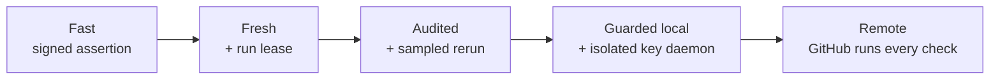
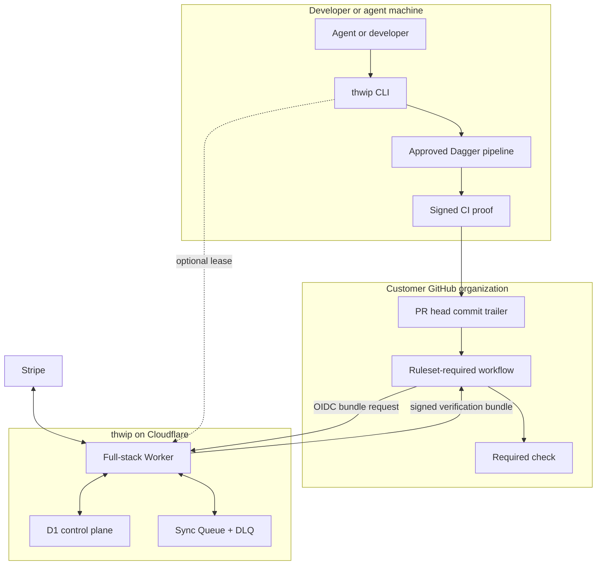
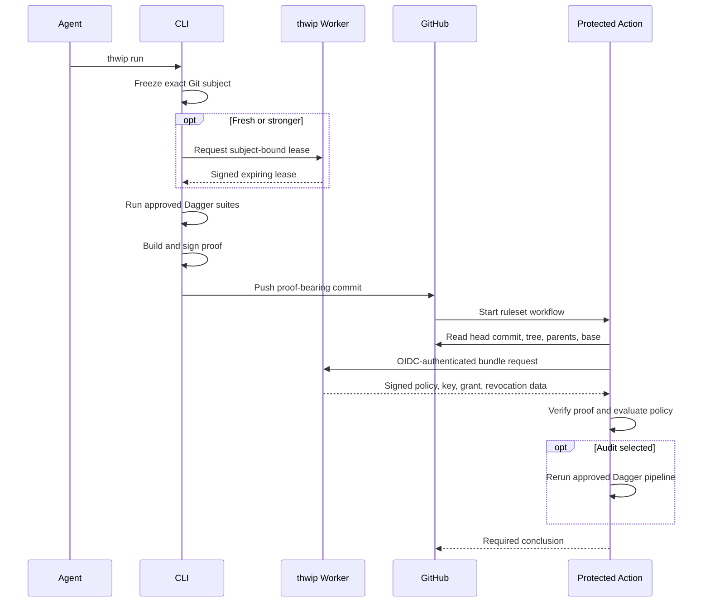
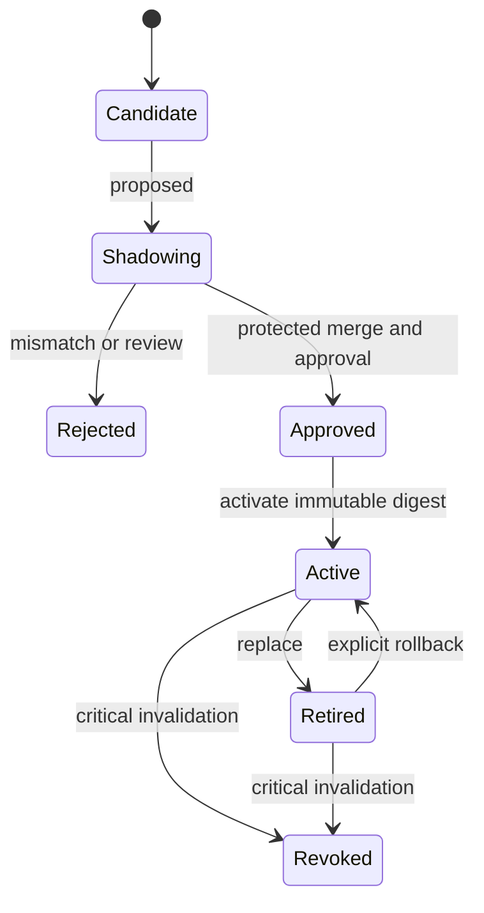
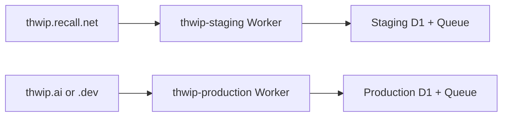
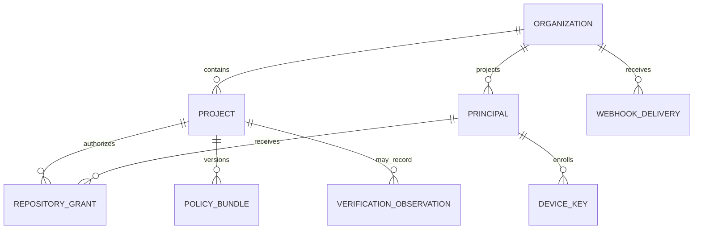

# thwip

## Product requirements, architecture, protocol, and build specification

**Status:** implementation proposal  
**Date:** 2026-07-28  
**Development origin:** `https://thwip.recall.net`  
**Production origin:** `https://thwip.ai` or `https://thwip.ai` — decide before production App registration  
**Working description:** Git-native CI proofs for agent-run Dagger pipelines

---

## 0. Decision summary

thwip should be built as a control plane, not a CI compute platform.

- Developers and agents run an approved Dagger pipeline locally.
- The thwip CLI freezes the exact Git subject, runs Dagger, and attaches a signed, compact CI proof to the commit message as a Git trailer.
- The proof binds the assertion to the GitHub repository’s numeric ID, Git tree, parents, base context, immutable policy, approved Dagger module, and required suites.
- A protected GitHub ruleset workflow reads the exact PR head commit, obtains current policy/key/permission data from thwip, and performs all proof verification inside the customer’s GitHub Actions account.
- The thwip API returns a signed verification bundle; it does not return a precomputed `pass: true`.
- The policy configuration and lifecycle live in the thwip service. The deterministic policy evaluator lives in a shared TypeScript package and executes in the GitHub Action.
- A project may require an optional context-bound run lease before local execution. A lease establishes freshness; it does not prove Dagger ran.
- Ordinary local evidence is a signed assertion. Guarded key custody or an independent GitHub rerun is required for stronger execution assurance.
- Use DSSE plus an in-toto Statement v1 and a small thwip predicate. Do not adopt classic in-toto layouts in v1.
- Use dedicated GitHub SSH **signing** keys and OpenSSH signing, not arbitrary Git transport keys and not thwip-managed private keys.
- Run one full-stack TypeScript Worker per environment, with Workers Static Assets, D1, and Queues. Do not use R2, KV, Durable Objects, Containers, or hosted build workers in v1.
- Use Hono, Effect, React/Vite, Better Auth, Drizzle, Octokit, Stripe, and the GitHub Actions toolkit. The intentionally custom code is the thwip proof, exact-Git binding, policy semantics, verifier, Dagger migration experience, and product UX.
- Launch Pro at **$5/month or $50/year**. Cloudflare cost is effectively the $5 Workers Paid minimum until substantial scale. At $5 monthly, current standard US Stripe payment and Billing fees leave about $4.52 before shared infrastructure, support, tax, and chargebacks.

### The precise product claim

> An enrolled signing key asserted that the approved pipeline and required suites passed for this exact repository, Git tree, ancestry/base context, and policy version.

thwip must not describe an ordinary local proof as cryptographic proof that arbitrary computation occurred. A signer controlling the key can lie. thwip makes that assertion attributable, replay-resistant across different code, policy-bound, enforceable, and optionally subject to independent audit.

---

# Part I — Product requirements

## 1. Product definition

### 1.1 Problem

Agentic development increases the amount of code produced and the number of CI iterations. Conventional hosted CI introduces four recurring costs:

1. The agent waits for a remote queue and cold environment after it already had a working local environment.
2. The same dependency installation, build, test, and lint work is repeated remotely.
3. Fast iterative work produces many remote CI runs whose only purpose is to reproduce work already performed.
4. Organizations must choose between slow, expensive checks and weak enforcement.

Local CI is fast, but GitHub cannot ordinarily distinguish “the approved checks really passed for this source” from “someone said they passed.” thwip creates a Git-native, policy-bound proof that GitHub can verify cheaply.

### 1.2 Product thesis

CI execution should happen where the code and warm cache already are. Trust enforcement should remain in GitHub.

thwip separates those jobs:

- **Execution:** local Dagger on the developer or agent machine.
- **Evidence transport:** the Git commit itself.
- **Control-plane state:** thwip on Cloudflare.
- **Verification and policy evaluation:** a protected GitHub Action.
- **Merge enforcement:** GitHub rulesets.
- **Independent audit:** optional Dagger rerun in GitHub Actions.

### 1.3 Positioning

thwip is:

- Git-native CI proofs for agents.
- A control plane for approved local Dagger runs.
- A fast required check that can turn green in seconds when the right proof is already present.

thwip is not:

- A remote runner.
- A replacement for Dagger.
- A build-log or artifact host.
- A production deployment authority.
- A general workflow language.
- A promise that a hostile local machine performed a computation merely because it signed a statement.

### 1.4 Personas

| Persona | Primary job |
|---|---|
| Organization owner | Install the GitHub App, choose repositories, enable enforcement, and manage billing. |
| Repository administrator | Approve Dagger pipelines, policy versions, and project security profiles. |
| Developer | Run the same approved CI locally and push a verifiable result. |
| Coding agent | Discover project instructions, run thwip, fix failures, and produce a proof-bearing commit. |
| Security reviewer | Understand what was verified, what was asserted, who signed it, and whether it was independently audited. |

### 1.5 Jobs to be done

- “When my agent finishes a change, run the exact required checks locally and let the PR go green without repeating all of CI remotely.”
- “When a proof arrives, reject it if it belongs to different code, a different repository, an old or unapproved pipeline, an unauthorized signer, or an expired run context.”
- “When CI or policy code changes, prevent the change from judging itself.”
- “When a team member leaves or a key is revoked, stop accepting new verification immediately.”
- “When I need greater assurance, independently rerun a sample or every run in GitHub without changing the developer workflow.”

## 2. Goals, non-goals, and success measures

### 2.1 Goals

thwip v1 must:

- Make an approved local Dagger run satisfy a GitHub-required check.
- Keep the compact signed proof in Git, alongside the source it covers.
- Use immutable numeric GitHub IDs as tenant and repository identity.
- Bind the proof to the exact Git tree, ancestry/base context, policy, pipeline, and suite results.
- Keep the required verifier outside the PR’s control.
- Support an offline-before-push profile and an optional fresh lease profile.
- Give every project a selectable security profile.
- Import GitHub repositories, members, teams, outside collaborators, and effective roles into an app-side projection.
- Treat GitHub, not Better Auth, as the source of repository authorization.
- Store no source code, raw logs, environment variables, or ordinary CI artifacts in thwip.
- Execute no customer Dagger workload in Cloudflare.
- Produce deterministic pass/fail reason codes from the CLI and Action.
- Operate entirely on Cloudflare for hosted application infrastructure, with GitHub and Stripe as required external systems.

### 2.2 Non-goals

thwip v1 will not:

- Automatically translate every possible GitHub Actions workflow with semantic perfection.
- Run remote CI on thwip infrastructure.
- Build a generic policy language.
- Build a custom identity provider, billing system, database, queue, crypto primitive, timestamp authority, or transparency log.
- Retain complete run logs or build artifacts.
- Give local proofs production credentials or permission to publish releases.
- Support merge queues until explicit merge-group semantics are implemented.
- Ship the guarded local daemon in the initial vertical slice.

### 2.3 Product metrics

| Metric | Initial target |
|---|---:|
| Proof-present PR check latency, excluding GitHub queue | p50 < 5 seconds; p95 < 15 seconds |
| thwip API calls in an ordinary Action verification | 1 |
| thwip-hosted customer build executions | 0 |
| Source/log bytes uploaded to thwip in the core flow | 0 |
| Deterministic CLI/Action decision parity | 100% over golden fixtures |
| Initial GitHub organization import | < 2 minutes for a 1,000-member org |
| Proof encoded size | target < 16 KiB; hard maximum 32 KiB |
| Pure proof verification after bundle fetch | p95 < 1 second |
| Webhook processing | acknowledge < 2 seconds; reconcile asynchronously |
| Security-critical authorization freshness | live or cached for at most 60 seconds during verification |

### 2.4 Adoption metrics

- Organization installs App and enables at least one project.
- First approved Dagger policy is activated.
- At least one user enrolls a dedicated signing key.
- First required check passes from a local proof.
- Percentage of eligible PRs that avoid a full GitHub rerun.
- Migration mismatch rate between legacy GitHub Actions and Dagger during shadowing.

## 3. Plans, quotas, and billing behavior

### 3.1 Launch plans

| Plan | Price | Active projects | Active users/signers | Security profiles |
|---|---:|---:|---:|---|
| Free | $0 | 3 | 5 | Fast, Fresh, Audited, Remote when GitHub supports them |
| Pro | $5/month or $50/year | 15 | 25 | Same controls; higher organization scale |

Do not paywall core security controls in v1. The plans should differ by scale, not by whether a repository can be secured correctly.

### 3.2 What counts

- A **project** counts only when a GitHub repository is enabled for thwip verification. Imported but disabled repositories do not count.
- A **user** counts only after the GitHub principal activates thwip and enrolls or is authorized to use a signing device. Shadow-imported GitHub members do not count.
- Service accounts and agents using a human owner’s unrestricted signing key are not separate identities. If an autonomous agent needs independent attribution, it must have its own principal and key.

### 3.3 Quota enforcement

- Enforce project enablement and principal activation transactionally in D1.
- Never delete projects, policies, keys, or history on downgrade.
- A downgrade that exceeds Free limits enters a 14-day read-only selection period. The owner selects which 3 projects and 5 users remain active.
- During the grace period, existing projects continue to verify. After it, non-selected projects fail with a clear billing-limit reason rather than silently changing policy.
- A transient Stripe webhook delay must not weaken security. Use the last confirmed entitlement until reconciliation; do not accept an unverified client-side checkout result as entitlement.
- Free organizations need no Stripe Customer. Create the organization Customer only on upgrade.

## 4. Primary product flows

### 4.1 Organization onboarding

1. A GitHub organization owner signs in with GitHub.
2. The owner installs the thwip GitHub App on all or selected repositories.
3. thwip creates an organization keyed by GitHub’s numeric organization ID and links the App installation.
4. thwip imports the installed repositories as projects and imports members, teams, outside collaborators, and permission projections as shadow principals.
5. The owner chooses up to the plan’s active-project limit.
6. thwip generates the organization’s required-workflow repository and ruleset payload.
7. The owner runs the generated one-time `gh api` command. The runtime GitHub App never receives Administration write permission.
8. A repository administrator begins pipeline migration and approves the first policy.
9. Users run the CLI login/device flow and enroll dedicated signing keys.

If the App is installed on selected repositories, “all projects” means all repositories granted to that installation. The UI must not imply visibility into repositories GitHub did not grant.

### 4.2 User and device onboarding

1. The user runs `thwip login`.
2. The CLI uses Better Auth’s RFC 8628 device-authorization flow; the user completes GitHub sign-in in the browser.
3. The CLI checks for a dedicated GitHub SSH signing key labeled for thwip.
4. If none exists, the CLI instructs or offers to run `ssh-keygen` and `gh ssh-key add --type signing`.
5. The CLI registers the exact public key bytes, GitHub signing-key ID, algorithm, device label, and proof of possession with thwip.
6. The private key remains on the device or in its signing agent. It is never sent to thwip.

An existing generic authentication key must not be silently reused. The product should create a dedicated signing key so that revocation and device attribution remain clear.

### 4.3 Pipeline migration

1. `thwip init` identifies the repository by numeric GitHub ID and reads the active policy state.
2. It inventories `.github/workflows/*.yml`, including jobs, matrices, services, caches, artifacts, secrets, and reusable workflows.
3. It generates:
   - A Dagger TypeScript module scaffold.
   - An `thwip.md` agent brief describing the conversion.
   - A candidate policy.
   - A migration report listing unsupported or GitHub-only behavior.
4. Codex or another agent performs the repository-specific conversion using official Dagger modules where possible.
5. `dagger check` and the existing GitHub workflow run in shadow mode over representative changes.
6. thwip compares suite names and conclusions; a repository administrator resolves mismatches.
7. The candidate pipeline is approved and activated only after protected review and merge.

thwip should automate inspection, scaffolding, comparison, and instructions. It should not promise a universal one-click semantic compiler for arbitrary workflow YAML.

### 4.4 Normal run

1. The agent invokes `thwip run`.
2. The CLI freezes a clean materialization of the exact intended Git tree.
3. If the project requires freshness, the CLI requests a subject-bound run lease.
4. The CLI runs the base-approved Dagger pipeline against the frozen source.
5. Required suites pass.
6. The CLI creates an in-toto statement, signs its DSSE pre-auth bytes with the enrolled key, and adds exactly one `thwip-Proof` trailer.
7. The commit is optionally or automatically Git-signed after the trailer is present.
8. The user or agent pushes.
9. The protected GitHub workflow reads the PR head commit, obtains one verification bundle from thwip with GitHub OIDC, and verifies locally.
10. GitHub marks the required workflow successful, or the Action emits a stable failure reason.

### 4.5 Pipeline or policy change

The current base-approved policy judges the PR. The changed pipeline is a candidate and may run informationally, but it cannot approve itself. After protected merge and administrative approval, thwip activates a new immutable policy digest.

### 4.6 Outside contributor

If a contributor is not enrolled:

- The proof-only check explains that no authorized signer is present.
- Project policy may allow a maintainer to run and sign the exact head tree.
- Project policy may use the Remote profile and run Dagger in GitHub.
- thwip must not issue secrets to fork code.

---

# Part II — Terminology

## 5. Canonical terms

| Term | Definition |
|---|---|
| thwip organization | Product tenant bound one-to-one to a GitHub organization’s immutable numeric ID. |
| Project | An installed GitHub repository enabled for thwip. Its numeric repository ID is canonical. |
| Shadow principal | An imported GitHub user or team that has not activated an thwip account and does not consume a user seat. |
| Active user | A GitHub principal linked to a Better Auth user and activated for thwip. |
| Device key | A dedicated signing key enrolled to one active user and one device. |
| Git subject | The repository, Git tree, parent list, base context, and optional merge-tree context covered by a proof. |
| Pipeline | The approved Dagger program used to run CI. |
| Suite | A stable, policy-addressable check such as `unit`, `lint`, or `typecheck`. |
| Candidate pipeline | A proposed pipeline version that is not yet allowed to judge required checks. |
| Policy bundle | An immutable, content-addressed declaration of approved pipeline material, required suites, and verification controls. |
| Active policy | The policy digest currently authorized to judge new runs for a project. |
| CI proof | A compact signed statement asserting suite results for one Git subject and policy. |
| Run lease | An optional thwip-signed, expiring token bound to a Git subject, active policy, signer, and device. |
| Verification bundle | Current policy, key, grant, revocation, and trust data returned to the Action. It is evidence, not a pass/fail decision. |
| Verifier | The pure deterministic package that validates a proof and evaluates fixed thwip policy. |
| Verification Action | The GitHub Action adapter that obtains GitHub context and a verification bundle, then invokes the verifier. |
| Execution assertion | A signer’s statement that a suite ran and passed. |
| Audit rerun | An independent Dagger execution in GitHub Actions. |
| Execution proof | Reserved for an independently trusted execution environment or rerun; do not use this term for a normal local proof. |
| Fast profile | Local signed proof with no pre-run thwip lease. |
| Fresh profile | Local signed proof plus an expiring subject-bound lease. |
| Audited profile | Fresh profile plus deterministic random and risk-triggered GitHub reruns. |
| Guarded local | A future mode in which a separate local daemon owns the key and runs the approved pipeline before signing. |
| Remote profile | The approved Dagger pipeline runs in GitHub for every required check. |

External copy should prefer “signed CI proof” and “verifiable local CI” over “proof that CI ran.”

---

# Part III — Security model

## 6. Trust model

### 6.1 Trust roots

thwip v1 trusts:

- GitHub for repository identity, organization identity, membership, permissions, commit objects, event context, ruleset enforcement, and Actions OIDC.
- The thwip service signing root for policy bundles, verification bundles, and run leases.
- The enrolled public key directory and revocation state for signer attribution.
- Dagger and the approved pipeline for declared execution semantics.
- The local signer for execution truth in Fast and Fresh modes.
- GitHub-hosted execution for independently audited or Remote runs.

Stripe is trusted only for billing state. Stripe must never influence cryptographic proof validity.

### 6.2 What is independently known

The verifier must classify fields by provenance:

| Class | Examples |
|---|---|
| Cryptographically verified | DSSE payload bytes, signer key, policy/bundle signatures, lease signature |
| GitHub-derived | Numeric repository/owner IDs, head commit, tree, parents, base SHA, workflow identity |
| thwip-derived | Active policy, key enrollment/revocation, current effective permission, plan/project status |
| Signer-asserted | Dagger actually ran, timestamps, network/cache behavior, suite output digests |
| Independently observed | GitHub audit rerun result |

The UI and Action summary must not render signer-asserted facts as independently observed facts.

### 6.3 Security profiles



| Profile | Lease | Who controls execution assertion | GitHub rerun | Assurance |
|---|---:|---|---:|---|
| Fast | No | Enrolled user/agent key | None | Integrity, signer attribution, and exact subject/policy binding |
| Fresh | Yes | Enrolled user/agent key | None | Fast assurance plus trusted issuance window |
| Audited | Yes | Enrolled key or guarded daemon | Random and risk-triggered | Probabilistic independent detection and deterrence |
| Guarded local | Yes | Separate local daemon | Optional | Agent cannot sign without asking the daemon to execute; host admin/kernel remain trusted |
| Remote | Optional | GitHub runner | Every run | Conventional remote-CI execution assurance |

Recommended defaults:

- New projects: **Fresh**.
- Low-risk, outage-tolerant, or fully offline-before-push projects: **Fast**.
- Security-sensitive projects: **Audited**, with mandatory triggers for CI/policy, lockfiles, auth, billing, deployment, and secrets code.
- Guarded local: post-v1.
- Merge queue: Remote for the synthetic merge group until thwip defines stronger group semantics.

### 6.4 Project-level policy knobs

- Minimum current GitHub permission: `triage`, `write`, `maintain`, or `admin`.
- Whether the PR author may be the signer.
- Allowed signing-key algorithms.
- Whether the key must still appear in the user’s GitHub SSH signing-key list.
- Proof age.
- Lease requirement and TTL.
- Head-tree or merge-tree evaluation.
- Base-advance behavior.
- Required suites.
- Approved Dagger module/engine/container digests.
- Network and cache declarations.
- Audit rate in basis points.
- Mandatory audit paths and change classes.
- Remote fallback for unenrolled contributors.

## 7. Threat model

| Threat | Required control | Residual risk |
|---|---|---|
| Proof copied to another repository | Sign and compare numeric repository and owner IDs. | None if GitHub context is derived independently. |
| Proof copied to different code | Sign and compare the exact Git tree OID. | Identical trees are intentionally equivalent. |
| Cherry-pick, rebase, or squash | Bind parent list and base context. | A new run/proof is normally required. |
| Base branch advances | Bind exact base SHA or required merge tree. | Frequent rebases may require reruns. |
| PR changes its own pipeline | Current base-approved immutable policy remains authoritative. | Policy administrators remain trusted. |
| PR changes verifier workflow | Use an organization ruleset-required workflow pinned to immutable SHAs. | GitHub org administrators remain trusted. |
| A different workflow spoofs the check name | Require a specific ruleset workflow, not a status context alone. | Customers lacking this GitHub feature receive a degraded compatibility mode only. |
| Signer lies about running Dagger | Audited/Remote modes or guarded key daemon. | Un-audited Fast/Fresh proofs remain assertions. |
| Agent uses an available signing key as an oracle | Dedicated key, clear consent boundary, audits, future guarded daemon/hardware key. | A user may intentionally authorize an agent to sign. |
| Key theft | OS/OpenSSH key protection, one key per device, proof of possession, rotation, immediate thwip revocation. | A compromised host can often use the key while it is unlocked. |
| User leaves organization | Live effective-permission check and webhook reconciliation. | GitHub/API outage causes fail-closed verification. |
| GitHub signing key is removed | Live or ≤60-second cached GitHub key-presence check; thwip revocation. | GitHub key-directory availability. |
| Old proof replay | Exact immutable subject binding; optional lease TTL. | Reuse for the identical subject is harmless by design. |
| Fake local clock | Use lease `iat`/`exp` for Fresh; treat local timestamps as asserted. | Fast mode has no trusted run time. |
| Mutable container/dependency tags | Require digests in approved policy. | Networked package resolution may remain non-hermetic if policy permits it. |
| Local cache poisoning | Dagger isolation/content addressing, declared cache mode, audits. | Cache behavior is locally asserted without audit. |
| Proof parser attack | One bounded trailer, strict schema, no compression in v1, fuzz/property tests. | Parser and dependency vulnerabilities remain possible. |
| Proof leaks secrets | Allowlisted schema only; no logs, environment, local paths, or raw commands. | A malicious custom pipeline can still leak through its own outputs. |
| thwip API substitutes policy/key | Signed bundles and a verifier-pinned thwip root; later organization-owned root. | Default v1 trusts thwip control-plane administrators and service signing key. |
| API outage | Fail closed with a clear retryable result. | Required checks cannot pass during a sustained outage. |
| Billing outage | Last confirmed entitlement plus reconciliation; billing never changes proof validity. | Upgrades/downgrades may be delayed. |
| Cloudflare denial-of-wallet | Bounded bodies, OIDC, rate limits, static-asset-first routing, sampled success logs. | Deliberate distributed traffic still consumes quota. |
| GitHub compromise | Out of scope. | GitHub is a fundamental trust root. |

### 7.1 Security invariants

1. A PR cannot introduce the policy or verifier that alone approves that PR.
2. Untrusted proof fields are never used before size bounds and schema validation.
3. The verifier derives GitHub context independently; it never trusts repository/tree/base values merely because the proof contains them.
4. Human-readable GitHub names are display fields; numeric IDs are authorization keys.
5. Unknown schema, algorithm, policy, suite, key, or reason-code versions fail closed.
6. A current revocation wins over a historical signature.
7. An API response cannot establish its own trust root.
8. A local proof cannot mint deployment or release credentials.
9. Fork and audit jobs receive no production secrets.
10. The API supplies verification inputs; only the protected Action decides the required result.

---

# Part IV — Architecture

## 8. System architecture



### 8.1 Architectural boundary

| Component | Responsibility | Explicitly does not do |
|---|---|---|
| thwip CLI | Auth, device enrollment, Git subject freezing, Dagger invocation, proof construction/signing, commit trailer management | Decide organization authorization independently of GitHub |
| Dagger | Containerized execution, dependency graph, caching, suites, services, traces | Create thwip policy or decide signer authorization |
| Git commit | Carry the compact proof with the source | Store raw logs/artifacts |
| GitHub ruleset workflow | Provide protected execution identity and required-check enforcement | Trust PR-owned workflow code |
| Verification Action | Derive GitHub facts, fetch bundle, verify proof, evaluate policy, publish conclusion | Run ordinary customer CI unless audit/Remote requires it |
| Cloudflare Worker | UI, auth, GitHub/Stripe webhooks, sync, policy lifecycle, lease issuance, bundle resolution | Execute Dagger or make the required pass/fail decision |
| D1 | Relational source for thwip control-plane projections | Store source code, private keys, or ordinary CI evidence blobs |
| Queues | Retry and fan out synchronization/reconciliation | Process every CI verification |
| Stripe | Checkout, subscriptions, payment methods, invoices, Customer Portal | Determine proof validity |

### 8.2 Normal run sequence



### 8.3 Policy lifecycle



### 8.4 Cloudflare deployment



Staging and production share source code but not Worker names, D1 databases, queues, secrets, GitHub Apps, Stripe modes, callback URLs, or service-signing keys.

## 9. Request paths and compute placement

### 9.1 Browser and control plane

- `GET /*` serves the React dashboard through Workers Static Assets.
- `/api/auth/*` is Better Auth, including GitHub callbacks, device authorization, organization session context, and Stripe plugin endpoints.
- `/api/github/webhooks` validates GitHub webhook HMAC before parsing.
- `/api/auth/stripe/webhook` is handled by the Better Auth Stripe plugin.
- `/v1/*` contains typed thwip product APIs.
- A scheduled Worker performs reconciliation, stale-shadow cleanup, and lease/observation retention.
- A Queue consumer performs idempotent installation/member/team/repository synchronization.

### 9.2 Verification

The Action performs:

- Git commit/trailer retrieval.
- Proof parsing and schema validation.
- DSSE/SSHSIG verification.
- Git subject comparison.
- Policy evaluation.
- Lease verification.
- Suite and signer checks.
- Audit selection.
- GitHub step summary and conclusion.

The Worker performs only:

- GitHub OIDC verification.
- Project/installation lookup.
- Current signer/key/permission refresh when needed.
- Signed verification-bundle assembly.

This preserves the desired constraint: thwip hosts no per-run verifier compute beyond the small authenticated data lookup needed to provide current control-plane facts.

---

# Part V — Proof, policy, and verification protocol

## 10. Git subject and commit self-reference

A proof cannot contain the final commit SHA while also living inside that commit: adding the proof changes the commit object and therefore its SHA.

thwip binds to the immutable inputs beneath the commit instead:

- GitHub numeric owner ID.
- GitHub numeric repository ID.
- Git object format: `sha1` or `sha256`.
- Git tree OID.
- Ordered parent OID list.
- Base ref and exact base SHA.
- Evaluation mode: `head-tree` or `merge-tree`.
- Merge-tree OID when required.
- Approved policy and pipeline digests.

The protected Action reads the actual head commit and compares those values. For `pull_request`, it must use `github.event.pull_request.head.sha`; GitHub’s `GITHUB_SHA` is the synthetic PR merge commit. A rebase, cherry-pick, squash, or base change normally changes the bound context and requires a new run.

Two commits with the same tree, parents, base, and policy but different non-thwip message text are equivalent thwip subjects. The proof signer, not the Git `author` field, is the security identity.

### 10.1 Exact-source execution requirements

Before Dagger starts, the CLI must:

1. Resolve the remote to the numeric GitHub repository ID.
2. Determine whether the intended source is `HEAD`, the index, or an explicitly selected commit.
3. Refuse ambiguous dirty-tree operation by default.
4. Materialize the exact tree into a clean temporary Git worktree or archive.
5. Make that source read-only to the pipeline where practical.
6. Capture parent and base context.
7. Run the approved Dagger module from the active base policy, not unapproved module code in the PR.
8. Recompute the tree and context before attaching the proof.
9. Refuse attachment if any bound input changed.

Untracked files, unstaged changes, ignored files, or files outside the Git subject must not silently affect a required run.

For v1, either reject repositories with Git submodules or bind every submodule path and commit OID explicitly. Do the same for Git LFS object IDs before claiming LFS support.

## 11. Proof carrier

The final commit trailer block contains exactly:

```text
thwip-Proof: v1.<base64url(dsse-envelope-json)>
```

v1 deliberately uses no additional compression. A compact digest-only predicate is expected to fit comfortably under 16 KiB, and avoiding a decompressor removes dependencies and an entire parser attack class. A later carrier version can add compression if measured proofs require it.

Rules:

- Exactly one `thwip-Proof` trailer is allowed.
- Duplicate, folded, ambiguous, unknown-version, or malformed values fail closed.
- Base64url has no padding.
- Encoded size target: < 16 KiB.
- Encoded hard maximum: 32 KiB.
- Decoded envelope hard maximum: 24 KiB.
- Proof payload contains summaries and digests only.
- It contains no raw logs, environment variables, secrets, local absolute paths, hostnames, usernames unrelated to GitHub identity, or source contents.
- Use Git’s trailer semantics for insertion, but use a strict thwip parser for verification.
- Git notes are not the default: they are independently mutable, inconsistently fetched, and poorly surfaced in normal GitHub review.

If the commit already has a native Git signature, amendment invalidates it. The CLI must either add the trailer before the final signed commit is created or explicitly re-sign the amended commit.

## 12. Envelope and statement

Use:

- DSSE envelope payload type: `application/vnd.in-toto+json`.
- in-toto Statement v1 `_type`: `https://in-toto.io/Statement/v1`.
- Domain-independent predicate URI: `urn:thwip:attestation:ci-run:v1`.

A URN avoids making the protocol identifier depend on whether production chooses `thwip.ai` or `thwip.ai`.

Classic in-toto layouts and link metadata are not required. thwip needs the stable Statement vocabulary and DSSE type-binding, not an additional general supply-chain planner.

### 12.1 Conceptual TypeScript schema

All GitHub IDs are decimal strings, never JavaScript numbers.

```ts
type DecimalId = string
type GitOid = string
type Sha256 = `sha256:${string}`
type IsoDateTime = string

interface InTotoStatementV1<Predicate> {
  _type: "https://in-toto.io/Statement/v1"
  subject: Array<{
    name: "git-tree"
    digest: Record<"sha1" | "sha256", GitOid>
  }>
  predicateType: "urn:thwip:attestation:ci-run:v1"
  predicate: Predicate
}

interface thwipCiRunPredicateV1 {
  schemaVersion: "1"

  repository: {
    provider: "github"
    ownerId: DecimalId
    repositoryId: DecimalId
  }

  git: {
    objectFormat: "sha1" | "sha256"
    treeOid: GitOid
    parentOids: GitOid[]
    baseRef: string
    baseSha: GitOid
    evaluationMode: "head-tree" | "merge-tree"
    mergeTreeOid?: GitOid
    submodules?: Array<{ path: string; commitOid: GitOid }>
    lfsObjects?: Array<{ path: string; oid: `sha256:${string}` }>
  }

  policy: {
    digest: Sha256
    version: number
  }

  dagger: {
    moduleDigest: Sha256
    engineImageDigest: Sha256
    cliVersion: string
    approvedImages: Sha256[]
  }

  run: {
    startedAt: IsoDateTime
    finishedAt: IsoDateTime
    lease?: string
    networkMode: "disabled" | "restricted" | "unrestricted"
    cacheMode: "disabled" | "read-only" | "read-write"
    suites: Array<{
      id: string
      status: "passed" | "failed" | "skipped"
      durationMs: number
      reportDigest?: Sha256
    }>
  }

  signer: {
    keyId: string
    githubUserId: DecimalId
  }
}

interface DsseEnvelope {
  payloadType: "application/vnd.in-toto+json"
  payload: string
  signatures: [{
    keyid: string
    sig: string
  }]
}
```

Local timestamps are signer-asserted. In Fresh or stronger profiles, the lease’s service-issued `iat`, `nbf`, and `exp` are the trusted time bounds.

### 12.2 Serialization and hashing

- DSSE signs the exact decoded payload bytes. Do not parse and reserialize before signature verification.
- Construct DSSE PAE exactly as the DSSE v1 specification defines it. `payload` and `sig` use standard padded base64; only the outer Git trailer carrier uses unpadded base64url.
- Run `ssh-keygen -Y sign -n thwip-ci-dsse-v1` over the exact PAE bytes. Store the standard-base64 encoding of the binary SSHSIG object in `sig`, not the ASCII armor and not a bare Ed25519 value.
- After signature verification, parse with Effect Schema and reject unknown or invalid required fields.
- Use RFC 8785 JSON Canonicalization Scheme only when computing thwip policy/module digests that must be reproducible from parsed data.
- Adopt the maintained `canonicalize` package; do not implement JSON canonicalization.
- Use SHA-256 with an explicit `sha256:` prefix for thwip content digests.
- Preserve native Git OIDs and their object-format declaration for Git objects.
- Generate cross-runtime golden vectors for every protocol version.

## 13. Signing-key model

### 13.1 v1 default

Use a dedicated GitHub SSH signing key per device:

- Generate Ed25519 with OpenSSH.
- Add only the public key to GitHub as type `signing`.
- Snapshot the exact public key, GitHub signing-key ID, fingerprint, algorithm, GitHub numeric user ID, and device label in thwip.
- Require a proof-of-possession challenge during enrollment.
- Sign the DSSE pre-auth encoding with OpenSSH SSHSIG under an thwip-specific namespace.
- Verify with OpenSSH on the CLI and GitHub-hosted Ubuntu runner.

This adopts GitHub’s public key directory, OpenSSH key formats, SSH agents, hardware-backed `*-sk` keys where supported, and mature cryptographic primitives. thwip owns no private-key custody.

The signing namespace must be fixed and versioned, for example:

```text
thwip-ci-dsse-v1
```

Do not silently accept a key uploaded as a generic Git authentication key. An organization may allow an existing GitHub signing key, but the onboarding default is a new thwip-labeled key.

### 13.2 Enrollment and lifecycle

Store:

- thwip key ID.
- GitHub signing-key ID.
- GitHub numeric user ID.
- Public key bytes and SHA-256 fingerprint.
- Algorithm.
- Device label.
- Proof-of-possession time.
- Created, last-seen, and revoked times.
- Revocation reason and actor.

Requirements:

- One key may belong to only one active principal in an thwip organization.
- Keep immutable historical public-key records after revocation so old proofs remain explainable.
- Current verification must check thwip revocation and, when policy requires, current presence in GitHub’s SSH signing-key directory.
- Support overlapping key rotation.
- Design the proof algorithm field for agility; Ed25519 is the v1 default, not an eternal protocol assumption.

### 13.3 Honest limitation

An agent with unrestricted access to an SSH agent can ask it to sign. Hardware-backed storage reduces theft but does not prove the agent actually ran Dagger. The future guarded daemon improves this by owning the key and exposing only “run approved pipeline, then sign” rather than a generic signing oracle.

## 14. Run leases

The useful nonce is thwip-issued because it must bind thwip context. Public randomness does not know the active policy, repository, tree, base, device, or authorization state.

### 14.1 Lease request

```json
{
  "repositoryId": "123456789",
  "treeOid": "abc123",
  "parentOids": ["def456"],
  "baseSha": "789abc",
  "deviceKeyId": "key_01..."
}
```

The service resolves organization, current authorization, and active policy itself.

### 14.2 Lease claims

Use a compact ES256 JWS with:

- `iss`: environment-specific thwip issuer.
- `aud`: `urn:thwip:ci-run:v1`.
- `jti`.
- thwip organization/project IDs.
- GitHub numeric owner/repository/user IDs.
- Git tree, parents, base, and optional merge-tree context.
- Active policy digest.
- Device key ID.
- Security profile.
- `iat`, `nbf`, and `exp`.

Recommended default TTL: 30 minutes, configurable down to 5 minutes and up to 2 hours.

### 14.3 Replay semantics

The v1 lease should be stateless. It is already bound to one immutable Git subject, signer, device, and policy. Reusing it for that identical subject within its short lifetime does not let it approve different code.

Do not build single-consume coordination unless a customer requirement demonstrates a real benefit. If a later Strict Fresh mode requires one use:

- Store `jti` with a unique D1 constraint.
- Consume with one conditional `UPDATE ... WHERE consumed_at IS NULL AND expires_at > ?`.
- Bind the first accepted proof digest idempotently.
- Add a per-repository Durable Object only if measured D1 contention requires it.

A lease proves that thwip authorized the context during a recent time window. It does not prove local execution.

## 15. Policy bundle

Policy is versioned declarative data evaluated by fixed code. Do not introduce Rego, Cedar, OpenFGA, Casbin, or JSON Logic in v1.

An immutable policy bundle contains:

- Schema and policy version.
- thwip project and numeric GitHub repository IDs.
- Active Dagger module digest.
- Supported Dagger CLI version and engine image digest.
- Approved container image digests.
- Required suite IDs.
- Security profile.
- Minimum current GitHub permission.
- Whether the PR author may be the signer.
- Allowed key algorithms and GitHub-key-presence requirement.
- Head-tree or merge-tree evaluation.
- Lease requirement and maximum age.
- Network/cache/secret declarations.
- Audit rate and mandatory audit paths.
- Proof and verification timeout limits.
- Eligible previous-policy grace rules.
- Critical revocation state.

Example:

```json
{
  "schemaVersion": "1",
  "projectId": "prj_01...",
  "repositoryId": "123456789",
  "version": 4,
  "securityProfile": "fresh",
  "minimumPermission": "write",
  "allowAuthorAsSigner": true,
  "evaluationMode": "head-tree",
  "lease": {
    "required": true,
    "maxAgeSeconds": 1800
  },
  "dagger": {
    "moduleDigest": "sha256:...",
    "engineImageDigest": "sha256:...",
    "requiredSuites": ["lint", "typecheck", "unit"]
  },
  "audit": {
    "basisPoints": 100,
    "mandatoryPaths": [
      ".github/**",
      "dagger/**",
      "pnpm-lock.yaml",
      "src/auth/**",
      "src/billing/**"
    ]
  }
}
```

### 15.1 Pipeline digest

The approved module digest must be reproducible from a defined allowlist of:

- Dagger module manifest/config.
- Dagger module source.
- Generated bindings when committed.
- Dependency lockfiles.
- Pinned Dagger engine version.
- Explicit referenced module revisions and container image digests.

Do not hash mutable tags or the entire developer worktree. Store the canonical manifest of included paths and digests inside the policy bundle so reviewers can explain the digest.

### 15.2 Rotation behavior

- A new policy becomes a Candidate.
- It shadows but cannot satisfy the required check.
- Protected merge and explicit approval create an immutable digest.
- Activation retires the old policy.
- An unexpired lease from the retired policy may remain eligible if the new policy declares a grace period.
- A critical revocation overrides all grace and fails immediately.
- Fast proofs without a lease require the currently active digest unless the policy explicitly permits a short previous-policy window.

## 16. Verification bundle

The Action makes one request:

```http
POST /v1/verification-bundles:resolve
Authorization: Bearer <GitHub Actions OIDC JWT>
Content-Type: application/json
```

The bounded request includes:

```json
{
  "repositoryId": "123456789",
  "headSha": "abcdef...",
  "baseSha": "012345...",
  "policyDigest": "sha256:...",
  "keyIds": ["key_01..."]
}
```

The response includes:

- Project and installation identity.
- Requested immutable policy bytes and status.
- Active policy digest and eligible grace digests.
- Exact enrolled public keys and thwip revocation records.
- Current effective repository permission for each signer.
- Current GitHub signing-key presence when required.
- Lease issuer public keys and accepted key IDs.
- thwip bundle signing metadata.
- Bundle issuance and short expiry.

The response is signed as an ES256 JWS. The verifier pins an thwip public root or an explicitly configured organization root. A key delivered only inside that response cannot authenticate the same response.

The API must not include a Boolean verification decision.

## 17. Verification algorithm

The GitHub Action must execute these steps in order:

1. Require a supported event and derive target repository, owner, base, and workflow identity from GitHub.
2. For `pull_request`, select `github.event.pull_request.head.sha`, never synthetic `GITHUB_SHA`.
3. Fetch the raw head commit and derive tree and ordered parents.
4. Derive/fetch expected merge-tree context only when policy requires it.
5. Locate the final trailer block and require exactly one bounded thwip trailer.
6. Decode the carrier and validate the outer DSSE shape without trusting selectors.
7. Obtain a GitHub Actions OIDC token with the exact environment audience.
8. Fetch the verification bundle using only bounded selectors.
9. Validate GitHub OIDC in the Worker and validate the returned bundle signature in the Action.
10. Verify the SSHSIG signature over DSSE pre-auth bytes using the exact enrolled key.
11. Parse the signed in-toto payload with the exact v1 Effect Schema.
12. Compare numeric owner/repository IDs with GitHub-derived values.
13. Compare tree, parents, base, object format, and merge context with GitHub-derived values.
14. Confirm signer/key binding, current thwip status, current GitHub key presence if required, and no revocation.
15. Confirm each signer’s current effective GitHub permission satisfies policy.
16. Confirm the proof policy is active or explicitly grace-eligible.
17. Compare Dagger module, engine, approved image, and suite digests with policy.
18. Validate any required lease signature, audience, expiry, signer, subject, and policy binding.
19. Require every policy suite exactly once and with `passed`; reject duplicates and unexpected semantics.
20. Apply author-separation, proof age, network, cache, and other fixed controls.
21. Compute audit selection.
22. If selected, require the separate unprivileged GitHub Dagger job to agree.
23. Emit a deterministic reason code, human summary, and process exit status.
24. Optionally post a compact observation to thwip; verification success must not depend on that telemetry write.

The same `@thwip/verifier` package must power:

- The GitHub Action.
- `thwip verify`.
- Protocol golden tests.
- Offline troubleshooting.

No second server implementation is allowed.

### 17.1 Stable outcome classes

Examples:

```text
PASS
PROOF_MISSING
PROOF_DUPLICATE
PROOF_TOO_LARGE
PROOF_SCHEMA_UNSUPPORTED
SIGNATURE_INVALID
SIGNER_KEY_UNKNOWN
SIGNER_KEY_REVOKED
SIGNER_PERMISSION_INSUFFICIENT
SUBJECT_REPOSITORY_MISMATCH
SUBJECT_TREE_MISMATCH
SUBJECT_ANCESTRY_MISMATCH
SUBJECT_BASE_MISMATCH
POLICY_NOT_ACTIVE
PIPELINE_DIGEST_MISMATCH
SUITE_MISSING
SUITE_NOT_PASSED
LEASE_REQUIRED
LEASE_EXPIRED
LEASE_CONTEXT_MISMATCH
AUDIT_REQUIRED
AUDIT_DISAGREED
BUNDLE_UNAVAILABLE
BUNDLE_SIGNATURE_INVALID
```

Reason-code semantics are versioned API. UI copy may improve without changing their meaning.

## 18. Audits and public randomness

Public randomness is useful for unpredictable audit selection, not for lease issuance.

An optional future public formula:

```text
audit =
  H(proof_digest || first_drand_round_after_trusted_push_observation)
  mod 10_000
  < audit_basis_points
```

The beacon round must be selected after a trusted push observation so a signer cannot know the outcome before committing. The Git commit timestamp is user-controlled and cannot choose the round.

Before adding drand, v1 may use a GitHub-derived post-push value plus an thwip secret audit key. That is operationally simpler but not publicly reproducible. The UI must label which selection method is used.

Mandatory audit triggers should include:

- Dagger/policy/verifier workflow files.
- Dependency manifests and lockfiles.
- Authentication and authorization.
- Billing and quota enforcement.
- Deployment/release configuration.
- Secret handling.
- Previously flaky or nondeterministic suites.

Audit jobs must use the exact approved base pipeline, check out the exact Git subject, run without production secrets, and publish their own conclusion.

---

# Part VI — Hosted application specification

## 19. Cloudflare application shape

Deploy one full-stack Worker artifact into two isolated Wrangler environments.

### 19.1 Required Cloudflare products

| Product | v1 use |
|---|---|
| Workers Paid | Hono API, Better Auth, webhook handlers, scheduled reconciliation, Queue consumer |
| Workers Static Assets | React/Vite dashboard, served asset-first |
| D1 | Auth tables, GitHub projections, policies, keys, project configuration, billing mirror, idempotency, optional observations |
| Queues | GitHub/Stripe reconciliation, retries, and fan-out |
| Queue DLQ | Poison-message inspection and controlled replay |
| Workers Logs/traces | Sampled operational telemetry and failures |
| Custom Domains | `thwip.recall.net` staging and final production origin |

### 19.2 Explicitly deferred

| Product | Reason |
|---|---|
| R2 | The proof lives in Git; v1 stores no large evidence or logs. |
| KV | Eventual consistency is inappropriate for policy, revocation, permission, and nonce state. |
| Durable Objects | Stateless leases and D1 atomic writes are sufficient until contention is measured. |
| Containers | thwip runs no hosted Dagger workloads. |
| Workflows | Queue plus scheduled reconciliation is enough for the v1 state machine. |
| Workers for Platforms | thwip does not execute customer-supplied Worker code. |

### 19.3 Worker handlers

The same Worker exports:

- `fetch` for UI/API/auth/webhooks.
- `queue` for sync and reconciliation messages.
- `scheduled` for periodic full reconciliation, stale-row cleanup, and billing repair.

Keep static routing asset-first so ordinary dashboard assets do not invoke billable dynamic code.

## 20. Authentication and organization model

### 20.1 Better Auth

Adopt:

- Better Auth GitHub social provider.
- Better Auth native Cloudflare D1 database support.
- `organization()` for activated app members, roles, teams, and current session context.
- Better Auth Device Authorization plugin for CLI login.
- `@better-auth/stripe` for organization subscriptions and Customer Portal.

Do not build password auth, email magic links, session cookies, OAuth token refresh, CLI device codes, subscription lifecycle tables, or billing portal screens.

### 20.2 Authority split

| Question | Authority |
|---|---|
| Who is logged into the thwip UI/CLI? | Better Auth session/device token backed by GitHub login |
| Which thwip organization is active in the UI? | Better Auth organization/session context |
| Which GitHub organization/repository is this? | GitHub numeric IDs |
| Is this repository installed/enabled? | GitHub App installation plus thwip project status |
| May this user sign for this repository now? | Current GitHub effective permission plus thwip key/project state |
| Is the organization entitled to another project/user? | Better Auth Stripe subscription projection plus thwip quota transaction |

Better Auth roles must never override insufficient GitHub repository permission for proof acceptance.

### 20.3 Shadow principals

Initial synchronization creates `principals` and grant rows for GitHub users/teams without creating credential-bearing Better Auth users.

On first GitHub sign-in:

- Link the Better Auth user to the existing numeric GitHub principal.
- Add the activated user to the Better Auth organization with a projected app role.
- Enforce the active-user quota in the same D1 batch/transactional operation.
- Do not rely on email or username as the join key.

## 21. GitHub synchronization

### 21.1 Runtime App permissions

The long-lived App requests only:

- Repository Metadata: read.
- Repository Contents: read.
- Organization Members: read.
- User Email addresses: read, for GitHub authentication.

It requests no Checks, Statuses, Actions, Pull requests, repository Administration, or organization Administration write permission in v1.

Subscribe to:

- `organization`
- `repository`
- `member`
- `membership`
- `team`

GitHub delivers `installation`, `installation_repositories`, and `github_app_authorization` automatically.

### 21.2 Webhook processing

1. Read the raw request body under a strict maximum.
2. Verify `X-Hub-Signature-256` with `@octokit/webhooks` before JSON parsing.
3. Insert `X-GitHub-Delivery` under a unique D1 constraint.
4. Return success for a duplicate delivery without processing twice.
5. Enqueue a small typed message.
6. A Queue consumer fetches authoritative current GitHub state and applies an idempotent projection update.
7. Failures retry and eventually enter the DLQ.

Webhook payloads are hints, not the only state authority. Run periodic reconciliation because deliveries can be missed and effective permission can change through teams, outside collaboration, or repository selection.

### 21.3 Verification-time freshness

For each signer in a bundle request:

- Use the App installation to fetch or refresh effective repository permission if the projection is older than 60 seconds.
- When policy requires current GitHub key presence, fetch or refresh the user’s public SSH signing-key list.
- Fail closed if current security-critical state cannot be obtained after bounded retries.
- Cache display data longer; do not cache revocation/authorization decisions indefinitely.

## 22. D1 logical model



Better Auth manages its user, session, account, organization, member, device-code, subscription, and Stripe reference tables in the same D1 database. thwip custom tables use internal IDs and numeric GitHub IDs, with explicit links to Better Auth records.

### 22.1 `organizations`

| Field | Notes |
|---|---|
| `id` | thwip ID |
| `better_auth_org_id` | Unique link |
| `github_org_id` | Unique decimal string |
| `github_login` | Display only |
| `installation_id` | Current GitHub App installation |
| `repository_selection` | `all` or `selected` |
| `plan` | `free` or `pro` projection |
| `status` | active, grace, suspended, uninstalled |
| timestamps | created, updated, reconciled |

### 22.2 `projects`

| Field | Notes |
|---|---|
| `id` | thwip ID |
| `organization_id` | FK |
| `github_repository_id` | Unique within provider |
| `github_name` | Display only |
| `default_branch` | Display/config aid |
| `enabled` | Consumes project quota |
| `active_policy_digest` | Immutable policy FK |
| `security_profile` | Fast/Fresh/Audited/Remote |
| timestamps | created, updated, reconciled |

### 22.3 `principals`

| Field | Notes |
|---|---|
| `id` | thwip ID |
| `organization_id` | FK |
| `github_user_id` | Decimal string; unique in org |
| `better_auth_user_id` | Nullable until activation |
| `github_login`, `avatar_url` | Display cache |
| `github_org_role` | Projection |
| `activated_at`, `deactivated_at` | Seat state |

Teams use a separate principal kind or `github_teams` table; never overload numeric user and team IDs without a type discriminator.

### 22.4 `repository_grants`

- Project ID.
- Principal or team ID and type.
- Effective permission.
- Direct/team/outside-collaborator source.
- Source GitHub team IDs where applicable.
- `synced_at`.

### 22.5 `device_keys`

- Key ID/fingerprint.
- Principal and numeric GitHub user ID.
- GitHub SSH signing-key ID.
- Algorithm/public key.
- Device label.
- Created/last-seen/revoked times.
- Revocation actor/reason.

### 22.6 `policy_bundles`

- SHA-256 digest as immutable key.
- Project and version.
- Canonical policy bytes.
- Source base SHA.
- Candidate/Shadowing/Active/Retired/Revoked state.
- Service or organization signature.
- Creator/approver/activation metadata.

### 22.7 `webhook_deliveries`

- Provider and unique delivery ID.
- Event/action.
- Received/processed times.
- Attempt count/status/error code.

### 22.8 `verification_observations`

Optional and compact:

- Project and GitHub head SHA.
- Proof digest.
- GitHub Actions run ID/attempt.
- Outcome reason code.
- Audit selected/result.
- Observed time.

This is product history, not authoritative evidence. The proof remains in Git. Define a short retention period and allow organizations to disable observation writes.

### 22.9 Required indexes

- Unique GitHub organization ID.
- Unique GitHub repository ID.
- `(organization_id, github_user_id)`.
- `(project_id, principal_id)`.
- `(project_id, policy_version)` and policy digest.
- Key fingerprint and GitHub signing-key ID.
- GitHub installation ID.
- Stripe customer/subscription ID.
- Unique webhook delivery ID.
- Expiration/retention timestamp for cleanup.

Use indexed point/range lookups; D1 bills rows scanned, so do not rely on full-table filters for hot paths.

## 23. API specification

All endpoints:

- Use Effect Schema at the boundary.
- Return typed, versioned errors.
- Impose body/list/field bounds.
- Use idempotency for mutations that may retry.
- Represent GitHub IDs as decimal strings.
- Redact secrets and raw tokens from logs.

### 23.1 Authentication routes

Managed by Better Auth:

- `/api/auth/*`
- GitHub callback: `/api/auth/callback/github`
- CLI device authorization page/API.
- Stripe webhook: `/api/auth/stripe/webhook`
- Subscription upgrade and Customer Portal endpoints.

### 23.2 CLI/user routes

| Method and path | Purpose |
|---|---|
| `POST /v1/devices/challenges` | Issue enrollment proof-of-possession challenge |
| `POST /v1/devices` | Enroll exact public signing key |
| `GET /v1/devices` | List own devices |
| `POST /v1/devices/{id}/revoke` | Revoke own/admin-managed key |
| `GET /v1/projects` | List authorized installed projects |
| `GET /v1/projects/{id}/policy` | Fetch active policy and migration metadata |
| `POST /v1/run-leases` | Issue optional subject-bound lease |
| `POST /v1/policies/candidates` | Create candidate from approved project context |
| `POST /v1/policies/{digest}/activate` | Protected administrative activation |
| `POST /v1/policies/{digest}/revoke` | Critical revocation |

### 23.3 Action routes

| Method and path | Purpose |
|---|---|
| `POST /v1/verification-bundles:resolve` | One OIDC-authenticated input-bundle fetch |
| `POST /v1/verification-observations` | Optional compact result telemetry |

The OIDC endpoint validates:

- JWT signature from GitHub discovery/JWKS.
- `iss === https://token.actions.githubusercontent.com`.
- Exact environment-specific audience.
- `nbf`, `iat`, `exp`, algorithm, and `kid`.
- Numeric `repository_id` and `repository_owner_id`.
- Active installation and enabled project.
- Allowed event.
- GitHub-hosted runner where managed policy requires it.
- Exact reusable workflow `job_workflow_ref` and allowlisted `job_workflow_sha`.
- Caller workflow identity/source when available.
- Short OIDC lifetime. Bundle resolution is read-only, so do not add single-use coordination merely to consume `jti`.

Do not authorize a tenant by parsing only the human-readable OIDC `sub`.

### 23.4 Administration routes

- Project enable/disable and profile selection.
- Shadow-member and activated-user views.
- Policy Candidate/Shadowing/Active history.
- GitHub reconciliation status/manual retry.
- Ruleset setup payload generation and validation.
- Plan/usage and Stripe Customer Portal.
- Organization uninstall/export/delete flow.

## 24. Dashboard requirements

Keep the UI small:

1. **Onboarding:** GitHub App installation, repository selection, required-workflow setup, first policy.
2. **Projects:** enabled state, active policy, security profile, last verification/audit.
3. **People and devices:** imported permissions, active-seat status, keys, revocation.
4. **Policy:** current/candidate diff, required suites, Dagger material, approval history.
5. **Billing:** current limits, usage, upgrade, Stripe-hosted Customer Portal.
6. **Operations:** sync health, webhook/DLQ failures, ruleset validation.

Do not build a custom log viewer, artifact browser, CI graph editor, or payment-method UI.

## 25. Billing integration

Use `@better-auth/stripe` with organization customers:

- `organization()` is enabled.
- Stripe plugin organization support is enabled.
- Better Auth organization ID is the Stripe `referenceId`.
- Only the projected owner/admin role can upgrade, cancel, or open the portal.
- The Pro plan maps to fixed monthly and annual Stripe Price IDs.
- Better Auth handles Checkout creation, signed webhooks, subscription lifecycle, and Customer Portal.
- thwip enforces the Free and Pro limits in its activation/enablement transactions.

Do not use Stripe Entitlements, usage meters, per-seat line items, or custom invoices in v1. The product has two fixed plan limits, not metered billing.

Webhook processing must be idempotent. Treat webhook data as the payment-state authority; never grant Pro merely because a browser returns from Checkout.

---

# Part VII — GitHub enforcement

## 26. Required workflow model

The strongest zero-thwip-verification-compute design is an organization ruleset that requires one exact workflow file from a protected source repository.

The source workflow calls thwip’s reusable verifier workflow or bundled Action, pinned to a full 40-character Git commit SHA. It does not check out or execute PR code during proof-only verification.

Example source workflow:

```yaml
name: thwip proof verification

on:
  pull_request:

jobs:
  thwip:
    permissions:
      contents: read
      pull-requests: read
      id-token: write
    uses: thwip/thwip/.github/workflows/verify.yml@FULL_40_CHARACTER_RELEASE_SHA
    with:
      endpoint: https://thwip.recall.net
```

The reusable workflow:

- Runs on a GitHub-hosted Ubuntu runner.
- Pins its bundled Action to the same immutable release.
- Uses no checkout in proof-only mode.
- Receives no repository, cloud, deployment, or production secrets.
- Requests GitHub OIDC only for the thwip bundle endpoint.
- Adds a separate unprivileged checkout/Dagger job only when policy selects an audit.

Ruleset workflows support `pull_request`, `pull_request_target`, and `merge_group`. Event path/branch filters are ignored by GitHub for this rule. Include `merge_group` only after thwip supports it; otherwise fail onboarding when the target repository uses merge queue.

### 26.1 Why a status name is insufficient

A normal PR-owned workflow can be modified by the same PR. A required status-check name can also collide with another GitHub Actions job from the same GitHub Actions App identity. The high-assurance product path therefore requires GitHub’s “Require workflows to pass before merging” ruleset rule, which selects the exact workflow source.

If a customer’s GitHub plan or settings do not expose that rule:

- Mark the integration **Compatibility mode**.
- Explain that repository-local enforcement is not equivalent.
- Do not market it as the highest assurance.
- A future alternative is an thwip App-authored check, but that requires Checks write and a small trusted result-publishing step in the service.

## 27. GitHub App manifest

Create separate GitHub Apps for staging and production. The staging manifest:

```json
{
  "name": "thwip Dev",
  "url": "https://thwip.recall.net",
  "description": "Git-native CI proofs for agent-run Dagger pipelines.",
  "hook_attributes": {
    "url": "https://thwip.recall.net/api/github/webhooks",
    "active": true
  },
  "redirect_url": "https://thwip.recall.net/admin/github/manifest/callback",
  "callback_urls": [
    "https://thwip.recall.net/api/auth/callback/github"
  ],
  "setup_url": "https://thwip.recall.net/onboarding/github/installed",
  "setup_on_update": true,
  "request_oauth_on_install": true,
  "public": false,
  "default_permissions": {
    "contents": "read",
    "emails": "read",
    "members": "read",
    "metadata": "read"
  },
  "default_events": [
    "member",
    "membership",
    "organization",
    "repository",
    "team"
  ]
}
```

Set `public: true` for external pilots and production. Production replaces every staging origin after the domain decision.

The manifest registration endpoint must:

1. Generate and persist a random one-use CSRF `state`.
2. POST the manifest form field to GitHub’s organization App-registration page.
3. Validate `state` on callback.
4. Exchange the temporary code within one hour at `POST /app-manifests/{code}/conversions`.
5. Return the credentials once to the authenticated operator over TLS with `Cache-Control: no-store`; do not give the Worker permission to mutate its own Cloudflare secrets.
6. The operator immediately stores the secret values with `wrangler secret put`, confirms the App works, and disables the manifest-bootstrap route.
7. Never log or retain the one-time plaintext response.

Core `gh` has no `gh app create`, so the browser manifest handshake and App installation are unavoidable GitHub steps.

## 28. Ruleset template

thwip generates, but does not submit with its runtime App, a JSON payload like:

```json
{
  "name": "thwip proof verification",
  "target": "branch",
  "enforcement": "active",
  "conditions": {
    "repository_id": {
      "repository_ids": [123456789]
    },
    "ref_name": {
      "include": ["~DEFAULT_BRANCH"],
      "exclude": []
    }
  },
  "rules": [
    {
      "type": "workflows",
      "parameters": {
        "do_not_enforce_on_create": true,
        "workflows": [
          {
            "repository_id": 987654321,
            "path": ".github/workflows/thwip-required.yml",
            "sha": "FULL_40_CHARACTER_RULES_SOURCE_SHA"
          }
        ]
      }
    }
  ]
}
```

An organization owner submits it with a locally authorized `gh api` call. This one-time setup keeps Organization Administration write permission out of the long-lived thwip App.

The CLI must read and preserve existing organization rulesets and allowed-Actions policy. It must not silently replace unrelated review, signed-commit, merge-queue, or allowed-action controls.

## 29. OIDC trust policy

Use a distinct exact audience per environment:

- Staging: `https://thwip.recall.net/api/github-actions`
- Production: `https://<final-origin>/api/github-actions`

Validate numeric ID claims directly. Newer GitHub repositories may have immutable numeric IDs in `sub`, while older repositories can retain a name-based subject; thwip must work safely in both cases.

For reusable workflows, pin:

- `job_workflow_ref`
- `job_workflow_sha`
- Allowed caller workflow source and SHA when recorded by onboarding

Record GitHub `run_id`, `run_attempt`, `actor_id`, and OIDC `jti` for bounded audit/debugging. Do not persist the OIDC token.

## 30. Event semantics

### Pull requests

- Proof commit: `github.event.pull_request.head.sha`.
- Base: `github.event.pull_request.base.sha`, refreshed through the GitHub API when needed.
- Synthetic merge commit: never treated as the proof-bearing commit.
- Head-tree policy: proof covers PR head plus exact base context.
- Merge-tree policy: Action derives the expected merge tree independently and compares the proof field.

### Merge groups

A merge-group SHA is newly synthesized and cannot already contain a local proof for the group. Until explicit support ships:

- Onboarding rejects merge-queue enablement, or
- The merge-group workflow runs the approved Dagger pipeline remotely.

Do not treat a PR’s head-tree proof as proof that the combined merge group passes.

### Pushes to protected branches

The primary v1 enforcement is the PR/ruleset flow. Direct pushes should already be blocked by the organization’s repository rules. If post-push verification is offered, it must be a separate informational workflow and must not confuse the PR proof subject.

---

# Part VIII — Adopted stack and custom-code boundary

## 31. Recommended TypeScript stack

Use a pnpm workspace and TypeScript strict mode throughout.

| Concern | Adopt | Notes |
|---|---|---|
| Edge HTTP | Hono | Worker-native Web APIs and typed RPC |
| Domain logic | Effect | Typed errors, services/layers, retries, resources, redaction |
| Runtime schemas | Effect Schema | Single boundary/schema system; do not add Zod |
| Hono validation | `@hono/standard-validator` | Effect Schema implements Standard Schema |
| UI | React, Vite, Cloudflare Vite plugin | One full-stack Worker artifact |
| Routing/data | TanStack Router and TanStack Query | Avoid custom router/cache state |
| Accessible primitives | React Aria Components or Radix primitives | Prefer maintained components over bespoke interaction code |
| Persistence | D1 plus Drizzle ORM/Drizzle Kit | Typed thwip tables and SQL migrations |
| Auth | Better Auth native D1 | GitHub login, sessions, organization, CLI device flow |
| Billing | `@better-auth/stripe` plus `stripe` | Checkout, subscription webhooks, Customer Portal |
| GitHub | `octokit`, `@octokit/webhooks` | App auth, typed API, HMAC verification |
| Action | `@actions/core`, `@actions/github` | Context, OIDC, summaries, outputs |
| JWT/JWS | `jose` | OIDC, verification bundles, run leases |
| Local signing | OpenSSH `ssh-keygen -Y` plus GitHub SSH signing keys | Key generation, agent/hardware support, SSHSIG |
| CI engine | Dagger CLI and official TypeScript SDK/modules | thwip invokes; it does not schedule containers itself |
| Evidence | DSSE and in-toto Statement v1 specs | thwip defines only a small predicate |
| Canonical JSON | `canonicalize` | RFC 8785 for policy/hash material only |
| Unit/integration tests | Vitest, `@effect/vitest` | One TypeScript test runner |
| Worker tests | `@cloudflare/vitest-pool-workers` | Real `workerd` bindings |
| Property/fuzz tests | `fast-check` | Proof/trailer/schema/adversarial inputs |
| Browser tests | Playwright | Onboarding, auth, billing, project UX |
| Observability | Workers Logs and automatic traces | No vendor SDK initially |
| Dependency updates | Dependabot with grouped, reviewed updates | Pin Actions to full SHAs |
| Package releases | Changesets and GitHub Releases | Version CLI, Action, protocol packages together |

### 31.1 Effect usage rules

- Model domain errors as tagged types.
- Use Effect Schema for every untrusted boundary.
- Wrap Drizzle/Octokit/Stripe calls in Effect services.
- Use Effect retry schedules only for idempotent operations.
- Keep the pure verifier free of network, clock, and database access; pass all facts explicitly.
- Do not force the React UI itself into Effect where ordinary React/TanStack patterns are simpler.

### 31.2 Better Auth usage rules

- Pass the D1 binding directly using Better Auth’s native D1 support.
- Let Better Auth own its tables and routes.
- Enable `account.encryptOAuthTokens`; Better Auth otherwise stores provider tokens unencrypted by default.
- Use the organization plugin only for activated users and UI/session roles.
- Store GitHub shadow principals and effective grants in thwip tables.
- Use the Device Authorization plugin for `thwip login`.
- Use the Stripe plugin’s organization reference authorization hook.
- Do not create a second homegrown API-key/session system.

### 31.3 Dagger usage rules

- Customer repositories own their Dagger module and suites.
- Pin a supported Dagger CLI/engine version in policy; never execute “latest.”
- Prefer official Dagger modules for common tools when their semantics fit.
- Run `dagger check` as the primary suite entry point.
- Commit generated SDK bindings when required by the selected Dagger version.
- Keep Dagger out of the Cloudflare Worker dependency graph.

## 32. Is in-toto required?

No. thwip could define its own signed JSON. It should still adopt the in-toto Statement v1 and DSSE envelope because they provide:

- A familiar subject/predicate vocabulary.
- Type-bound signed payload bytes.
- Existing documentation and test vectors.
- A migration path to Sigstore witnesses or other attestation tooling.

thwip does **not** need:

- Classic in-toto layouts.
- in-toto link files for every Dagger step.
- Rekor for every local private-repository run.
- Fulcio/keyless browser authentication on every local CI execution.
- SLSA provenance fields that do not describe this CI assertion.

There is no compelling mature TypeScript library that exactly models thwip’s dedicated-key, commit-carried proof. The justified custom protocol code is small:

- Effect schemas for Statement and predicate.
- DSSE pre-auth framing, backed by published vectors.
- SSHSIG signer/verifier adapters.
- Carrier parsing.

Never implement Ed25519, ECDSA, SHA-256, SSH key parsing, or JCS primitives from scratch. If Sigstore JavaScript libraries are later adopted for optional public witnesses, pin versions with the July 2026 DSSE/verification fixes and keep their Node/runtime requirements out of the Worker.

## 33. Policy engine placement

The answer is split deliberately:

- **Policy authoring, approval, versions, and active state live in thwip.**
- **The deterministic policy evaluator code lives in the shared repository package.**
- **The authoritative evaluation for a required check runs in GitHub Actions.**
- **The CLI runs the same evaluator for local diagnostics.**

The Worker returns signed facts and policy data, not a decision. This achieves current revocation/permission checks without paying for or trusting thwip-hosted verification.

If future enterprise customers require arbitrary policy-as-code, OPA compiled to Wasm is the mature extension. Do not add it until fixed typed policy controls prove insufficient.

## 34. Build versus adopt

### 34.1 thwip must custom-build

1. Exact Git subject freezing and change detection.
2. GitHub Actions-to-Dagger inventory, scaffolding, shadow comparison, and agent instructions.
3. The thwip in-toto predicate.
4. DSSE/SSHSIG composition and Git trailer carrier.
5. Device enrollment and GitHub-key lifecycle glue.
6. Immutable policy lifecycle and self-modification protection.
7. The pure deterministic verifier and stable reason codes.
8. Run-lease context binding.
9. GitHub organization/repository/member projection and onboarding UX.
10. Project/profile/policy/device product UI.

### 34.2 thwip must not custom-build

- Container scheduling or remote runners.
- General authentication, sessions, OAuth, or CLI device authorization.
- Organization invitations/teams/roles unrelated to the GitHub projection.
- GitHub installation-token refresh or webhook HMAC.
- Cryptographic algorithms or SSH key formats.
- A generic policy language.
- Checkout, subscription webhooks, invoices, card forms, or billing portal.
- Database, migrations, queue, object storage, or CDN.
- Build logs/artifact storage.
- Timestamp authority, randomness beacon, or transparency log.
- Observability backend.

This boundary is the central maintainability requirement. A proposed feature that crosses it needs an explicit “why an existing standard/library cannot do this” review.

---

# Part IX — Build requirements

## 35. Repository and package layout

Use one pnpm monorepo. Keep protocol and verifier packages dependency-light so the exact same code can run in the CLI, a bundled GitHub Action, tests, and troubleshooting tools.

```text
thwip/
├── apps/
│   └── control-plane/          # Hono Worker + React/Vite static application
├── packages/
│   ├── action/                 # Thin GitHub Actions adapter
│   ├── cli/                    # thwip executable
│   ├── db/                     # Drizzle schema, queries, and migrations
│   ├── github/                 # Octokit App/webhook/OIDC adapters
│   ├── protocol/               # Proof, policy, bundle, and lease schemas
│   ├── verifier/               # Pure deterministic verification
│   └── config/                 # Shared TypeScript/ESLint/test configuration
├── fixtures/
│   ├── golden/                 # Cross-runtime signed protocol vectors
│   └── adversarial/            # Malformed and attack-oriented vectors
├── migrations/                 # Ordered D1 SQL migrations
├── scripts/                    # Release and fixture-generation scripts
├── .github/
│   └── workflows/              # thwip's own build/release workflows
├── pnpm-workspace.yaml
├── tsconfig.base.json
└── wrangler.jsonc
```

The deployable control plane remains one Worker. Separate packages are compile-time boundaries, not separate services.

### 35.1 TypeScript requirements

- Enable `strict`, `noUncheckedIndexedAccess`, `exactOptionalPropertyTypes`, and `useUnknownInCatchVariables`.
- Use ESM and Web-standard APIs in shared and Worker packages.
- Represent GitHub IDs as branded decimal strings. Never coerce them to JavaScript numbers.
- Represent digests and Git OIDs as branded strings validated at boundaries.
- Use Effect tagged errors for domain failures and stable reason codes for verification failures.
- Keep `@thwip/verifier` pure: no environment access, network, filesystem, global clock, random source, database, or logging side effects.
- Inject clock and randomness into lease issuance, audit selection, and tests.
- Generate API clients from shared schemas or Hono RPC types; do not maintain duplicate handwritten request types.
- Keep Node-only OpenSSH and Git operations behind CLI/Action adapters so they cannot enter the Worker bundle.
- Commit `pnpm-lock.yaml`, use `packageManager` in the root manifest, and require frozen-lockfile installs in CI.

## 36. Traceable functional requirements

| ID | Requirement | Acceptance condition |
|---|---|---|
| FR-001 | GitHub organization onboarding | An owner installs the App; the tenant is keyed to the numeric organization ID and only granted repositories appear. |
| FR-002 | GitHub projection | Repository, member, membership, team, and installation events update an idempotent projection; reconciliation repairs dropped or reordered events. |
| FR-003 | Project quotas | D1 transactions prevent enabling project 4 on Free or project 16 on Pro. |
| FR-004 | User quotas | Shadow principals are free; activation 6 on Free or 26 on Pro is blocked transactionally. |
| FR-005 | CLI authentication | RFC 8628 device authorization completes without entering a browser password or long-lived token in the terminal. |
| FR-006 | Key enrollment | Enrollment proves possession of a dedicated GitHub SSH signing key; no private-key bytes cross an thwip boundary. |
| FR-007 | Pipeline discovery | `thwip init` inventories all workflow files and emits a Dagger scaffold plus an explicit unsupported-behavior report. |
| FR-008 | Policy approval | A candidate cannot become active without protected merge and an authorized approval action. |
| FR-009 | Exact-source execution | `thwip run` refuses an ambiguous dirty source and aborts if the bound tree or context changes during execution. |
| FR-010 | Local execution | The approved, digest-matching Dagger module runs all required suites against the frozen source. |
| FR-011 | Proof attachment | Exactly one bounded `thwip-Proof` trailer is added before final commit signing. |
| FR-012 | Optional freshness | Fresh and stronger profiles obtain a signed lease bound to repository, tree, ancestry/base, policy, signer, and device. |
| FR-013 | Protected verification | The ruleset-owned Action selects the exact PR head commit and obtains an OIDC-authenticated bundle. |
| FR-014 | Local decision | The Action verifies the signed bundle and proof and computes the result without a server-returned pass Boolean. |
| FR-015 | Current authorization | A revoked key, disabled principal, removed collaborator, insufficient permission, or disabled project fails a new verification. |
| FR-016 | Self-change protection | A PR changing Dagger or policy material is judged by the base-approved policy; its candidate cannot approve itself. |
| FR-017 | Audit | Deterministic sampling and mandatory paths cause an unprivileged GitHub Dagger rerun in Audited mode. |
| FR-018 | Billing | Stripe subscription state maps idempotently to entitlement; client redirects cannot grant Pro. |
| FR-019 | Downgrade | Excess resources enter the documented grace state without deleting security or audit history. |
| FR-020 | Explainability | CLI, Action, and dashboard show the same stable outcome code and distinguish asserted facts from observed facts. |

## 37. Non-functional requirements

### 37.1 Security

- Use separate service-signing keys, GitHub Apps, OAuth credentials, webhook secrets, Stripe modes, and databases for staging and production.
- Keep all secrets in Cloudflare encrypted secrets. Never place them in `wrangler.jsonc`, D1, build output, logs, GitHub issue text, or client bundles.
- Verify GitHub webhook HMAC and Stripe webhook signatures over the untouched raw request body before JSON parsing.
- Validate GitHub Actions OIDC issuer, audience, expiry, not-before time, numeric repository/owner IDs, event, ref context, `job_workflow_ref`, and `job_workflow_sha`.
- Permit verification-bundle resolution only for the OIDC-identified repository. Request fields may narrow that repository; they may not select another tenant.
- Apply strict size, depth, count, character-set, and time limits before expensive proof parsing or signature work.
- Use constant-time library verification where applicable. Never implement cryptographic primitives.
- Redact tokens, PEMs, JWK private members, authorization headers, cookies, webhook signatures, proof payloads, and local paths from telemetry.
- Set secure, HTTP-only, same-site cookies and a restrictive CSP. Use Cloudflare Turnstile only on abuse-prone public forms, not as an authentication factor.
- Use GitHub installation tokens with the shortest practical lifetime and the minimum repository selection.
- Pin third-party GitHub Actions to full commit SHAs and review Dependabot updates.
- Run CodeQL, secret scanning, dependency review, and npm provenance for thwip’s own source and releases.

### 37.2 Reliability and consistency

- Webhook handlers acknowledge within two seconds after signature verification and durable enqueue.
- Every queued event has an idempotency key derived from provider delivery ID plus event/action.
- A dead-letter queue retains exhausted sync events for operator replay.
- Nightly reconciliation compares GitHub installations, repositories, members, teams, and permissions with the D1 projection.
- Security-critical bundle resolution uses live GitHub state or state refreshed no more than 60 seconds earlier.
- Stripe webhook writes are idempotent by Stripe event ID; a scheduled reconciliation checks subscription state daily.
- Policy activation, quota changes, key revocation, and entitlement transitions use D1 transactions and append an audit record.
- Verification observations are best-effort. A telemetry outage must not turn a valid proof red.
- Use Cloudflare’s native D1 recovery/time-travel capability and periodically test a database restore into staging.

### 37.3 Performance and limits

| Boundary | Requirement |
|---|---:|
| Worker bundle request, excluding provider latency | p95 CPU < 20 ms |
| Verification-bundle response | target < 64 KiB; hard maximum 256 KiB |
| Proof trailer | target < 16 KiB; hard maximum 32 KiB encoded |
| Policy bundle | target < 64 KiB; hard maximum 256 KiB |
| Verification bundle lifetime | 60 seconds by default; never more than 5 minutes |
| GitHub/Stripe webhook body | maximum 2 MiB |
| CLI concurrent Dagger runs per worktree | 1 |
| GitHub API retries | bounded exponential backoff, only when safe/idempotent |
| Dashboard accessibility | WCAG 2.2 AA for primary onboarding and administration paths |

### 37.4 Data minimization and retention

| Data | Default retention |
|---|---|
| Active tenant/project/principal/policy state | While the organization is active |
| Retired/revoked policy and public-key metadata | Life of tenant plus 90 days |
| Administrative audit events | 1 year |
| Verification observations and reason codes | 90 days |
| Raw valid webhook body | Do not persist after enqueue normalization |
| Failed webhook diagnostic body | Maximum 7 days, encrypted/redacted |
| OIDC tokens, GitHub installation tokens | Never persist |
| Source code, raw CI logs, CI artifacts, private keys | Never collect |

An organization deletion enters a 30-day recoverable state, then removes tenant data except records legally required for billing. Git commit proofs remain in the customer’s Git history and are outside thwip’s deletion boundary.

## 38. Test and release gates

### 38.1 Test layers

1. **Protocol unit tests:** Effect Schema boundaries, DSSE pre-auth encoding, SSHSIG adapters, JCS digests, trailer parsing, and every reason code.
2. **Golden vectors:** fixtures generated with OpenSSH and verified in Node and GitHub’s Ubuntu runner. Checked bytes must not be regenerated implicitly during tests.
3. **Property tests:** random envelopes, duplicate fields/trailers, Unicode, extreme counts, malformed base64url, unknown versions, and size boundaries.
4. **Verifier decision tables:** every policy control independently flips pass to its expected stable failure.
5. **Worker integration tests:** real `workerd`, D1 migrations, queue retries, raw-body webhook verification, OIDC claim validation, and signed-bundle rotation.
6. **GitHub contract tests:** recorded, sanitized API responses plus a dedicated test organization for installation, selected repositories, rulesets, user removal, key removal, forks, and base updates.
7. **Stripe contract tests:** Stripe test clocks and CLI-triggered events for upgrade, renewal, failed payment, cancellation, replay, out-of-order delivery, and downgrade grace.
8. **Browser tests:** sign-in, App installation return, project enablement, policy approval, device enrollment instructions, checkout, portal, and downgrade selection.
9. **Migration shadow tests:** representative repositories run legacy GitHub Actions and Dagger; suite equivalence is reviewed before activation.
10. **Load tests:** bundle resolution, webhook bursts, and organization reconciliation at the 10,000-organization cost-model assumptions.

### 38.2 Mandatory adversarial fixtures

Release is blocked unless the verifier rejects:

- A valid proof copied to a different repository, owner, tree, parent list, base SHA, or merge tree.
- A proof on an older PR commit when the head has changed.
- A proof created by a removed collaborator or a currently insufficient permission level.
- A revoked, unknown, cross-user, non-signing, or mismatched GitHub key.
- An expired, wrong-audience, wrong-environment, wrong-device, wrong-policy, or wrong-subject lease.
- A policy/pipeline change attempting to approve itself.
- A forged bundle signed by a key supplied only inside the forged bundle.
- Duplicate trailers, duplicate suite IDs, skipped required suites, unknown critical fields, oversized payloads, and parser differentials.
- An OIDC token from another repository, workflow, environment, actor context, or unpinned reusable-workflow revision.
- A fork PR attempting to receive secrets or satisfy a privileged audit job.
- A merge-group event being accepted with an ordinary PR-head proof.

Also prove the positive cases for policy grace, key rotation overlap, a base-approved policy change, an outside-contributor maintainer signature, and an audited rerun.

### 38.3 Release requirements

- `pnpm lint`, `pnpm typecheck`, `pnpm test`, Worker integration tests, and the fixture suite pass from a frozen lockfile.
- D1 migrations are forward-only, reviewed SQL and tested against a production-shaped staging copy.
- Protocol changes require a versioned schema, migration/compatibility note, golden vectors, and verifier support before emission begins.
- The Action bundle is reproducible, checked into its release repository, and referenced by a full Git commit SHA in the required workflow.
- CLI binaries/packages and Action releases have checksums, an SBOM, GitHub artifact attestations, and npm provenance where applicable.
- Production deploy requires the exact staging-tested Git SHA and a manual environment approval.
- A rollback changes the Worker deployment/version; it never rolls D1 backward destructively.

## 39. Delivery phases and exit criteria

### Phase 0 — Foundations

- Monorepo, strict TypeScript, Effect services, Worker/Vite shell, D1 migrations, environment isolation, observability, and release pipeline.
- Exit: staging is live at `thwip.recall.net`; a signed health response proves the expected environment and build SHA.

### Phase 1 — Cryptographic vertical slice

- One hand-configured repository, one policy, CLI login, key enrollment, Dagger run, commit trailer, protected Action, verification bundle, and deterministic result.
- Exit: valid exact-head proof passes; all mandatory cross-subject/revocation fixtures fail.

### Phase 2 — Organization product

- GitHub App manifest/install flow, repository/member/team projection, reconciliation, dashboard, project/user quotas, and generated ruleset setup.
- Exit: an owner can onboard a fresh test organization without database or Cloudflare-console intervention.

### Phase 3 — Migration and policy lifecycle

- Workflow inventory, Dagger scaffold, `thwip.md`, shadow comparison, candidate approval, immutable activation, profiles, leases, and rollback.
- Exit: three representative repositories migrate with documented semantic equivalence and self-change protection.

### Phase 4 — Billing and operations

- Stripe Checkout/Customer Portal, monthly/annual Pro, entitlement reconciliation, downgrade grace, support/admin audit views, backup/restore, and incident runbooks.
- Exit: test-clock lifecycle and disaster-recovery exercises pass.

### Phase 5 — Assurance

- Deterministic audits, mandatory paths, unprivileged GitHub reruns, key rotation UX, outside-contributor path, and external security review.
- Exit: Audited profile passes a threat-model review and a public protocol/verifier specification is published.

Guarded local execution and merge-queue-native evidence are post-v1 projects with their own threat models.

---

# Part X — Environment and service setup

## 40. Toolchain policy

The commands below distinguish Cloudflare’s new `cf` CLI from Wrangler:

- Use `cf` for login, account/zone context, local exploration, build, and deploy.
- Keep pinned Wrangler for D1, Queues, migrations, Worker secrets, tailing, and any deploy operation `cf` does not yet support.

As of 2026-07-28, `cf` remains a technical preview and is not a complete Wrangler replacement. Pin both in the repository rather than relying on changing global versions. See Cloudflare’s [`cf` announcement](https://blog.cloudflare.com/cf-cli-local-explorer/) and current [Codex/agent setup](https://developers.cloudflare.com/agent-setup/codex/).

### 40.1 Evaluated initial versions

These are starting pins, not permission to upgrade security-critical packages automatically:

| Package | Evaluated version |
|---|---:|
| `cf` | `0.5.0` |
| `wrangler` | `4.114.0` |
| `@cloudflare/vite-plugin` | `1.47.0` |
| `hono` | `4.12.32` |
| `effect` | `3.22.0` |
| `@effect/cli` | `0.76.0` |
| `better-auth` | `1.6.25` |
| `@better-auth/cli` | `1.4.21` |
| `@better-auth/stripe` | `1.6.25` |
| `stripe` | `22.3.2` |
| `drizzle-orm` | `0.45.2` |
| `octokit` | `5.0.5` |
| `jose` | `6.2.4` |
| `@actions/core` | `3.0.1` |
| `@actions/github` | `9.1.1` |
| `canonicalize` | `3.0.0` |

Before the first implementation commit, install the current Node LTS, Corepack/pnpm, Dagger, `gh`, Stripe CLI, and `jq`; record their exact versions in `.tool-versions` or `mise.toml`. The authoritative installation references are [Dagger](https://docs.dagger.io/getting-started/installation/), [`gh`](https://cli.github.com/manual/gh), and [Stripe CLI](https://docs.stripe.com/stripe-cli/use-cli).

## 41. Bootstrap the source repository

Authenticate GitHub using SSH and create the private product repository:

```bash
gh auth login --web --git-protocol ssh
gh auth status

export thwip_SOURCE_ORG="your-company"
gh repo create "$thwip_SOURCE_ORG/thwip" --private --clone
cd thwip

corepack enable
pnpm init
pnpm add --save-dev cf@0.5.0 wrangler@4.114.0 typescript vitest
pnpm add effect@3.22.0 hono@4.12.32 better-auth@1.6.25
```

Add the remaining packages only to the workspace that uses them. In particular, the Worker must not depend on Dagger, OpenSSH adapters, Git subprocess libraries, or the GitHub Actions toolkit.

## 42. Bootstrap Cloudflare

### 42.1 Authenticate and pin project context with `cf`

```bash
pnpm exec cf auth login
pnpm exec cf auth create thwip
pnpm exec cf auth activate thwip .
pnpm exec cf accounts list

export thwip_CF_ACCOUNT_ID="copy-the-account-id"
pnpm exec cf context set account-id "$thwip_CF_ACCOUNT_ID" --project
pnpm exec cf context set zone recall.net --project
pnpm exec cf context show
```

The Cloudflare account must control the `recall.net` zone for the development custom domain. When the production domain is chosen, add that zone to the same account and update only the production environment.

### 42.2 Create state resources with pinned Wrangler

```bash
pnpm exec wrangler d1 create thwip-staging
pnpm exec wrangler d1 create thwip-production

pnpm exec wrangler queues create thwip-sync-staging
pnpm exec wrangler queues create thwip-sync-staging-dlq
pnpm exec wrangler queues create thwip-sync-production
pnpm exec wrangler queues create thwip-sync-production-dlq
```

Copy the returned D1 database IDs into the corresponding `env.staging` and `env.production` bindings in `wrangler.jsonc`. Configure each sync queue with its environment’s DLQ and a bounded retry count. Cloudflare environments do not safely imply shared state; explicitly declare every environment binding.

A representative configuration shape is:

```jsonc
{
  "$schema": "node_modules/wrangler/config-schema.json",
  "main": "apps/control-plane/src/worker.ts",
  "compatibility_date": "2026-07-28",
  "assets": {
    "directory": "apps/control-plane/dist/client",
    "binding": "ASSETS",
    "run_worker_first": ["/api/*", "/v1/*"]
  },
  "observability": {
    "enabled": true
  },
  "env": {
    "staging": {
      "name": "thwip-staging",
      "routes": [
        {
          "pattern": "thwip.recall.net",
          "custom_domain": true
        }
      ],
      "d1_databases": [
        {
          "binding": "DB",
          "database_name": "thwip-staging",
          "database_id": "COPY_STAGING_DATABASE_ID",
          "migrations_dir": "migrations"
        }
      ],
      "queues": {
        "producers": [
          {
            "binding": "SYNC_QUEUE",
            "queue": "thwip-sync-staging"
          }
        ],
        "consumers": [
          {
            "queue": "thwip-sync-staging",
            "dead_letter_queue": "thwip-sync-staging-dlq",
            "max_retries": 5
          }
        ]
      },
      "vars": {
        "thwip_ENV": "staging",
        "PUBLIC_ORIGIN": "https://thwip.recall.net"
      }
    },
    "production": {
      "name": "thwip-production",
      "routes": [
        {
          "pattern": "CHOOSE_thwip_AI_OR_DEV",
          "custom_domain": true
        }
      ],
      "d1_databases": [
        {
          "binding": "DB",
          "database_name": "thwip-production",
          "database_id": "COPY_PRODUCTION_DATABASE_ID",
          "migrations_dir": "migrations"
        }
      ],
      "queues": {
        "producers": [
          {
            "binding": "SYNC_QUEUE",
            "queue": "thwip-sync-production"
          }
        ],
        "consumers": [
          {
            "queue": "thwip-sync-production",
            "dead_letter_queue": "thwip-sync-production-dlq",
            "max_retries": 5
          }
        ]
      },
      "vars": {
        "thwip_ENV": "production",
        "PUBLIC_ORIGIN": "CHOOSE_HTTPS_PRODUCTION_ORIGIN"
      }
    }
  }
}
```

Cloudflare Custom Domains create the required DNS records and certificate lifecycle; do not separately maintain a proxy record for the same hostname. See [Custom Domains](https://developers.cloudflare.com/workers/configuration/routing/custom-domains/).

### 42.3 Create and apply the database schema

Keep a CLI-loadable Better Auth configuration/factory that does not require a live Worker binding, then generate its tables rather than hand-authoring them:

```bash
pnpm dlx @better-auth/cli@1.4.21 generate \
  --config apps/control-plane/src/auth.cli.ts \
  --output packages/db/src/better-auth-schema.ts

pnpm exec drizzle-kit generate --config drizzle.config.ts

pnpm exec wrangler d1 migrations apply thwip-staging --local --env staging
pnpm exec wrangler d1 migrations apply thwip-staging --remote --env staging
```

Review generated SQL before applying it. Production promotion is a distinct operation:

```bash
pnpm exec wrangler d1 migrations apply thwip-production --remote --env production
```

Follow the current [D1 migration workflow](https://developers.cloudflare.com/d1/reference/migrations/) and never mutate an already-applied migration.

### 42.4 Store secrets

Generate independent values per environment. At minimum:

```text
BETTER_AUTH_SECRET
GITHUB_APP_CLIENT_SECRET
GITHUB_APP_PRIVATE_KEY
GITHUB_WEBHOOK_SECRET
STRIPE_SECRET_KEY
STRIPE_WEBHOOK_SECRET
thwip_SERVICE_SIGNING_PRIVATE_JWK
```

Store each value interactively so it does not enter shell history:

```bash
pnpm exec wrangler secret put BETTER_AUTH_SECRET --env staging
pnpm exec wrangler secret put GITHUB_APP_PRIVATE_KEY --env staging
pnpm exec wrangler secret put thwip_SERVICE_SIGNING_PRIVATE_JWK --env staging
```

Repeat for every named secret and for production. The GitHub App ID/client ID, Stripe product/price IDs, and public service JWK are identifiers, not secrets; put them in environment vars after review.

### 42.5 Develop and deploy with `cf`

```bash
CLOUDFLARE_ENV=staging pnpm exec cf dev
CLOUDFLARE_ENV=staging pnpm exec cf build --mode staging
CLOUDFLARE_ENV=staging pnpm exec cf deploy --mode staging
```

If the preview CLI does not support a required configuration or regresses, use the pinned fallback:

```bash
pnpm exec wrangler dev --env staging
pnpm exec wrangler deploy --env staging
pnpm exec wrangler tail --env staging
```

Production uses the tested commit and `--mode production`/`--env production` only after replacing the domain placeholders. Static-asset requests are free and unlimited; Worker-executed routes are billed as Worker requests. See [Static Assets billing](https://developers.cloudflare.com/workers/static-assets/billing-and-limitations/).

## 43. Register the GitHub Apps

Create two Apps: **thwip Dev** and **thwip**. Never point both environments at the same App credentials or webhook URL.

### 43.1 Dev App

1. Deploy staging first so the manifest endpoints exist.
2. Sign in to `https://thwip.recall.net`.
3. Open the App-manifest registration route generated from section 27.
4. Choose the test organization in GitHub and complete the browser manifest flow.
5. Let the callback exchange the temporary code and show the credentials once on an authenticated, `no-store` response.
6. Put the secret fields into staging with Wrangler, set the non-secret App/client IDs as vars, redeploy with manifest bootstrap disabled, and discard the response.
7. Install the new App on selected repositories in the test organization.
8. Confirm a signed `ping` webhook, installation ID, numeric owner ID, and exact selected-repository set.

The browser step is required: core `gh` does not create GitHub Apps. The manifest avoids error-prone manual permission entry. Use GitHub’s [App Manifest flow](https://docs.github.com/en/enterprise-cloud@latest/apps/sharing-github-apps/registering-a-github-app-from-a-manifest), [permission guidance](https://docs.github.com/en/enterprise-cloud@latest/apps/creating-github-apps/registering-a-github-app/choosing-permissions-for-a-github-app), and [webhook event definitions](https://docs.github.com/en/enterprise-cloud@latest/webhooks/webhook-events-and-payloads).

### 43.2 Authentication

Use the GitHub App’s client ID and client secret for Better Auth’s GitHub sign-in/user-authorization flow. Configure the exact callback:

```text
https://thwip.recall.net/api/auth/callback/github
```

Use Better Auth’s native D1 support and maintained [GitHub provider](https://better-auth.com/docs/authentication/github), [organization plugin](https://better-auth.com/docs/plugins/organization), and [device authorization plugin](https://better-auth.com/docs/plugins/device-authorization). GitHub installation/member/grant state remains the authorization source even though Better Auth owns sessions.

Before production, rerun the manifest with the final origin, create a separate production App, verify every callback/webhook URL, and set it public only when external organizations may install it.

## 44. Configure the protected organization workflow

The long-lived App is read-only. An organization owner performs the ruleset mutation locally with `gh`.

### 44.1 Prepare a rules source repository

```bash
gh auth refresh --scopes admin:org,workflow

export thwip_CUSTOMER_ORG="customer-org"
export thwip_RULES_REPO="thwip-rules"

gh repo create "$thwip_CUSTOMER_ORG/$thwip_RULES_REPO" \
  --private \
  --add-readme \
  --clone
```

Add the required-workflow YAML from section 26 at `.github/workflows/thwip-required.yml`, pin the thwip reusable workflow/Action to a full reviewed commit SHA, protect the default branch, review the change, and push it.

Allow organization repositories to call the private source workflow:

```bash
gh api \
  --method PUT \
  "repos/$thwip_CUSTOMER_ORG/$thwip_RULES_REPO/actions/permissions/access" \
  -f access_level=organization
```

### 44.2 Generate and submit the exact ruleset

```bash
export thwip_TARGET_REPO="example-project"

gh api "repos/$thwip_CUSTOMER_ORG/$thwip_RULES_REPO" --jq .id
gh api "repos/$thwip_CUSTOMER_ORG/$thwip_TARGET_REPO" --jq .id
gh api \
  "repos/$thwip_CUSTOMER_ORG/$thwip_RULES_REPO/commits/HEAD" \
  --jq .sha
```

Give those three immutable values to `thwip ruleset render`, review `thwip-ruleset.json`, then submit:

```bash
gh api \
  --method POST \
  "orgs/$thwip_CUSTOMER_ORG/rulesets" \
  --input thwip-ruleset.json

gh ruleset list --org "$thwip_CUSTOMER_ORG"
gh ruleset check \
  --default \
  --repo "$thwip_CUSTOMER_ORG/$thwip_TARGET_REPO"
```

The renderer must merge with, not replace, existing governance. Retain any reviews, signed-commit, merge-queue, allowed-Actions, or deployment protections. The authoritative feature is GitHub’s [ruleset-required workflow](https://docs.github.com/en/enterprise-cloud@latest/repositories/configuring-branches-and-merges-in-your-repository/managing-rulesets/available-rules-for-rulesets#require-workflows-to-pass-before-merging); a repository-local workflow is compatibility mode, not equivalent protection.

## 45. Enroll a device signing key

The shipping CLI should automate this safely, but the transparent manual equivalent is:

```bash
gh auth refresh --scopes write:ssh_signing_key
gh api user --jq '{id: .id, login: .login}'

export thwip_GITHUB_LOGIN="your-login"
export thwip_DEVICE_LABEL="laptop-2026"
export thwip_KEY_PATH="$HOME/.config/thwip/keys/$thwip_DEVICE_LABEL"

mkdir -p "$HOME/.config/thwip/keys"
ssh-keygen \
  -t ed25519 \
  -f "$thwip_KEY_PATH" \
  -C "thwip:$thwip_GITHUB_LOGIN:$thwip_DEVICE_LABEL"

gh ssh-key add "$thwip_KEY_PATH.pub" \
  --type signing \
  --title "thwip $thwip_DEVICE_LABEL"
```

Then:

```bash
thwip login
thwip keys enroll \
  --public-key "$thwip_KEY_PATH.pub" \
  --label "$thwip_DEVICE_LABEL"
```

The enrollment command fetches the signing-key record from GitHub, obtains a one-time proof-of-possession challenge, signs it through OpenSSH, and uploads only the public key, GitHub key ID, signature, and device metadata. See [`gh ssh-key add`](https://cli.github.com/manual/gh_ssh-key_add) and GitHub’s [SSH signing-key API](https://docs.github.com/en/rest/users/ssh-signing-keys).

## 46. Configure Stripe

Use one Stripe account with test mode for staging and live mode for production. Better Auth’s Stripe plugin owns checkout, subscription webhooks, and Customer Portal integration; thwip owns only the plan-to-entitlement mapping.

### 46.1 Create the launch catalog in test mode

```bash
stripe login
stripe products create \
  --name "thwip Pro" \
  --description "Up to 15 active projects and 25 active users"
```

Copy the returned `prod_...` ID:

```bash
export thwip_STRIPE_PRODUCT_ID="prod_replace_me"

stripe prices create \
  --product "$thwip_STRIPE_PRODUCT_ID" \
  --currency usd \
  --unit-amount 500 \
  -d "recurring[interval]"=month \
  --lookup-key thwip_pro_monthly

stripe prices create \
  --product "$thwip_STRIPE_PRODUCT_ID" \
  --currency usd \
  --unit-amount 5000 \
  -d "recurring[interval]"=year \
  --lookup-key thwip_pro_annual
```

Copy both `price_...` IDs into the staging environment configuration and Better Auth Stripe plan declaration. Recreate the product/prices deliberately in live mode; never copy test IDs into production.

### 46.2 Test webhooks locally

```bash
stripe listen \
  --forward-to http://localhost:5173/api/auth/stripe/webhook
```

Put the displayed `whsec_...` only in the ignored local secret file. In another terminal:

```bash
stripe trigger checkout.session.completed
stripe trigger customer.subscription.updated
stripe trigger invoice.payment_failed
stripe trigger customer.subscription.deleted
```

Also use Stripe test clocks for full renew/cancel/dunning sequences; isolated trigger fixtures do not replace lifecycle tests.

### 46.3 Register the staging webhook

```bash
stripe webhook_endpoints create \
  -d url=https://thwip.recall.net/api/auth/stripe/webhook \
  -d "enabled_events[]"=checkout.session.completed \
  -d "enabled_events[]"=customer.subscription.created \
  -d "enabled_events[]"=customer.subscription.updated \
  -d "enabled_events[]"=customer.subscription.deleted \
  -d "enabled_events[]"=invoice.paid \
  -d "enabled_events[]"=invoice.payment_failed
```

Store the returned signing secret as `STRIPE_WEBHOOK_SECRET` in staging. Repeat with the final production URL and live-mode CLI authentication only after production is ready.

Enable Stripe’s hosted Customer Portal rather than building payment-method, invoice, cancellation, or plan-change screens. Follow Better Auth’s maintained [Stripe plugin](https://better-auth.com/docs/plugins/stripe), Stripe’s [CLI workflow](https://docs.stripe.com/stripe-cli/use-cli), and [Customer Portal](https://docs.stripe.com/no-code/customer-portal).

## 47. First end-to-end staging proof

The first milestone is complete only when all of these work from a fresh test organization:

1. Open `thwip.recall.net` and sign in through the Dev App.
2. Install on one selected repository.
3. Observe the repository and team/member projection after webhook plus reconciliation.
4. Enable the project and approve a minimal immutable policy.
5. Create/enroll a dedicated signing key.
6. Run `thwip init`, review the Dagger scaffold, and activate the candidate after shadowing.
7. Run `thwip run`; inspect the single proof trailer locally.
8. Push a PR and see the protected Action pass from the exact head proof.
9. Amend the tree without rerunning and see the expected subject-mismatch failure.
10. Remove the signer’s permission or revoke the key and see current verification fail.
11. Upgrade in Stripe test mode, enable project 4, cancel, and exercise the downgrade grace path.

No manual D1 editing or Cloudflare dashboard mutation is allowed during this proof. Any unavoidable manual GitHub browser step must be surfaced and documented by the product.

---

# Part XI — Cloudflare cost model and product pricing

## 48. Cost-model assumptions

The model intentionally excludes customer Dagger execution because it runs on customer machines or in the customer’s GitHub Actions account.

Per organization, per month:

- 1,000 proof verifications.
- 2 Worker requests per verification.
- 8 ms Worker CPU per request.
- 12 D1 rows read and 5 rows written per verification.
- 1 MiB of durable D1 data.
- 90 Queue operations for GitHub/Stripe synchronization.
- Static dashboard assets served through Workers Static Assets.
- Success logs sampled; errors and administrative changes retained.

Staging and production are separate logical resources inside one Workers Paid account, so their ordinary use shares the plan’s included usage. The estimate uses current published [Workers](https://developers.cloudflare.com/workers/platform/pricing/), [D1](https://developers.cloudflare.com/d1/platform/pricing/), and [Queues](https://developers.cloudflare.com/queues/platform/pricing/) rates:

- Workers Paid minimum: $5/month, including 10 million requests and 30 million CPU milliseconds.
- Worker overage: $0.30/million requests and $0.02/million CPU milliseconds.
- D1 included: 25 billion row reads, 50 million row writes, and 5 GB storage.
- D1 overage: $0.001/million rows read, $1.00/million rows written, and $0.75/GB-month.
- Queues included: 1 million operations; then $0.40/million operations.
- Static Assets: free and unlimited when the Worker is not invoked.

Pricing and limits can change. Recheck the linked first-party pages before launch and quarterly thereafter.

## 49. Estimated monthly Cloudflare bill

| Total organizations | Verifications | Worker requests | CPU ms | D1 reads/writes | D1 storage | Queue ops | Estimated bill |
|---:|---:|---:|---:|---:|---:|---:|---:|
| 100 | 100,000 | 200,000 | 1.6M | 1.2M / 0.5M | 0.1 GB | 9,000 | **$5.00** |
| 1,000 | 1,000,000 | 2,000,000 | 16M | 12M / 5M | 1 GB | 90,000 | **$5.00** |
| 10,000 | 10,000,000 | 20,000,000 | 160M | 120M / 50M | 10 GB | 900,000 | **$14.35** |

The 10,000-organization line is:

- $5.00 Workers base.
- $3.00 for 10 million excess Worker requests.
- $2.60 for 130 million excess CPU milliseconds.
- $3.75 for 5 GB excess D1 storage.
- $0 D1 row and Queue overage under these assumptions.

The largest uncertainty is not D1; it is accidental per-run logging or unnecessary API fan-out. The implementation should preserve one bundle request per verification, avoid storing proof bodies, and sample successful request logs.

## 50. Stripe economics

For planning, assume US online domestic-card pricing of 2.9% + $0.30 per successful charge and Stripe Billing pay-as-you-go pricing of 0.7% of billing volume. Verify the customer’s actual contract and region at [Stripe pricing](https://stripe.com/pricing) and [Stripe Billing pricing](https://stripe.com/billing/pricing).

| Pro cadence | Customer price | Payments fee | Billing fee | Net before Cloudflare/support/tax |
|---|---:|---:|---:|---:|
| Monthly | $5.00 | $0.445 | $0.035 | **$4.52** |
| Annual | $50.00 | $1.75 | $0.35 | **$47.90/year** |

Annual billing materially reduces the effect of the fixed $0.30 payment fee. These figures exclude international-card/currency fees, Stripe Tax, disputes, refunds, sales tax, support, payroll, and GitHub CI used to build thwip itself.

## 51. Margin scenarios

Assume 10% of organizations pay monthly for Pro and 90% remain Free:

| Total orgs | Pro orgs | Monthly revenue | Stripe estimate | Cloudflare estimate | Contribution before people/tax | Contribution margin |
|---:|---:|---:|---:|---:|---:|---:|
| 100 | 10 | $50.00 | $4.80 | $5.00 | **$40.20** | **80.4%** |
| 1,000 | 100 | $500.00 | $48.00 | $5.00 | **$447.00** | **89.4%** |
| 10,000 | 1,000 | $5,000.00 | $480.00 | $14.35 | **$4,505.65** | **90.1%** |

This is a strong infrastructure margin. The strategic issue at $5 is support capacity and perceived value, not Cloudflare consumption.

### 51.1 Launch recommendation

Launch with:

- **Free:** 3 active projects, 5 active users, $0.
- **Pro:** 15 active projects, 25 active users, **$5/month or $50/year**.
- The same security profiles on both plans.
- No run-count billing at launch; use abuse protection and a documented fair-use policy.
- Stripe Checkout and Customer Portal only; no custom billing UI beyond plan status and links.

Keep the $5 price as an explicitly self-service launch price. It is affordable and has ample infrastructure margin, but one human support exchange can exceed a customer’s monthly contribution. Instrument activation, support load, and conversion before deciding whether new Pro subscriptions should later be $9–$12. Grandfathering early customers is a product decision, not a protocol concern.

Do not offer unlimited project/user scale at $5. Organizations beyond 15 projects or 25 active users need a later Team plan or a conversation, because permission synchronization and support—not verification compute—drive the long-tail cost.

---

# Part XII — Operations, risks, and decisions

## 52. Operational dashboards and alerts

Use Cloudflare native logs, traces, analytics, D1 metrics, Queue metrics, and Tail. Do not add a third-party observability platform before native retention/query limits are actually constraining.

Alert on:

- GitHub or Stripe webhook signature failures above a low baseline.
- Queue age, retry rate, or any DLQ arrival.
- Reconciliation drift.
- Bundle-resolution 5xx rate or p95 latency.
- GitHub API rate-limit exhaustion.
- Policy activation and key-revocation failures.
- Stripe event lag or entitlement mismatch.
- D1 storage/write growth relative to the cost model.
- Proof outcome shifts, especially `BUNDLE_INVALID`, `OIDC_INVALID`, and unexpected policy mismatch.

Every user-visible error includes a correlation ID, never a secret or raw proof.

## 53. Principal risks and mitigations

| Risk | Consequence | Mitigation |
|---|---|---|
| A signer lies about local execution | Invalid code can receive a Fast/Fresh proof | Honest product language; Audited or Remote profiles; future guarded daemon |
| Agent can use a generic signing oracle | Attribution without execution assurance | Dedicated device key; guarded daemon roadmap; independent audit |
| PR changes its own verifier/pipeline | Self-approval | Ruleset-owned workflow pinned outside target repo; base-approved policy |
| Proof replay | Different code/project is approved | Bind numeric repo/owner, tree, ancestry/base, policy, signer, and optional lease |
| Stale permissions or key state | Removed user still verifies | One short-lived bundle; live/≤60s refresh; immediate thwip revocation |
| GitHub webhook loss/reordering | Projection drifts | Idempotent Queue consumer plus scheduled reconciliation |
| App permission sprawl | Excess customer trust | Read-only runtime App; owner-run one-time `gh api` for ruleset writes |
| Fork or workflow secret attack | Untrusted code reaches credentials | No secrets to Dagger job; OIDC repository/workflow pinning; outside-contributor path |
| Merge queue mismatch | PR evidence is misapplied to group code | Reject/remote-run merge-group events until explicitly supported |
| Protocol parser differential | Signed bytes mean different things | Verify exact bytes first; strict schema; golden/property/adversarial tests |
| Domain choice changes protocol IDs | Proofs become domain-dependent | Stable `urn:thwip:*` identifiers; environment issuer remains explicit |
| `cf` preview instability | Setup/deploy blocks | Pin `cf`; keep pinned Wrangler fallback for unsupported operations |
| $5 attracts high-support users | Healthy infra margin but poor business margin | Self-service UX, docs, annual plan, support telemetry, later Team tier |
| Dependency compromise | Verifier/control plane compromise | Minimal packages, lockfile, full Action SHAs, provenance, SBOM, grouped review |

## 54. Decisions required before production

1. Choose `thwip.ai` or `thwip.ai`; register the production App only afterward.
2. Choose the exact legal entity, Stripe statement descriptor, privacy policy, terms, deletion SLA, and support promise.
3. Decide whether Fast is allowed by default or whether Fresh is the recommended baseline.
4. Choose the initial Audited sampling rate and mandatory sensitive paths.
5. Decide whether current GitHub signing-key presence is mandatory for every project or only selected profiles.
6. Decide the supported GitHub plans for organization ruleset-required workflows and document compatibility mode for customers without that capability.
7. Decide whether repositories with submodules or Git LFS are rejected in v1 or supported with the explicit bindings in section 10.
8. Define the precise Dagger version support window and policy digest manifest.
9. Define customer-visible history retention if it differs from section 37.4.
10. Commission an external review of the proof/bundle/lease threat model before calling the system production-secure.

## 55. Explicitly deferred

- Guarded local key daemon and platform attestation.
- Merge-queue-native local proofs.
- Multi-provider source control.
- Artifact/log hosting.
- Public transparency log or Sigstore witness.
- Enterprise policy-as-code.
- SSO/SAML/SCIM beyond GitHub organization identity.
- Usage billing.
- Team/Enterprise plans.
- Multiple signers on one proof.
- thwip-hosted Dagger compute.

## 56. Definition of v1 done

thwip v1 is done when a new GitHub organization can self-onboard, migrate and approve a Dagger pipeline, enroll users without surrendering private keys, run CI locally, carry a signed exact-subject proof in Git, and satisfy a ruleset-protected GitHub check whose decision is computed entirely in GitHub Actions using current signed control-plane facts.

It must also fail closed for the adversarial cases in section 38, enforce Free/Pro limits and Stripe lifecycle correctly, restore production-shaped D1 data into staging, and operate within the published 10,000-organization cost model.

---

# References

## Standards and security

- [in-toto Statement v1](https://in-toto.io/Statement/v1)
- [DSSE envelope specification](https://github.com/in-toto/attestation/blob/main/spec/v1/envelope.md)
- [Sigstore bundle format](https://docs.sigstore.dev/about/bundle/) — optional future witness/interoperability
- [GitHub Actions OIDC reference](https://docs.github.com/en/actions/reference/security/oidc)
- [OIDC with reusable workflows](https://docs.github.com/en/actions/how-tos/secure-your-work/security-harden-deployments/oidc-with-reusable-workflows)

## Adopted product infrastructure

- [Dagger TypeScript SDK](https://docs.dagger.io/next/extending/sdks/typescript/)
- [Effect](https://effect.website/)
- [Hono](https://hono.dev/docs)
- [Cloudflare Vite plugin](https://developers.cloudflare.com/workers/vite-plugin/)
- [Drizzle with Cloudflare D1](https://orm.drizzle.team/docs/connect-cloudflare-d1)
- [Better Auth D1 support](https://better-auth.com/blog/1-5)
- [Better Auth user/account token storage](https://better-auth.com/docs/concepts/users-accounts)
- [Octokit](https://github.com/octokit/octokit.js)
- [`jose`](https://github.com/panva/jose)
- [Cloudflare Workers observability](https://developers.cloudflare.com/workers/observability/)
- [Cloudflare Queues and dead-letter queues](https://developers.cloudflare.com/queues/configuration/configure-queues/)

## Administration

- [`gh` manual](https://cli.github.com/manual/gh)
- [`gh ruleset`](https://cli.github.com/manual/gh_ruleset)
- [GitHub App registration from a manifest](https://docs.github.com/en/enterprise-cloud@latest/apps/sharing-github-apps/registering-a-github-app-from-a-manifest)
- [Ruleset-required workflows](https://docs.github.com/en/enterprise-cloud@latest/repositories/configuring-branches-and-merges-in-your-repository/managing-rulesets/available-rules-for-rulesets#require-workflows-to-pass-before-merging)
- [Stripe CLI](https://docs.stripe.com/stripe-cli/use-cli)

---

## Final architecture principle

thwip’s value is not that it stores a green result. Its value is that a small, inspectable verifier can establish **who asserted what, for exactly which Git subject and approved policy, under the organization’s current authorization state**, while execution stays where it is fastest.

